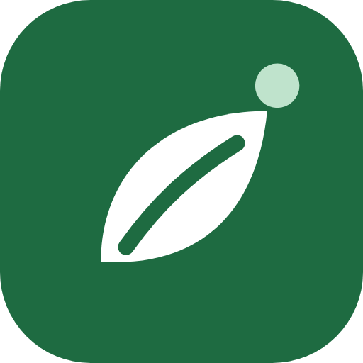
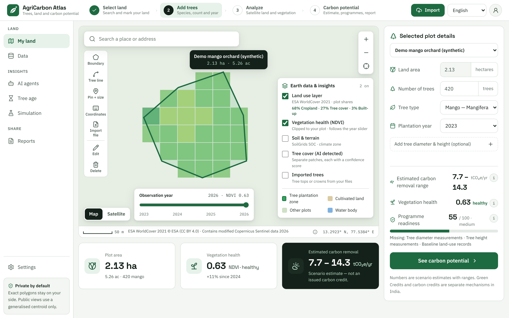
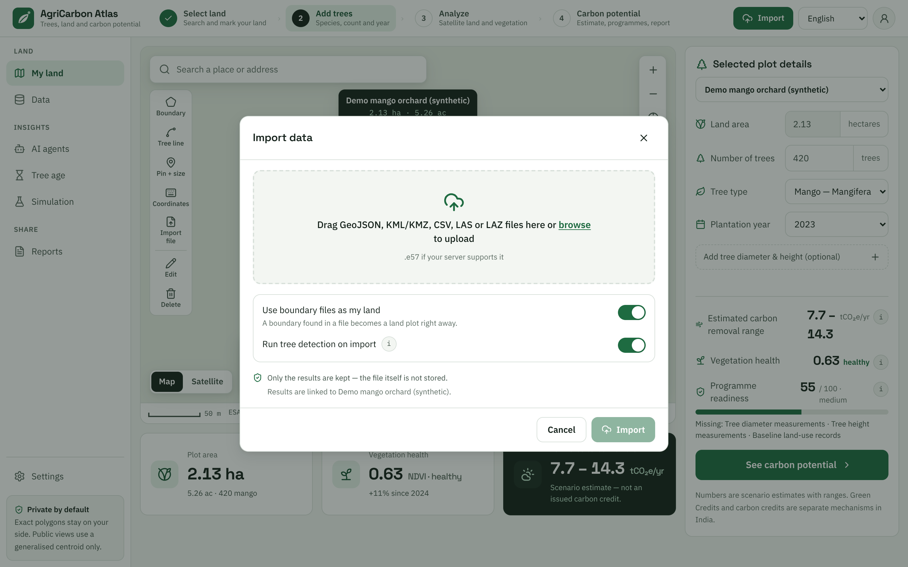
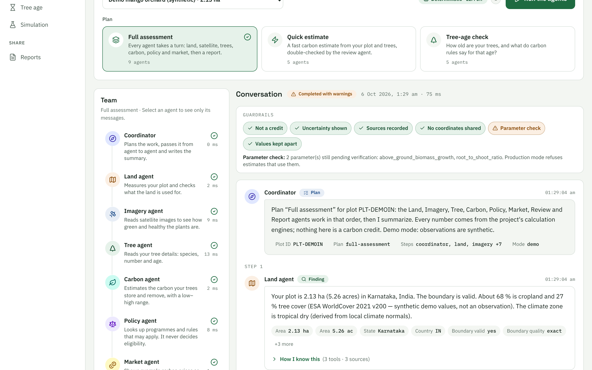
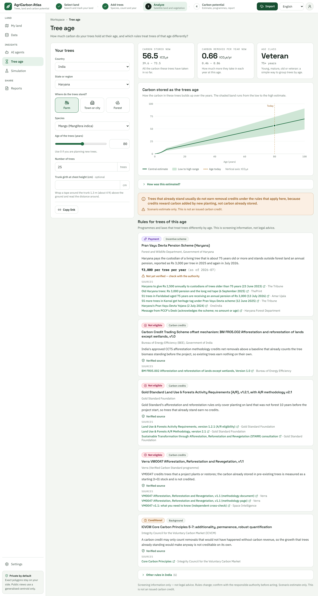
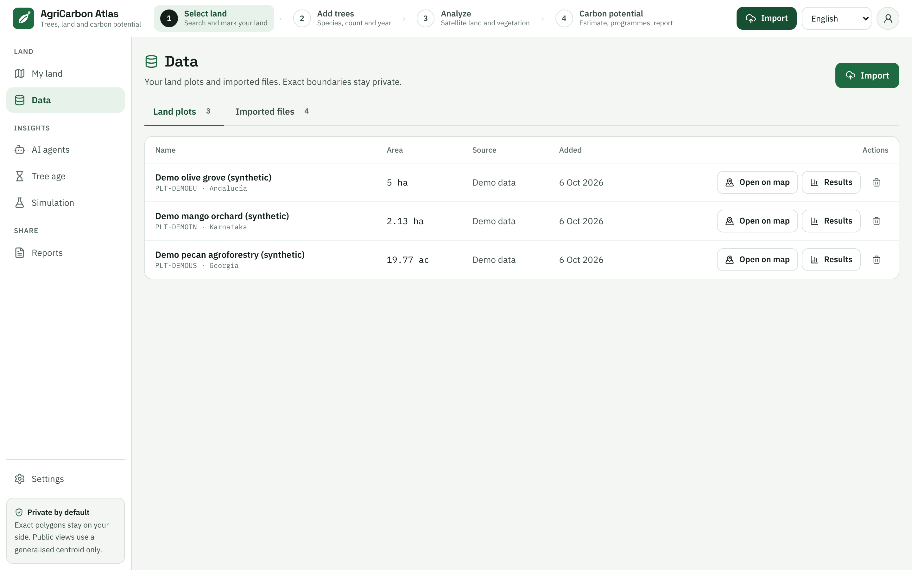
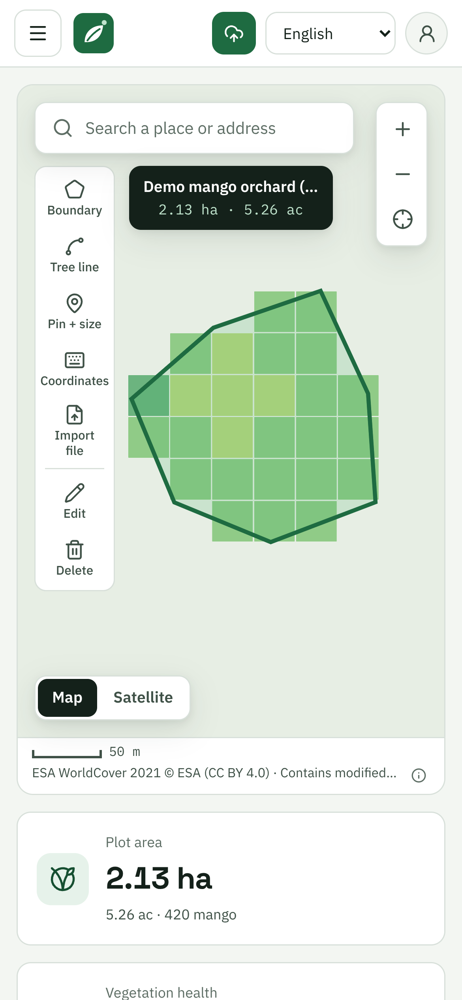
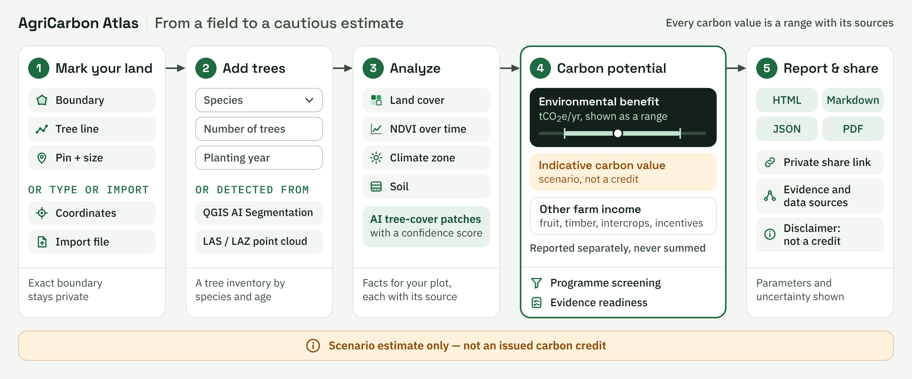
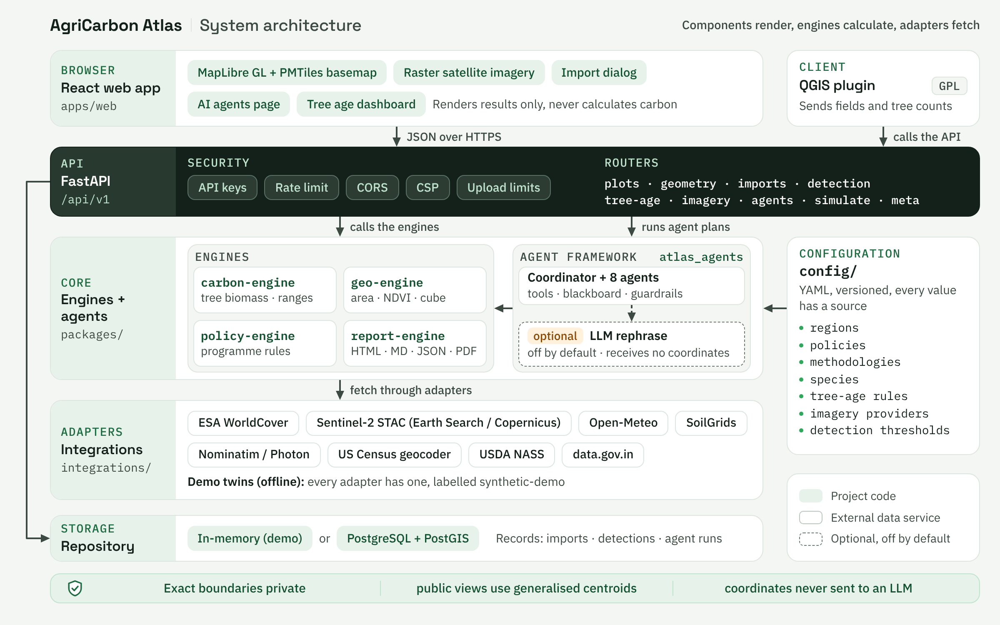
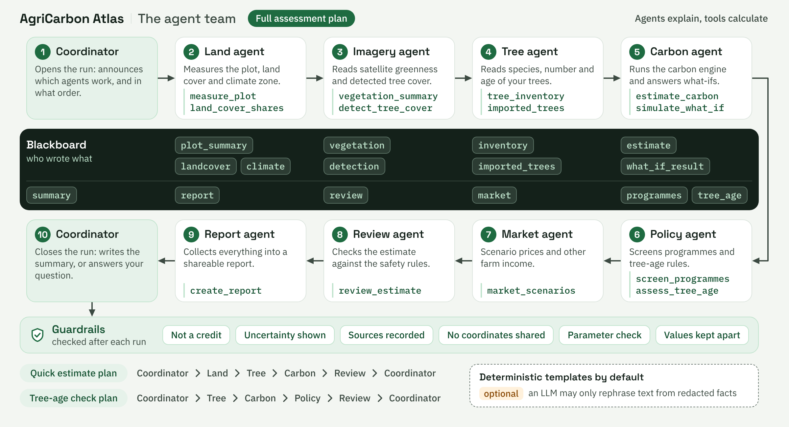

<p align="center">
  
</p>

<h1 align="center">Vriksha Atlas</h1>

<p align="center"><em>(project code name: AgriCarbon Atlas &middot; <strong>vriksha</strong> = "tree" in Sanskrit)</em></p>

<p align="center">
  <strong>Open geospatial intelligence for tree planting, agricultural carbon potential and sustainable land analysis.</strong><br>
  Mark your land · add your trees · see what they might remove · learn which programmes and rules apply.
</p>

<p align="center">
  <a href="LICENSE"></a>
  
  
  
  
</p>

> **Estimates, not credits.** Every carbon number in this project is a *scenario estimate* with a low–central–high
> range, a confidence grade and its sources (`certified: false`). Nothing here is an issued carbon credit, and nothing
> here decides eligibility for a programme.



## What it does

AgriCarbon Atlas helps farmers, landowners, advisors and researchers answer four questions about **one piece of land**,
honestly and in plain language:

1. **Where is my land?** Draw the boundary, draw a **tree line** along a bund or field edge, drop a **pin and type the
   size**, type **latitude/longitude** or corner points, or **import** GeoJSON, KML/KMZ, CSV or a LAS/LAZ point cloud.
2. **What is growing there?** Land cover (ESA WorldCover), vegetation health over time (Sentinel-2 NDVI), climate zone,
   soil carbon, and **AI-detected tree cover** — separate patches, each with a confidence score.
3. **What might the trees remove?** An IPCC-based estimate of annual carbon removal (tCO₂e/yr) with a range, kept
   **separate** from the indicative carbon value (a price scenario) and other farm income — never summed.
4. **What applies to me?** A first screening of programmes per region (India's Green Credit Programme and CCTS are
   separate mechanisms; the EU needs CRCF certification), the **rules by tree age** (credit eligibility, heritage-tree
   protection, tree pensions, compensatory planting), and a readiness checklist of the evidence still missing.

The main screen stays simple on purpose: a map, a short form and three result cards. Detail pages carry the depth.

## See it

| Import data (Trimble-style) | The AI agent team — who said what |
|---|---|
|  |  |
| **Tree age and the rules that apply** | **Carbon potential — three separated values** |
|  |  |
| **Data: land plots and imported files** | **On a phone** |
|  |  |

More screenshots: [docs/images/screenshots/](docs/images/screenshots/) (landing, simulation, report, species).

## Quick start

**Windows, one click:** run `run_all.bat` (installs, tests, runs the agent demo; `run_all.bat serve` also starts the API and web app).

Requirements: Python 3.12+, Node.js 22+, `make`. No API keys are needed for demo mode.

```bash
make install        # Python packages (editable) + web dependencies
make dev            # API on http://localhost:8000 (docs at /docs) + web app on http://localhost:5173
```

Or with Docker (API, web, PostGIS and MinIO):

```bash
cp .env.example .env
make docker-up      # web on http://localhost:8080, API on http://localhost:8000
```

**Demo mode** (default, `ATLAS_MODE=demo`) needs no network: three synthetic demo plots are created and every outside
dataset is replaced by a labelled synthetic twin. **Live mode** (`ATLAS_MODE=live`) calls the free public APIs listed in
[docs/data-sources/FREE_APIS.md](docs/data-sources/FREE_APIS.md). Try the agents from the command line:

```bash
make agents-demo    # prints a full AI-agent run for the demo plot, message by message
```

Sample files to import are in [data/sample/imports/](data/sample/imports/) (a KML boundary, corner points as CSV,
tree crowns as GeoJSON and a small LAZ point cloud — all synthetic).

## How it works





- **Components render, engines calculate, adapters fetch.** The React app never computes a carbon number; the Python
  engines do, from parameters in [`config/`](config/) that each carry a source and a verification status.
- **All data exchange is JSON.** No DuckDB, no 3D: the vegetation "cube" is a small JSON grid filtered in the browser
  ([ADR-0002](docs/architecture/adr/0002-json-cube-no-duckdb.md)).
- **Provenance everywhere.** Results list dataset versions, acquisition dates, model and parameter versions.

## The agentic AI framework (built for learning)



A small, readable framework in [`packages/agent-framework`](packages/agent-framework/) (`atlas_agents`): **agents**
with one job each, **tools** that call the engines, **plans** that order the agents, a **blackboard** that records who
wrote what, a **reviewer** with guardrails, and a **reasoner** that turns facts into sentences.

- **Who says what is always visible.** Every message names its agent, its kind (plan, finding, warning, hand-off,
  answer, summary), the tools it called and the sources behind it.
- **Deterministic by default.** Sentences come from templates; numbers come only from tool calls into the engines.
- **LLM-ready, but optional.** Set `ATLAS_AGENT_REASONER=llm` with any OpenAI-compatible endpoint (for example a local
  Ollama) and the model may only *rephrase* sentences from redacted facts. Coordinates are never sent, and if the model
  adds or changes a number the template text is kept.

Start with the learning guide: [docs/agents/README.md](docs/agents/README.md) (concepts, diagrams, a real transcript,
how to add an agent, how to switch on an LLM, and how it maps to LangGraph, CrewAI and AutoGen).

## Highlights

| Area | What you get |
|---|---|
| Land input | Boundary · tree line (length, spacing, suggested tree count) · pin + size · typed coordinates (decimal or DMS) · GeoJSON/KML/KMZ/CSV · LAS/LAZ |
| Tree detection | Point clouds: canopy height model + local maxima → tree tops and heights. Crowns/points from QGIS AI Segmentation: counted inside your plot with a confidence filter. Satellite: NDVI tree-cover patches with a confidence score |
| Carbon | IPCC 2006 Tier 1 gain-loss (Tier 2 with measured diameter, Chave et al. 2014); ranges, confidence and readiness |
| Tree age | Stored carbon and yearly removal at any age, and 22 sourced rules (Verra, Gold Standard, ICVCM, CCTS, Green Credits, Haryana tree pension, Maharashtra heritage trees, Karnataka and Delhi tree acts, City Forest Credits, CRCF …) |
| Satellite view | Map / Satellite switch with licensed providers per country (USGS, IGN France, IGN Spain PNOA, PDOK, EOX Sentinel-2 cloudless; Esri only with your key) — [why these](docs/research/imagery-providers.md) |
| Regions | India, United States, European Union (member states by ISO code) — all in [`config/`](config/) |
| Languages | English, हिन्दी, ಕನ್ನಡ, Deutsch, Français, Español |
| QGIS | A plugin that sends a field polygon, counts AI-segmented crowns and runs the agent team — [integrations/qgis-plugin](integrations/qgis-plugin/) |

## Privacy and security

- Exact boundaries, centroids and imported files' geometry are **private**; public views use a generalised centroid.
- Imported files are **not stored** — only the derived results. Coordinates are never logged and never sent to an LLM.
- API keys (optional), rate limiting, request and upload size limits, CORS, a strict Content-Security-Policy,
  RFC 7807 errors, safe XML parsing (`defusedxml`), zip-bomb guards. See [SECURITY.md](SECURITY.md) and
  [docs/privacy/](docs/privacy/privacy-design.md).

## Repository layout

```text
apps/api/               FastAPI service (routers, services, agents, repositories)
apps/web/               React 19 + Vite web app (MapLibre, i18n, Vitest)
packages/
  agent-framework/      atlas_agents — agents, tools, plans, blackboard, guardrails, optional LLM
  carbon-engine/        tree biomass, uncertainty, readiness, carbon by tree age
  geo-engine/           geometry, imports, point clouds, detection, indices, vegetation cube
  policy-engine/        programme screening and tree-age rules
  report-engine/        HTML / Markdown / JSON (PDF optional) reports
integrations/           data adapters with demo twins, imagery notes, the QGIS plugin (GPL)
config/                 regions, policies, methodologies, species, tree-age rules, imagery, detection
data/                   schemas (JSON Schema, PostGIS SQL) and synthetic samples
docs/                   user guide, developer guide, architecture, agents, research, licensing
```

## Quality

`make test` runs the whole suite: about 2,200 Python tests (engines, adapters, API, agents, data-quality checks with a
production gate for unverified parameters) and about 470 web tests, plus type checks. `make lint` runs ruff, mypy and
ESLint. CI, CodeQL, dependency and secret scanning are in [.github/workflows](.github/workflows/).

## How it differs

Commercial platforms run carbon *projects* and sell credits; open platforms map forests at landscape scale. AgriCarbon
Atlas is a self-hostable, farmer-facing **screening tool for one plot**, with honest ranges, region-aware rules (including
rules by tree age), many friendly ways to mark land, and an explainable agent team. Details and sources:
[docs/research/competitive-landscape.md](docs/research/competitive-landscape.md).

## Documentation

Everything is indexed in [docs/README.md](docs/README.md). Good places to start:
[Getting started](docs/user-guide/getting-started.md) ·
[Mark your land](docs/user-guide/mark-your-land.md) ·
[Import data](docs/user-guide/import-data.md) ·
[AI agents](docs/user-guide/ai-agents.md) ·
[Tree age](docs/user-guide/tree-age.md) ·
[API contract](docs/architecture/api-contract.md) ·
[Developer setup](docs/developer-guide/setup.md) ·
[Carbon credit vs estimate](docs/concepts/carbon-credit-vs-estimate.md).

## Research impact and adoption

Facts only, added as they happen: independent forks and stars, outside pull requests and issues, organisations using
the project, citations of the software, linked papers and preprints, benchmark reproductions. Nothing is counted
that the maintainers generated themselves. Current state: early release (v0.2.0), no external adoption recorded yet.

## Cite

See [CITATION.cff](CITATION.cff). A DOI will be added after the first archived release
([how](docs/community/zenodo-doi.md)). Reproducible checks: [benchmarks/](benchmarks/README.md).
Method: [docs/methodology.md](docs/methodology.md) · What is different: [docs/novelty.md](docs/novelty.md) ·
Use cases: [docs/use-cases.md](docs/use-cases.md) · Architecture: [docs/architecture.md](docs/architecture.md).

## Contributing, licence and citation

Contributions are welcome — see [CONTRIBUTING.md](CONTRIBUTING.md), the [code of conduct](CODE_OF_CONDUCT.md) and the
[starter issues](docs/community/starter-issues.md). Every pull request states why, inputs, outputs, data source,
licensing impact, privacy impact and testing ([CLAUDE.md](CLAUDE.md) has the project rules).

Code and documentation are licensed under [Apache-2.0](LICENSE); the QGIS plugin folder is GPL-2.0-or-later; every
dataset keeps its own licence and attribution ([docs/licensing/](docs/licensing/DATA_LICENSES.md)). To cite the
project, use [CITATION.cff](CITATION.cff).

Data credits: ESA WorldCover, Copernicus Sentinel-2, Open-Meteo, ISRIC SoilGrids, OpenStreetMap contributors, USDA,
data.gov.in, and the imagery providers listed in [config/imagery/providers.yaml](config/imagery/providers.yaml).
