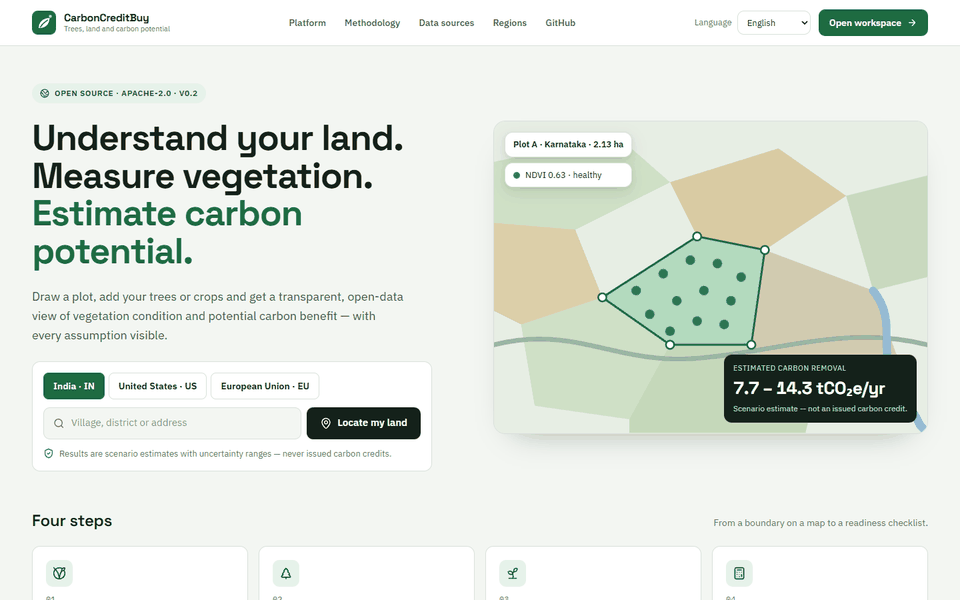
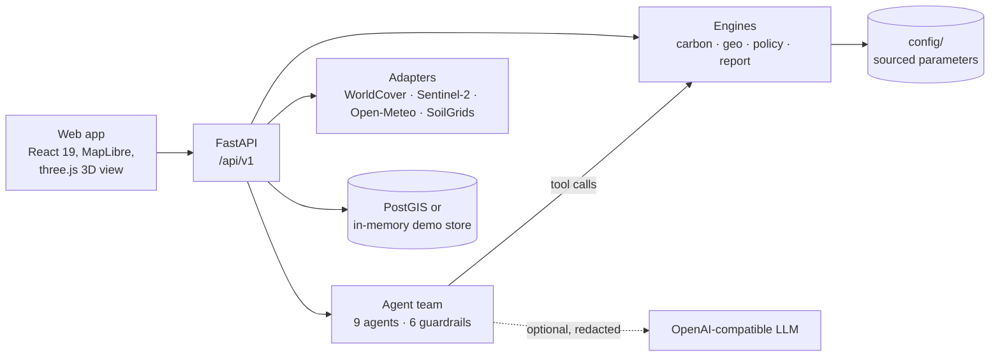

# CarbonCreditBuy

An open, explainable platform for estimating tree-based carbon removal on farmland, and the evidence a recognised
programme would still need.

[](https://doi.org/10.5281/zenodo.23298816)
[](LICENSE)


> **Estimates, not credits.** Every carbon number is a *scenario estimate* with a low–central–high range, a confidence
> grade and its sources (`certified: false`). Nothing here is an issued carbon credit, nothing decides eligibility for
> a programme, and demo mode uses synthetic data.



*Recorded from the running app in demo mode (synthetic data).*

## Overview

CarbonCreditBuy is a self-hostable web application and API for **one piece of land**. A user marks the land on a
map, describes the trees, and gets:

- an estimate of annual carbon removal (tCO₂e/yr) as a range with a confidence grade and the source of every
  parameter;
- vegetation and land-cover context from Earth-observation data;
- a first screening of carbon and environmental programmes, and of the rules that treat trees differently by age, for
  India, the United States and the European Union;
- the evidence still missing before any programme could issue a credit;
- explanations from a team of deterministic agents and a "Why this number?" sensitivity analysis.

## Problem

Farmers and landowners who plant or keep trees hear that trees "earn carbon credits", but they rarely get a clear
answer to three practical questions: how much carbon their trees might remove, how uncertain that number is, and what
a recognised programme would require before any credit exists. Commercial project developers answer inside a
contract; landscape-scale monitoring platforms do not work at the level of one plot.

## Motivation

A single headline number or price can mislead people into decisions about land, contracts and money. A transparent
range, with the provenance and verification status of every parameter and a list of missing evidence, lets farmers,
advisors and researchers judge whether pursuing a programme is worth the effort, and lets anyone check how the number
was produced.

## Key Contributions

Each item below is implemented and tested in this repository:

1. **Parameters with provenance.** Every carbon parameter in [`config/`](config/) carries a source, unit and
   verification status; production mode refuses `pending` values (enforced by a data-quality test).
2. **Ranges and readiness.** IPCC 2006 Tier 1 gain-loss (Tier 2 with measured diameter, Chave et al. 2014) as
   low–central–high ranges, beside an evidence-readiness score.
3. **Agents that cannot calculate.** Nine deterministic agents; every number comes from an engine tool call; six
   guardrails per run; an optional language model may only reword redacted text.
4. **Explanation by re-computation.** "Why this number?" re-runs the engine with each user-controlled input at ±10 %
   and lists every factor with its source and status.
5. **Tree age apart from credit rules.** Carbon held by existing trees is kept separate from 22 sourced rules that
   decide whether any credit is possible.
6. **Privacy boundary.** Exact plot geometry stays private; coordinates are never logged or sent to a language model.

What is new compared with existing approaches: [docs/novelty.md](docs/novelty.md).

## AI Methodology

The project uses **no trained machine-learning models**. Its AI components are deterministic and inspectable:

| Stage | Method |
|---|---|
| Inputs | Plot geometry (drawn, typed or imported), tree inventory (species, count, planting year, optional diameter and height), region; Earth-observation layers (ESA WorldCover, Sentinel-2 NDVI/NDMI, Open-Meteo climate, SoilGrids) |
| Processing | Geometry validation and projection; NDVI-threshold tree-cover patches with confidence; canopy-height local maxima for point clouds; IPCC Tier 1/2 carbon engine with uncertainty; configuration-driven policy screening |
| Decision logic | A deterministic intent router maps a question to one of three agent plans; agents skip themselves when inputs are missing; six guardrails decide whether a run completes, completes with warnings or fails |
| Optional LLM | Any OpenAI-compatible endpoint may reword template sentences from redacted facts; output that changes a number is rejected |
| Explanation | One-at-a-time sensitivity analysis by re-running the engine; every factor listed with source and verification status |
| Outputs | Ranges with confidence and provenance, readiness score, programme screening, agent transcript, HTML/Markdown/JSON report |
| Evaluation | Implementation checks in [benchmarks/](benchmarks/README.md) and the test suites; field validation not yet performed |

Details: [docs/methodology.md](docs/methodology.md).

## Architecture



Components render, engines calculate, adapters fetch, agents explain. More:
[docs/architecture.md](docs/architecture.md).

## Repository Structure

```text
apps/api/               FastAPI service (routers, services, agents, repositories)
apps/web/               React 19 + Vite web app (MapLibre, three.js, i18n, Vitest, Playwright)
packages/
  agent-framework/      carboncreditbuy_agents: agents, tools, plans, blackboard, guardrails, optional LLM
  carbon-engine/        tree biomass, uncertainty, readiness, carbon by tree age, cost scenario
  geo-engine/           geometry, imports, point clouds, detection, indices, vegetation cube
  policy-engine/        programme screening and tree-age rules
  report-engine/        HTML / Markdown / JSON reports
integrations/           data adapters with synthetic demo twins; QGIS plugin (GPL-2.0-or-later)
config/                 regions, policies, methodologies, species, tree-age rules, imagery, detection
data/                   schemas (JSON Schema, PostGIS SQL) and synthetic samples
benchmarks/             reproducible implementation checks with committed results
examples/               API walkthroughs (India, US, EU) and the agent-team script
research/               validation plan and research notes
docs/                   user guide, developer guide, architecture, agents, licensing
tests/                  data-quality tests (including the production gate)
scripts/                Windows launcher, screenshot and sample generators
```

## Installation

Requirements: Python 3.12+, Node.js 22+. No API keys are needed for demo mode.

```bash
git clone https://github.com/pavangemmanjunath-cell/AI_Carbon_Credits_Fram_Land.git
cd AI_Carbon_Credits_Fram_Land
python -m venv .venv && . .venv/bin/activate     # Windows: .venv\Scripts\activate
make install                                     # pip install -r requirements.txt + editable packages + npm install
```

Docker (API, web, PostGIS and MinIO): `cp .env.example .env && make docker-up`.

## Quick Start

**Windows:** double-click `START.bat`. It sets up `.venv` and `node_modules` on the first run, starts the API and the
web app, and opens the browser. `STOP.bat` stops both.

**Linux / macOS:**

```bash
make dev        # API on http://localhost:8000 (docs at /docs), web app on http://localhost:5173
```

Shortest check without a browser (prints a full agent run for the synthetic demo plot):

```bash
python examples/agents/run_team.py
```

## Usage

- **Web app:** mark land with Boundary, Pen, Rectangle or Circle; lock it to see corner coordinates and how many trees
  fit; add trees; open *Simulation* for the 3D view, costs and "Why this number?". Guide:
  [docs/user-guide/getting-started.md](docs/user-guide/getting-started.md).
- **API:** end-to-end walkthroughs with `curl` for an Indian mango farm, US agroforestry and EU carbon farming in
  [examples/](examples/README.md); the contract is in [docs/architecture/api-contract.md](docs/architecture/api-contract.md).

  ```bash
  curl -s -X POST http://localhost:8000/api/v1/simulate/drivers -H 'Content-Type: application/json' \
    -d '{"country":"IN","species_id":"mango","tree_count":420,"planting_year":2023,"horizon_years":30,"area_hectares":2.13}'
  ```

- **Agents:** ask a question on the *AI agents* page or call `POST /api/v1/agents/ask`. Plain-language guide:
  [docs/agents/AGENTS_OVERVIEW.md](docs/agents/AGENTS_OVERVIEW.md).
- **QGIS:** the plugin in [integrations/qgis-plugin](integrations/qgis-plugin/) sends a field polygon to the API.

## Dataset

| Data | Source | Licence | Real or synthetic |
|---|---|---|---|
| Demo plots, inventories, imports, vegetation cube | Generated for this repository ([data/sample/](data/sample/)) | Apache-2.0 | **Synthetic**, labelled as such in every response |
| Land cover | ESA WorldCover 2021 v200 | CC BY 4.0 | Real (live mode only) |
| Vegetation indices | Copernicus Sentinel-2 L2A via STAC | Copernicus open licence | Real (live mode only) |
| Climate normals, elevation | Open-Meteo | CC BY 4.0 | Real (live mode only) |
| Soil organic carbon | ISRIC SoilGrids 2.0 | CC BY 4.0 | Real (live mode only) |
| Basemap | OpenStreetMap via OpenFreeMap | ODbL | Real |
| Carbon parameters | IPCC 2006/2019, Chave et al. 2014, Global Wood Density Database, project assumptions | Cited per value in `config/` | Published values or labelled assumptions |

Preprocessing: geometry is validated and projected; satellite data is reduced to per-plot statistics and indices;
nothing is stored except derived results. Full licence table:
[docs/licensing/DATA_LICENSES.md](docs/licensing/DATA_LICENSES.md).

## Reproducing Results

```bash
python -m pytest -q                       # all Python tests
python benchmarks/run_experiments.py      # regenerates benchmarks/results and figures
git status benchmarks/                    # unchanged = reproduced exactly
```

Exact environment, expected results and the release checklist: [docs/reproducibility.md](docs/reproducibility.md).

## Benchmarks

The repository contains **implementation checks**, not a scientific benchmark against field data:

| ID | Check | Result (2026-10-11) |
|---|---|---|
| E2 | Independent re-implementation of the Tier 1 equations vs the engine | Agreement within 0.0002 tCO₂e (rounding) |
| E4 | Parameter census and production gate | 28 verified, 20 pending, 64 assumption; production refuses `pending` |
| E5 | Adversarial cases for the agent guardrails | 13 of 13 behave as expected |

All inputs are synthetic. A benchmark against field measurements and reference tools is under development
(validation levels 2 and 3 in [research/validation/](research/validation/README.md)).

## Tests

```bash
make test                                    # pytest + Vitest + TypeScript checks
python -m pytest -q                          # Python only
cd apps/web && npm run test -- --run         # web unit tests
cd apps/web && npx playwright test           # browser tests (start the app first)
```

Verified on 2026-10-11: 2,195 Python tests passed (4 skipped), 526 production data-quality checks passed, 481 web unit
tests and 18 browser tests passed. CI ([.github/workflows](.github/workflows/)) runs ruff, mypy, pytest, ESLint,
Prettier, a production build, CodeQL, dependency audits and secret scanning.

## Research and Publications

Associated publication information will be added when available.

## Citation

Use GitHub's **"Cite this repository"** button (generated from [CITATION.cff](CITATION.cff)).

Software DOI: <https://doi.org/10.5281/zenodo.23298816> (release `v1.1.1`). Concept DOI for all versions:
<https://doi.org/10.5281/zenodo.23298048>. Previous release `V_1.1`: <https://doi.org/10.5281/zenodo.23298049>.

The software DOI identifies this code. A future paper will have its own DOI; the two are not interchangeable.

## Research Impact & Adoption

Only independently verifiable evidence is recorded, with links, in
[docs/research-impact.md](docs/research-impact.md).

- **Independent citations:** none recorded yet.
- **Independent forks/extensions:** none recorded yet.
- **External contributors:** none recorded yet.
- **Academic use:** none recorded yet.
- **Industry use:** none recorded yet.
- **External publications:** none recorded yet.
- **Benchmark comparisons:** none recorded yet.
- **Conference/workshop demonstrations:** none recorded yet.

## Contributing

Contributions are welcome, especially independent reproduction, validation and parameter verification. See
[CONTRIBUTING.md](CONTRIBUTING.md) and the [code of conduct](CODE_OF_CONDUCT.md).

## Roadmap

See [ROADMAP.md](ROADMAP.md).

## Security

Report vulnerabilities privately as described in [SECURITY.md](SECURITY.md). Never put farm geometry or keys in a
public issue.

## License

Code and documentation: [Apache License 2.0](LICENSE). The QGIS plugin folder is GPL-2.0-or-later. Every dataset keeps
its own licence and attribution ([docs/licensing/](docs/licensing/DATA_LICENSES.md)).

## Authors

**Pavan Manjunath**, primary author. ORCID: <https://orcid.org/0000-0002-2694-8807>

**Thomas**, co-author (details to be added).

See [AUTHORS.md](AUTHORS.md) and [CONTRIBUTORS.md](CONTRIBUTORS.md).
