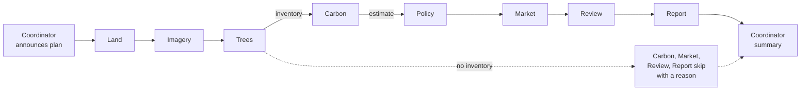

# The AI agents — who does what (plain-language overview)

This page explains the agent team without code. For the exact tools, blackboard keys and message formats see
the [agent catalog](catalog.md); to learn how the framework works inside, see the [learning guide](README.md).

## In one minute

- Nine small **agents** work on one plot, in a fixed order called a **plan**. Each agent has one job.
- Agents **never invent numbers.** Every figure in a message comes from a tool that calls a calculation engine
  (carbon engine, policy engine, geo engine). The agents only describe and route.
- An AI language model (LLM) is **optional and off by default.** Without it, messages are written from fixed
  templates. With it, the LLM may only reword those messages, and it never sees coordinates. If a reworded
  message changes, adds or drops a number, it is thrown away and the template text is kept.
- Six **guardrails** check every run before it counts as finished (see [Safety checks](#safety-checks-on-every-run)).
- Nothing an agent says is a carbon credit, a certification or an eligibility decision.

## The team

| Agent | What it does, in plain words | Tools it uses | What you see |
|---|---|---|---|
| **Coordinator** | Opens the run with the plan, closes it with a summary or the answer to your question. | none — reads what the others wrote | "The team will check land, satellite, trees, carbon…" → headline and next steps |
| **Land agent** | Measures the plot and checks the boundary, land cover and climate zone. | `measure_plot`, `land_cover_shares`, `climate_zone` | "Your plot is 2.13 ha in Karnataka, India. About 68 % is cropland…" |
| **Imagery agent** | Reads satellite vegetation (how green, how moist, the trend) and detected tree cover. | `vegetation_summary`, `detect_tree_cover` | NDVI / NDMI with their class and trend |
| **Tree agent** | Reads your tree inventory: species, count, planting year, survival, missing measurements. | `tree_inventory`, `imported_trees` | "420 mango trees planted in 2023…" and a hand-off to the Carbon agent |
| **Carbon agent** | Runs the carbon engine and answers "what if" questions. | `estimate_carbon`, `simulate_what_if` | "Estimated removal is 7.7–14.3 tCO₂e per year (central 11.0)… This is an estimate, not a carbon credit." |
| **Policy agent** | Screens the country's carbon and environmental programmes; checks tree-age rules. | `screen_programmes`, `assess_tree_age` | Which programmes *may* apply and what each still needs |
| **Market agent** | Puts scenario prices on the estimate and lists other farm income — three separate values. With your own costs, also the break-even carbon price. | `market_scenarios`, `cost_scenario` | Environmental benefit, indicative value (a scenario), other income — never added together; then "Your entered costs come to … a carbon price of about … per tCO₂e would match these costs" |
| **Review agent** | Double-checks the estimate: range, unit, confidence, sources, pending parameters, missing evidence. | `review_estimate` | Pass/warn checks and the evidence still missing |
| **Report agent** | Writes the HTML assessment report. | `create_report` | A link to the report |

## How a run flows

Agents share results on a **blackboard** (a shared notebook with access rules: each agent may only read and
write its own keys). When an input is missing, the agent that needs it **skips itself and says why** — it never
fills the gap with a guess. The closing Coordinator step always runs.

| Plan | Who works | Use it for |
|---|---|---|
| **Full assessment** (default) | Coordinator → Land → Imagery → Trees → Carbon → Policy → Market → Review → Report → Coordinator | Everything the team can say, with a report |
| **Quick estimate** | Coordinator → Land → Trees → Carbon → Review → Coordinator | A fast carbon estimate with a review |
| **Tree-age check** | Coordinator → Trees → Carbon → Policy → Review → Coordinator | Old trees: carbon by age and age rules |

## Asking a question

Type a question on the **AI agents** page. A deterministic router (no AI) picks the plan from keywords in
English, Hindi, Kannada, German, French and Spanish:

| You ask | Plan chosen | What happens |
|---|---|---|
| "What if I plant 100 more trees?" | Quick estimate | Carbon agent runs a what-if: 420 → 520 trees, both ranges side by side |
| "My mango trees are 60 years old — do any rules apply?" | Tree-age check | Policy agent uses age 60 from your question and says the inventory differs |
| "Which programmes could apply to my farm?" | Full assessment | Policy agent screens the programmes (screening only) |
| "Please make me a report" | Full assessment | Ends with a report link |
| "What does planting cost and when does it break even?" (with costs) | Full assessment | Market agent adds the cost scenario from **your** costs |
| Anything else ("What is the weather tomorrow?") | Quick estimate | The Coordinator says it could not match the question |

## Safety checks on every run

| Guardrail | Checks that… |
|---|---|
| `not-a-credit` | `certified: false` everywhere, a disclaimer is attached, nothing reads like a credit or guaranteed income |
| `uncertainty-present` | every carbon number is a low–central–high range with a unit and a confidence grade |
| `provenance-present` | every finding cites its evidence and sources |
| `no-coordinates` | no coordinates, geometry or exact location in any message, fact or tool summary |
| `pending-parameters` | parameters still `pending` verification are flagged (a **warn** — production mode refuses them) |
| `values-separated` | environmental benefit, indicative value and other income are never added together |
| `llm-rephrase` (LLM on) | flags when the LLM's wording was rejected because it changed a number |

A run that passes with warnings is reported as **Completed with warnings**. In the demo, the warning is expected:
two IPCC parameters (`above_ground_biomass_growth`, `root_to_shoot_ratio`) are still marked pending
verification.

## Turning on an AI language model (optional)

On Windows, double-click **`API-KEYS.bat`** → *1) Choose the AI language model*, then restart (`STOP.bat`,
`START.bat`). Option *4) Test* sends one fixed sentence ("Reply with the single word: OK") — no project data.
On Linux/macOS set `ATLAS_AGENT_REASONER=llm`, `LLM_API_BASE_URL`, `LLM_MODEL` and `LLM_API_KEY` in the
environment (or the git-ignored `.env`).

Any OpenAI-compatible `/chat/completions` endpoint works. Free options, checked on **2026-10-11** against the
providers' own documentation (limits and model ids change often — check them before relying on them):

| Provider | Base URL | Example model | Free terms | Privacy (free tier) |
|---|---|---|---|---|
| **Ollama** (on your computer) — *most private* | `http://localhost:11434/v1` | `llama3.2` | Free; limited by your hardware; no key | Nothing leaves your machine |
| **Groq** — *recommended hosted option* | `https://api.groq.com/openai/v1` | `llama-3.1-8b-instant` | Free tier; exact limits shown in the Groq console | No prompts retained by default; zero-retention option ([docs](https://console.groq.com/docs/your-data)) |
| **Cloudflare Workers AI** | `https://api.cloudflare.com/client/v4/accounts/{ACCOUNT_ID}/ai/v1` | `@cf/meta/llama-3.1-8b-instruct` | 10,000 "Neurons" per day ([pricing](https://developers.cloudflare.com/workers-ai/platform/pricing/)) | No training on your content without consent ([data usage](https://developers.cloudflare.com/workers-ai/platform/data-usage/)) |
| **OpenRouter** `:free` models | `https://openrouter.ai/api/v1` | see its [free collection](https://openrouter.ai/collections/free-models) | 20 requests/min, 50/day ([limits](https://openrouter.ai/docs/api-reference/limits)) | Depends on the model's provider — switch off "may train" providers in its privacy settings |

**xAI Grok** (`https://api.x.ai/v1`, e.g. `grok-4.20-0309-non-reasoning`) works too, but it is **paid**: no free tier
or free credits could be confirmed on xAI's official pages on 2026-10-11 (cheapest listed models from about $1–1.25
per million input tokens). xAI states it does not train on API inputs without explicit permission and keeps them 30
days for abuse checks ([security FAQ](https://docs.x.ai/developers/faq/security)). Older "free credit" offers required
sharing data for training — not acceptable here.

Left out on purpose: **Google Gemini's free tier** (prompts may be used to improve products and reviewed by
people; free use is not allowed for apps serving the EEA, UK and Switzerland) and **Mistral's free mode** (may
train on inputs unless you opt out). **GitHub Models** was retired on 30 July 2026; **Cerebras**, **Together**
and **Hugging Face** no longer offer an ongoing free tier.

Even with an LLM on, what it receives is the template sentence and redacted facts — never the plot boundary,
coordinates, names, e-mails or phone numbers (`carboncreditbuy_agents/llm/redaction.py`).

## The 3D land view, costs and "Why this number?"

The **Simulation** page shows your saved plot in 3D (switch to *Illustration* for the flat drawing):

- **Land** — your saved boundary, projected to metres in your browser; it is never sent anywhere. Without a saved
  plot, a square of the entered area. Grid squares are 10 m.
- **Trees** — placed on an orchard grid inside the boundary. Height and crown width are the species'
  `typical_height_m_at_maturity` and reference spacing from `config/species/species.yaml` × the growth factor for
  the chosen year. A species without a configured size is drawn as a neutral shape and shows "—", never a guessed
  number.
- **Click** a tree or the plot for its status: stage, age, size, and removal per tree (the engine's stand estimate ÷
  number of trees). Every card says "Estimate — not a carbon credit".
- **From growth to a carbon credit** — the five steps a recognised programme requires before any credit exists
  (design, validation, monitoring, verification, issuance), with the programme links for your country. The tool
  never marks a step as done.
- **Your costs → break-even carbon price** — nothing is pre-filled; enter your own costs. The engine
  (`carbon_engine.economics`) returns the total over the horizon (undiscounted), the carbon price that would cover
  it and the share covered at each price scenario. *Ask the agents* sends the same costs to the Market agent.
- **Why this number? (explainable AI)** — `POST /simulate/drivers` re-runs the carbon engine with each input you
  control moved ±10 % (one-at-a-time sensitivity) and lists every factor the estimate is built from with its source
  and verification status; the least certain factors are named. No AI model is involved, so nothing in the
  explanation can be invented.

## External services the platform uses

The app works fully offline in **demo mode** (`ATLAS_MODE=demo`, the default) with synthetic data. In live mode
it calls these services through adapters in [`integrations/`](../../integrations/); each one's license and
attribution is in [DATA_LICENSES.md](../licensing/DATA_LICENSES.md) and [FREE_APIS.md](../data-sources/FREE_APIS.md).

| Service | Used for | Key needed? | Setting |
|---|---|---|---|
| ESA WorldCover 2021 | Land-cover shares | No | `ESA_WORLDCOVER_BASE_URL` |
| Earth Search STAC (Element 84) | Sentinel-2 vegetation (NDVI, NDMI) | No | `EARTH_SEARCH_STAC_URL` |
| Copernicus Data Space STAC | Sentinel-2 (alternative) | Token only for downloads | `COPERNICUS_STAC_URL`, `COPERNICUS_TOKEN` |
| Open-Meteo | Climate normals, elevation | No | `OPEN_METEO_ARCHIVE_URL`, `OPEN_METEO_ELEVATION_URL` |
| ISRIC SoilGrids | Soil organic carbon context | No | `SOILGRIDS_URL` |
| Nominatim / Photon (OpenStreetMap) | Place search | No | `NOMINATIM_URL`, `PHOTON_URL` |
| US Census Geocoder | US county lookup | No | `CENSUS_GEOCODER_URL` |
| USDA NASS Quick Stats | US crop statistics | Free key | `USDA_NASS_API_URL`, `USDA_NASS_API_KEY` |
| data.gov.in | India crop statistics | Free key | `DATA_GOV_IN_API_URL`, `DATA_GOV_IN_API_KEY` |
| Satellite map tiles (USGS, IGN, PDOK, EOX; Esri optional) | Map display only | Esri only | `config/imagery/providers.yaml`, `ESRI_API_KEY` |
| An OpenAI-compatible LLM (optional: Ollama, Groq, Cloudflare, OpenRouter, xAI Grok …) | Rewording agent messages | Depends on provider | `LLM_API_BASE_URL`, `LLM_MODEL`, `LLM_API_KEY` |

## How keys are kept safe

- **Windows:** `API-KEYS.bat` stores keys encrypted with Windows DPAPI in `%APPDATA%\CarbonCreditBuy\settings.json`
  — outside the repository, readable only by your Windows user on your computer. `START.bat` decrypts them into
  the API process's environment only: not onto a command line, not into the web app, not into logs.
- **Everywhere:** keys go in environment variables or the `.env` file at the repository root (copy
  `.env.example`). `.env` is listed in `.gitignore` and `.dockerignore`, so it is never committed, pushed or copied
  into an image; never commit keys anywhere else. The repository's CI runs secret scanning.
- `VITE_*` variables are built into the web app and are **public** — never put a secret there. Esri keys reach
  the browser by design; restrict them by referrer.
- To protect a public deployment's write endpoints, set `ATLAS_API_KEYS`; clients send `X-API-Key`.

## Verified on 2026-10-11

| Check | Result |
|---|---|
| Python tests (engines, agents, API, integrations) | 2,195 passed, 4 skipped (PyQt5 / production-gate tests) |
| Web unit tests (Vitest) and TypeScript | 477 passed; typecheck and ESLint clean |
| Browser tests (Playwright) — every page, tab click-through, agent run, simulation explanation and costs | 18 passed |
| All three plans via the API | Every step ran; all guardrails pass (pending-parameters warns as expected) |
| Costs through the agents | Market agent adds the break-even price only when costs are sent; values-separated and not-a-credit pass |
| LLM path with a test model that returned a wrong number | Wrong number rejected, template kept, `llm-rephrase` warned; 0 of 10 LLM requests contained coordinates |
