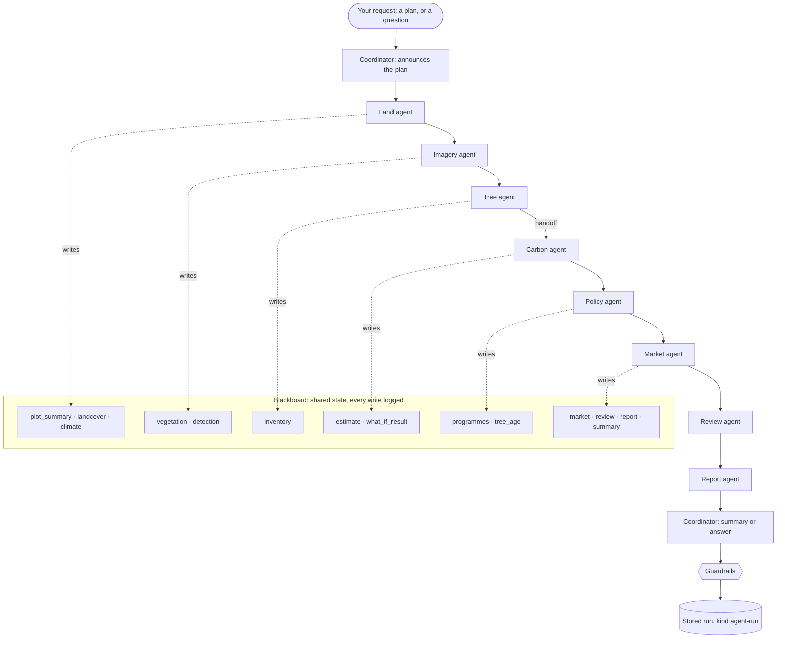
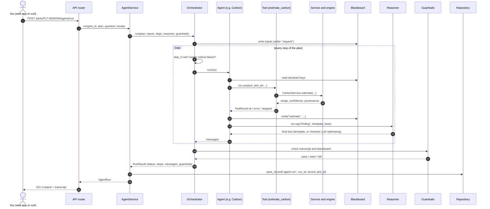
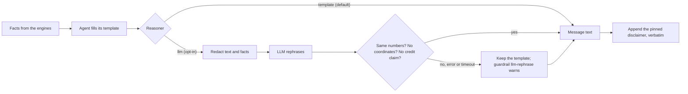

# Agents in AgriCarbon Atlas — a learning guide

AgriCarbon Atlas has a small team of software **agents** that look at one plot together and explain, in plain
language, what the project's engines found: the land, the satellite picture, the trees, the estimated carbon
removal, the programmes that might apply, the value scenarios, what evidence is still missing — and a report.

This guide is for people who want to **learn how agentic AI systems are built** by reading a small, complete
one. Everything runs offline in demo mode, and every concept is one short Python module you can read in a few
minutes.

> **The one rule.** Agents organise work and explain results. They never calculate a carbon number, a price or
> an eligibility result — the engines do ([CLAUDE.md](../../CLAUDE.md), principles 1, 11 and 12). An optional
> language model may only *rephrase* sentences, and its answer is checked before it is used.

Contents

1. [Try it in one minute](#1-try-it-in-one-minute)
2. [The building blocks](#2-the-building-blocks)
3. [The team at a glance](#3-the-team-at-a-glance)
4. [One run, step by step](#4-one-run-step-by-step)
5. [Who says what](#5-who-says-what)
6. [A real run, annotated](#6-a-real-run-annotated)
7. [Templates first, LLM optional](#7-templates-first-llm-optional)
8. [Privacy](#8-privacy)
9. [Switching on an LLM](#9-switching-on-an-llm)
10. [Adding a new agent](#10-adding-a-new-agent)
11. [Mapping to LangGraph, CrewAI and AutoGen](#11-mapping-to-langgraph-crewai-and-autogen)
12. [Exercises](#12-exercises)
13. [Reference](#13-reference)

Companion pages: the per-agent reference in [catalog.md](catalog.md), the decision record
[ADR-0006](../architecture/adr/0006-agentic-framework.md) and the wire format in the
[API contract](../architecture/api-contract.md) (section "Agents").

## 1. Try it in one minute

From the repository root, with the Python requirements installed:

```bash
python3 -m pip install -e packages/agent-framework       # once: the framework package
python3 examples/agents/run_team.py                        # full assessment of the demo plot PLT-DEMOIN
python3 examples/agents/run_team.py --plan quick-estimate
python3 examples/agents/run_team.py --ask "How much carbon if I add 200 trees?"
python3 examples/agents/run_team.py --ask "मेरे खेत में कितना कार्बन है?" --locale hi
```

The script builds the API's application context in demo mode, seeds the three synthetic demo plots and prints
the transcript. No server, network or API key is involved. Through the running API (`make api`) the same team
answers on four endpoints:

```bash
curl -s localhost:8000/api/v1/agents | jq '.agents[] | {id, says}'
curl -s -X POST localhost:8000/api/v1/plots/PLT-DEMOIN/agents/run \
     -H 'Content-Type: application/json' -d '{"plan": "full-assessment"}' \
     | jq '.messages[] | {agent_title, kind, text}'
curl -s -X POST localhost:8000/api/v1/agents/ask -H 'Content-Type: application/json' \
     -d '{"question": "How much carbon if I add 200 trees?", "plot_id": "PLT-DEMOIN"}' | jq .summary
curl -s 'localhost:8000/api/v1/agents/runs?plot_id=PLT-DEMOIN' | jq '.items[0]'
```

## 2. The building blocks

The framework is the package [`atlas_agents`](../../packages/agent-framework/README.md) (no dependencies, no
knowledge of carbon). The AgriCarbon team lives in [`apps/api/app/agents/`](../../apps/api/app/agents/).

| Concept | In one sentence | Framework module | AgriCarbon example |
|---|---|---|---|
| **Agent** | A named piece of code with one job, a list of tools and declared reads and writes | `agent.py` | `land.py`: size, place, land cover |
| **Tool** | A described function an agent calls; every call is timed and recorded | `tools.py` | `measure_plot`, `estimate_carbon` |
| **Blackboard** | Shared state the agents read and write; every write is logged | `blackboard.py` | `estimate` written by the Carbon agent |
| **Plan** | The ordered list of agents to run, with rules for skipping | `plan.py` | `full-assessment`, `quick-estimate` |
| **Orchestrator** | The loop that runs a plan and never lets one agent sink the run | `orchestrator.py` | used by `AgentService` |
| **Reasoner** | Turns an agent's template text into the final wording | `reasoner.py` | templates by default; LLM opt-in |
| **Guardrail** | A deterministic check over the finished run: pass, warn or fail | `guardrails.py` | `no-coordinates`, `not-a-credit` |
| **Intent router** | Maps a free-text question to a plan with keywords, not a model | `intents.py` | "add 200 trees" → what-if |

### Agent

An agent declares who it is and what it may touch, and implements one method:

```python
class LandAgent(Agent):
    id = "land"
    title = "Land agent"
    role = "Checks the plot itself: size, location, boundary, land cover and climate zone."
    says = "How big the plot is and where it lies, whether the boundary is valid, ..."
    tools = (measure_plot, land_cover_shares, climate_zone)
    reads = ("plot_id",)
    writes = ("plot_summary", "landcover", "climate")

    def run(self, ctx: RunContext) -> list[AgentMessage]:
        measured = ctx.use(measure_plot, plot_id=ctx.read("plot_id"))
        if not measured.ok:
            return [ctx.warn(f"I could not measure the plot ({measured.reason}).")]
        ctx.write("plot_summary", measured.value)
        return [ctx.say("finding", wording.plot_sentence(measured.value), evidence=[...])]
```

There is no prompt. The agent's policy *is* its `run` method — plain Python, covered by tests. `ctx` (the
`RunContext`) is the only door to the world: `ctx.read` / `ctx.write` for the blackboard, `ctx.use` for tools,
`ctx.say` / `ctx.warn` / `ctx.handoff` for messages. It refuses undeclared keys (`BlackboardAccessError`) and
undeclared tools (`ToolNotAllowed`), so the catalog in `GET /agents` always tells the truth about data flow.

**Is this really an agent?** In the literature an agent perceives, decides and acts towards a goal. LLM agents
decide with a model; these agents decide with code. They have the parts that make multi-agent systems useful —
a role each, tool use, shared memory, hand-offs, a coordinator, guardrails, a transcript — and deliberately not
the part that makes them hard to audit: a model choosing what happens next. Think of them as *deterministic
agents*; section 11 shows where an LLM would plug in.

### Tool

```python
@TOOLS.tool()
def measure_plot(app: AppContext, plot_id: str) -> dict[str, Any]:
    """Measure the plot (area, perimeter) and check that its boundary is a valid polygon."""
    plot = app.plots.require(plot_id)
    ...
    return {"area_hectares": plot["area_hectares"], "boundary_valid": problem is None, ...}
```

The first argument is the host application's dependency container (the API's `AppContext`; PydanticAI calls
the same idea `deps`). The first docstring line becomes the description in the catalog. `ctx.use(tool, ...)`
returns a `ToolResult` and never raises: `ok` (it returned), `error` (it raised) or `skipped` (it raised
`ToolSkipped`, for example because an optional module is not installed). The transcript keeps a `ToolCall`
with the status, the duration and **redacted summaries** of the input and output — never raw payloads, never
coordinates.

### Blackboard

Agents never call each other. Each reads what it needs from one shared board and writes what it found; the
orchestrator decides who runs next. Every write is logged as *(key, agent, step)*, which is what makes the
"who wrote what" view possible. Values are deep-copied on write, so no agent can change another's finding.
The run's inputs (`plot_id`, `question`, `locale` …) are written by `request` before the first step.

### Plan

A plan is data, written by people:

```python
QUICK_ESTIMATE = Plan(
    id="quick-estimate",
    title="Quick estimate",
    steps=(
        PlanStep("coordinator"),
        PlanStep("land"),
        PlanStep("trees"),
        PlanStep("carbon", skip_if=missing("inventory", reason="skipped: no tree inventory, ...")),
        PlanStep(
            "review", skip_if=missing("estimate", reason="skipped: no carbon estimate to review")
        ),
        PlanStep("coordinator", run_always=True),
    ),
)
```

`skip_if` lets a step skip itself when its input is missing — no inventory, no carbon estimate, no value
scenario, no report. That is how the team "continues when sensible" after a problem. `critical=True` stops the
plan if that step fails; `run_always=True` runs a step even then (the closing coordinator, so every run ends
with a summary).

| Plan | Steps |
|---|---|
| `full-assessment` | coordinator → land → imagery → trees → carbon → policy → market → review → report → coordinator |
| `quick-estimate` | coordinator → land → trees → carbon → review → coordinator |
| `tree-age-check` | coordinator → trees → carbon → policy → review → coordinator |

### Orchestrator

A `for` loop you can read in [orchestrator.py](../../packages/agent-framework/atlas_agents/orchestrator.py). For
each step it checks the skip rules, gives the agent a fresh `RunContext`, times `run`, catches any exception
(the step becomes `failed`, the team gets a warning message, the run continues), numbers the messages
`M1, M2, …` and records the step as `done`, `warning`, `skipped` or `failed`. Then it runs the guardrails and
decides the run status:

| Run status | When |
|---|---|
| `completed` | every step `done`, every guardrail `pass` |
| `completed-with-warnings` | a step warned, failed or was skipped, or a guardrail warned |
| `failed` | a critical step failed, no specialist produced anything, or a guardrail failed |

### Reasoner

Agents write **templates** filled from engine facts: `f"Estimated removal is {per_year(range)} using {method}."`
The reasoner decides the final wording. `TemplateReasoner` (the default) keeps the template. `LLMReasoner` asks a
model to rephrase it and then checks the answer — see [section 7](#7-templates-first-llm-optional).

### Guardrail

Six checks run after every AgriCarbon run (wired in
[`app/agents/service.py`](../../apps/api/app/agents/service.py), implemented as pure functions in
[`guardrails.py`](../../packages/agent-framework/atlas_agents/guardrails.py)):

| Id | Checks | Can |
|---|---|---|
| `not-a-credit` | `certified: false` on the run and on every carbon record; a disclaimer exists; no sentence claims an issued or certified credit or guaranteed income | pass / fail |
| `uncertainty-present` | every carbon number is a `low ≤ central ≤ high` range with a unit and a confidence grade | pass / fail |
| `provenance-present` | every finding and answer cites evidence; every carbon record has sources | pass / fail |
| `no-coordinates` | no location keys, coordinate-looking text or this plot's own centroid/bbox digits in any text, fact or tool summary | pass / fail |
| `pending-parameters` | parameters still `pending` verification are named (production mode refuses them) | pass / warn |
| `values-separated` | environmental benefit, indicative value and other farm income are never summed in one sentence or fact | pass / fail |

With the LLM reasoner on, a seventh result, `llm-rephrase`, reports how many rephrasings were used or rejected.

## 3. The team at a glance

The `full-assessment` plan, with what each specialist leaves on the blackboard:



## 4. One run, step by step



Three details worth noticing in the code:

- Tool calls are attached to the **next message** the agent says, so each finding shows the tools behind it.
- A hand-off is just a message with `to` set to another agent's id (`"carbon"`); the next agent still reads
  the blackboard, not the message. Messages explain; the blackboard carries data.
- The stored run uses the generic record API (`kind="agent-run"`, linked to the plot), so deleting a plot
  deletes its runs.

## 5. Who says what

| Agent | Role | Tools | What it says | Reads | Writes |
|---|---|---|---|---|---|
| **Coordinator** (`coordinator`) | Opens every run with the plan and closes it with a summary or the answer to your question. | — | At the start: which agents will work and in which order. At the end: the headline numbers, evidence readiness and next steps — or a direct answer to your question. | `*` | `summary` |
| **Land agent** (`land`) | Checks the plot itself: size, location, boundary, land cover and climate zone. | `measure_plot`, `land_cover_shares`, `climate_zone` | How big the plot is and where it lies (state, country), whether the boundary is valid, the land-cover shares and the climate zone. | `plot_id` | `plot_summary`, `landcover`, `climate` |
| **Imagery agent** (`imagery`) | Reads the satellite vegetation indices for the plot and, when the detection module is installed, the detected tree cover. | `vegetation_summary`, `detect_tree_cover` | How green the plot looks from space (NDVI, moisture NDMI), how that changed over the years, and the detected tree-cover patches when detection is available. | `plot_id` | `vegetation`, `detection` |
| **Tree agent** (`trees`) | Reads the tree inventory and any tree counts detected in imported files. | `tree_inventory`, `imported_trees` | How many trees of which species, when they were planted, their age and survival, which measurements are still missing — and trees counted in imported files. | `plot_id` | `inventory`, `imported_trees` |
| **Carbon agent** (`carbon`) | Runs the carbon engine on the tree inventory and answers what-if questions with the Simulation Lab. | `estimate_carbon`, `simulate_what_if` | Estimated carbon removal per year as a low–central–high range with the method and confidence, and what-if scenarios — always 'an estimate, not a carbon credit'. | `plot_id`, `inventory`, `what_if` | `estimate`, `what_if_result` |
| **Policy agent** (`policy`) | Screens the country's carbon and environmental programmes and, in the tree-age check, the rules that treat trees differently by age. | `screen_programmes`, `assess_tree_age` | Which programmes might apply and what each still needs — an initial screening, never an eligibility decision; in the tree-age check also the age class, carbon by age and the age rules that apply. | `plot_id`, `inventory`, `age_years` | `programmes`, `tree_age` |
| **Market agent** (`market`) | Puts configured scenario prices on the carbon estimate and lists the other farm income sources for the region. | `market_scenarios`, `cost_scenario` | Three separate values — environmental benefit (tCO₂e per year), indicative carbon value (a price scenario, not a credit) and other farm income — never added together. | `plot_id`, `estimate`, `costs` | `market`, `cost` |
| **Review agent** (`review`) | Double-checks the carbon estimate: range, unit, confidence, certified flag, sources, parameter verification status and missing evidence. | `review_estimate` | Whether the estimate carries a range, a confidence grade, its sources and certified: false; which parameters are still pending verification; and which evidence is still missing. | `plot_id`, `estimate` | `review` |
| **Report agent** (`report`) | Writes the HTML assessment report for the current estimate with the report engine. | `create_report` | That a report was written, its id and where to open it. | `plot_id`, `estimate`, `locale` | `report` |

The same table is produced by `app.agents.catalog.who_says_what()`, and a test fails when this page and the
code drift apart. Per-agent details, including when each agent warns or skips: [catalog.md](catalog.md).

## 6. A real run, annotated

`python3 examples/agents/run_team.py` on 2026-10-05, shortened (ids and durations change on every run):

```text
Run RUN-UCB09ATF  plan: Full assessment (full-assessment)  plot: PLT-DEMOIN
status: completed-with-warnings  duration: 163 ms  reasoner: template

[M1] step 0 · Coordinator → team · plan
      Plan “Full assessment” for plot PLT-DEMOIN: the Land, Imagery, Tree, Carbon, Policy, Market, Review
      and Report agents work in that order, then I summarize. Every number comes from the project's
      calculation engines; nothing here is a carbon credit. Demo mode: observations are synthetic.
[M2] step 1 · Land agent → team · finding
      Your plot is 2.13 ha (5.26 acres) in Karnataka, India. The boundary is valid. About 68 % is cropland
      and 27 % tree cover (ESA WorldCover 2021 v200 — synthetic demo values, not an observation). The climate
      zone is tropical dry (derived from local climate normals).
      tools: measure_plot (ok, 0 ms), land_cover_shares (ok, 0 ms), climate_zone (ok, 0 ms)
[M3] step 2 · Imagery agent → team · finding
      The latest satellite reading (2026-10-05) shows healthy vegetation: NDVI 0.63. The moisture index
      NDMI is 0.23 (moderate). The vegetation index rose by about 10.5 % from 2024-10 to 2026-10. (Demo
      mode: synthetic Sentinel-2 values.) Tree-cover detection (2026-10) found 1 patch covering about 74 %
      of the plot (1.58 ha), using NDVI threshold + connected components on the 30 m vegetation grid.
      tools: vegetation_summary (ok, 0 ms), detect_tree_cover (ok, 37 ms)
[M4] step 3 · Tree agent → team · finding
      You reported 420 mango trees (about 197 per hectare), planted in 2023 — about 3 years old. Survival
      rate 85 %. Not measured yet: trunk diameter (DBH) and tree height, so confidence is medium.
      tools: tree_inventory (ok, 0 ms), imported_trees (ok, 40 ms)
[M5] step 3 · Tree agent → carbon · handoff
      Carbon agent: please estimate removal for 420 mango trees planted in 2023 (survival 85 %).
[M6] step 4 · Carbon agent → team · finding
      Estimated removal is 7.7–14.3 tCO₂e per year (central 11.0) using IPCC Tier 1. Since planting, about
      16.1–29.9 tCO₂e (central 23.0) has been removed. Confidence is medium. This is an estimate, not a
      carbon credit.
      evidence: IPCC 2006 Guidelines, Vol. 4, Ch. 4 (Forest Land), Tier 1 gain-loss; Model tree-biomass
      v0.1.0 (Tier 1); Parameter set ipcc-2006-tier1 v0.1.0 (pending); …
…
[M9] step 6 · Market agent → team · finding
      Environmental benefit: an estimated 7.7–14.3 tCO₂e per year (central 11.0) of carbon removal.
      Indicative carbon value (scenario): about ₹12,122 per year at the reference price of ₹1,100 per tCO₂e
      (₹5,290 at the low price, ₹23,142 at the high price). Other farm income — fruit yield (mango, coconut,
      citrus); agroforestry intercrop; … — is not estimated here; add your own records. These three values
      answer different questions and are never added together. Market-value scenario — not guaranteed
      revenue. …
[M10] step 7 · Review agent → team · finding
      I checked the carbon estimate: a low–central–high range, a unit, a confidence grade (medium),
      certified: false, a disclaimer, its sources and a methodology. 2 parameter(s) are still pending
      verification (above ground biomass growth and root to shoot ratio); a production deployment refuses
      this estimate until they are verified. Evidence readiness is 55/100 (medium); still missing: …
[M11] step 8 · Report agent → team · finding
      I wrote an HTML report (RPT-2026-10-05-0001) … Open it at /api/v1/reports/RPT-2026-10-05-0001.
[M12] step 9 · Coordinator → team · summary
      Summary — Plot PLT-DEMOIN (2.13 ha, Karnataka, India): estimated removal 7.7–14.3 tCO₂e per year
      (central 11.0), confidence medium, evidence readiness 55/100. Next steps: 1) collect tree diameter
      measurements; 2) collect baseline land-use records; 3) collect land ownership / tenure document; 4) ask
      Ministry of Environment, Forest and Climate Change (MoEFCC) whether Green Credit Programme applies to
      your land (screening is not an eligibility decision). These are estimates and screening results — not
      carbon credits, certifications or eligibility decisions; …

Guardrails
  [pass] not-a-credit · [pass] uncertainty-present · [pass] provenance-present · [pass] no-coordinates
  [warn] pending-parameters: 2 parameter(s) still pending verification: above_ground_biomass_growth,
         root_to_shoot_ratio. Production mode refuses estimates that use them.
  [pass] values-separated

Blackboard — who wrote what
  plot_id ← request · locale ← request · mode ← request · plot_summary ← land (step 1) · landcover ← land
  (step 1) · climate ← land (step 1) · vegetation ← imagery (step 2) · detection ← imagery (step 2) ·
  inventory ← trees (step 3) · estimate ← carbon (step 4) · programmes ← policy (step 5) · market ← market
  (step 6) · review ← review (step 7) · report ← report (step 8) · summary ← coordinator (step 9)
```

What to notice:

1. **Every number has a source.** The Land agent cites the land-cover dataset, the Carbon agent the IPCC
   methodology, model and parameter set. In demo mode the evidence says *synthetic*, and so does the text.
2. **Tool statuses are honest.** Detection and imports come from optional modules. When one is missing, its
   tool call shows `skipped` with a reason and the agent says so in one sentence — no crash, no invented
   result. Here both are installed; on later runs the Imagery agent reuses the plot's latest stored
   detection instead of running a new one.
3. **Hand-offs are addressed.** M5 goes `→ carbon`; the Carbon agent's own hand-off goes to the next agent that
   uses its range (Market here, Review in the quick estimate).
4. **Disclaimers are pinned.** "This is an estimate, not a carbon credit." is appended after narration and can
   never be reworded away.
5. **Three values, three sentences.** The Market agent never adds tCO₂e, rupees and farm income together; the
   `values-separated` guardrail checks it.
6. **Why `completed-with-warnings`?** Two IPCC parameters are still `pending` verification. That is a real
   caveat about the estimate, so the run says so instead of looking perfectly green.

Asking a question picks a plan with the [intent router](../../packages/agent-framework/atlas_agents/intents.py):

```text
$ python3 examples/agents/run_team.py --ask "How much carbon if I add 200 trees?"
[M1] step 0 · Coordinator → team · plan
      You asked: “How much carbon if I add 200 trees?” I read it as a question about a what-if with a
      different number of trees (matched “add”); I chose the Quick estimate plan. The Carbon agent will
      also simulate adding 200 trees. …
[M6] step 3 · Carbon agent → team · finding
      What if you add 200 trees? With 620 mango trees instead of 420 (same planting year 2023), the
      simulation estimates 8.7–16.1 tCO₂e per year (central 12.4) instead of 7.7–14.3 tCO₂e (central 11.0)
      — about 1.4 tCO₂e per year more (difference of the central values). The model treats all trees as one
      planting from 2023, so trees planted later would start removing carbon later than this suggests. Above
      1.5 × the reference density (150 trees per hectare for this species) the model adds no extra growth
      per hectare, so extra trees add less. This is a scenario, not a carbon credit.
[M9] step 5 · Coordinator → team · answer
      You asked: “How much carbon if I add 200 trees?” With 620 mango trees instead of 420 … In short: …
```

The router matched the keyword "add" plus a number of trees, chose `quick-estimate` and put
`what_if: {"change": 200}` on the blackboard. The Carbon agent ran the Simulation Lab twice (420 and 620 trees)
and reported both ranges and their difference. Note the two honest caveats it adds: the model treats all trees
as one planting, and it caps the density effect — so 200 more trees add less than 200/420 of the estimate.

## 7. Templates first, LLM optional



**Why numbers never come from the LLM.** A language model can round, convert, mix up a range, invent a
plausible-looking figure or cite a source it never read, and it may answer differently tomorrow. A farmer or a
verifier must be able to trace every number to an equation, a parameter with a citation and their own inputs
([ADR-0003](../architecture/adr/0003-deterministic-before-ai.md)). So the numbers are fixed *before* the model
is involved, and the model's answer is accepted only if it keeps them.

What `LLMReasoner` does for each finding, answer and summary (plans, hand-offs and warnings are never sent):

1. builds a prompt from the template text and the facts, both **redacted** (no coordinates, geometry, names);
2. asks the model, with temperature 0 and a timeout, to rephrase *keeping every number*;
3. rejects the answer — and keeps the template — when it contains a number that is in neither the template nor
   the facts, drops a number the template had (so ranges survive), contains coordinate-like text, presents an
   estimate as a credit, or is far longer than the template;
4. after a provider error or timeout, stops calling the model for the rest of the run (one timeout, not one per
   message), and reports everything in the `llm-rephrase` guardrail.

The sentence "This is an estimate, not a carbon credit." is passed as `disclaimer=` and appended after
narration, so no model can drop it. Try the rejection yourself: the test
`test_llm_text_with_other_numbers_or_claims_is_rejected` in
[`test_agent_framework_reasoner.py`](../../packages/agent-framework/tests/test_agent_framework_reasoner.py)
feeds a fake model that answers "about 12 tCO₂e" for a 7.7–14.3 range — and the template wins.

## 8. Privacy

Exact plot geometry stays inside the services. The framework removes or masks location and identity at every
place text or data could leave the process:

| Where | What happens | Code |
|---|---|---|
| Tool summaries in the transcript | `redact` + `summarize`: location keys dropped, coordinate text masked, payloads shortened | `tools.py` |
| Message facts and text | facts redacted, text passed through `redact_text` in `ctx.say` | `agent.py` |
| The question you ask | coordinates masked before it is stored or shown to anyone | `app/agents/service.py` |
| The optional LLM prompt | only the redacted template text and redacted facts | `reasoner.py` |
| Logs | step failures log the agent id and exception *type* only | `orchestrator.py` |
| Guardrail `no-coordinates` | scans every text, fact and tool summary for location keys, coordinate patterns and this plot's own centroid and bbox digits (3–6 decimals); a hit fails the run | `guardrails.py` |

Removed keys (any depth, any case): `lat`, `lon`, `lng`, `latitude`, `longitude`, `geometry`, `coordinates`,
`bbox`, `centroid`, `public_centroid`, `polygon`, `boundary`, `line`, `point(s)`, `features`, `preview`,
`geojson`, `wkt`, `address`, `name`, `owner`, `email`, `phone`. Masked text: decimal pairs such as
`13.2923, 77.5384`, hemisphere and degree forms (`13.29N`, `13°17'40"N`), labelled values (`lat: 13.29`),
e-mail addresses and international phone numbers. What stays: area, state and country names, shares, indices,
ranges and ids — the derived indicators the explanation endpoint also accepts.

## 9. Switching on an LLM

Any OpenAI-compatible `/chat/completions` server works. A local model keeps even the redacted facts on your
machine. With [Ollama](https://ollama.com/):

```bash
ollama pull llama3.1:8b
export ATLAS_AGENT_REASONER=llm
export LLM_API_BASE_URL=http://localhost:11434/v1
export LLM_MODEL=llama3.1:8b
export LLM_TIMEOUT_SECONDS=20          # optional, default 20
make api
curl -s localhost:8000/api/v1/agents | jq .framework
# {"name": "atlas-agents", "version": "0.1.0", "reasoner": "llm", "llm_enabled": true}
```

Other servers: LM Studio `http://localhost:1234/v1`, llama.cpp server `http://localhost:8080/v1`, vLLM
`http://localhost:8001/v1` (start it on a port other than the API's 8000), or a hosted gateway with
`LLM_API_KEY` set. The LLM is used only when `ATLAS_AGENT_REASONER=llm` **and** both `LLM_API_BASE_URL` and
`LLM_MODEL` are set; otherwise templates are used and `GET /agents` says `"reasoner": "template"`.

What changes: findings, answers and summaries may be reworded or translated (`locale`), each run reports
`"reasoner": {"mode": "llm", "provider": "openai-compatible/<model>"}` and an `llm-rephrase` guardrail. What
does not change: every number, every warning, plan and hand-off, every pinned disclaimer, every tool call and
every other guardrail. If the model is slow, down or creative with numbers, you get the template text and a
warning — never a different number. A model that reformats numbers (for example `7,7` instead of `7.7`) is
rejected too; the `llm-rephrase` detail tells you how often that happens.

## 10. Adding a new agent

A worked example: a **Soil agent** that reports soil organic carbon from the analysis the API already runs
(SoilGrids in live mode). It is an exercise — it is not part of the shipped team.

**Step 1 — a tool** in [`apps/api/app/agents/tools.py`](../../apps/api/app/agents/tools.py). Return a small
dict, never geometry; pass sources through for evidence.

```python
@TOOLS.tool()
def soil_carbon(app: AppContext, plot_id: str) -> dict[str, Any]:
    """Soil organic carbon in the top 30 cm (SoilGrids) from the latest analysis."""
    plot = app.plots.require(plot_id)
    soil = _analysis(app, plot).get("soil")
    if not soil:
        raise LookupError("no soil result for this plot")
    return {
        "soc_0_30cm_g_per_kg": soil["soc_0_30cm_g_per_kg"],
        "synthetic": _synthetic(soil.get("provenance")),
        "sources": _sources(soil.get("provenance")),
    }
```

**Step 2 — the agent**, in a new module `apps/api/app/agents/soil.py`:

```python
class SoilAgent(Agent):
    id = "soil"
    title = "Soil agent"
    role = "Reads the soil organic carbon content of the plot."
    says = "Soil organic carbon in the top 30 cm, with its source."
    tools = (soil_carbon,)
    reads = ("plot_id",)
    writes = ("soil",)

    def run(self, ctx: RunContext) -> list[AgentMessage]:
        result = ctx.use(soil_carbon, plot_id=ctx.read("plot_id"))
        if not result.ok:
            return [ctx.warn(f"Soil data is not available ({result.reason}).")]
        soil = result.value
        ctx.write("soil", soil)
        text = f"Soil organic carbon in the top 30 cm is about {wording.num(soil['soc_0_30cm_g_per_kg'])} g/kg."
        return [
            ctx.say(
                "finding",
                text,
                facts={"soc_0_30cm_g_per_kg": soil["soc_0_30cm_g_per_kg"]},
                evidence=wording.evidence_from_sources(soil["sources"]),
            )
        ]
```

**Step 3 — register it**: add `SoilAgent` to `AGENT_TYPES` in
[`catalog.py`](../../apps/api/app/agents/catalog.py). It now appears in `GET /agents`.

**Step 4 — put it in a plan**: add `PlanStep("soil")` after `PlanStep("land")` in
[`plans.py`](../../apps/api/app/agents/plans.py). Plans are part of the API contract, so a plan change is a
contract change: update [api-contract.md](../architecture/api-contract.md) in the same pull request.

**Step 5 — test it**: the API tests check that every finding cites evidence and that no coordinates leak; add a
test for the new message, and run `python3 -m pytest -q apps/api/tests/test_agents_api.py`.

**Step 6 — document it**: add a section to [catalog.md](catalog.md) and a row to the table in section 5 (the
docs test lists anything missing).

Rules of thumb: one job per agent; numbers only from tools; every finding has evidence; when something is
missing, warn and let the plan's skip rules do the rest; never put coordinates in facts.

## 11. Mapping to LangGraph, CrewAI and AutoGen

The concepts here exist, under other names, in the popular frameworks — which makes this code a good stepping
stone:

| atlas_agents | LangGraph | CrewAI | AutoGen (AgentChat) | PydanticAI / OpenAI Agents SDK |
|---|---|---|---|---|
| `Agent.run(ctx)` | a node function | `Agent(role, goal, backstory)` + its `Task` | `AssistantAgent` | `Agent` |
| `Tool` (`deps` first) | tool / `ToolNode` | tool (`@tool`) | `FunctionTool` | `@agent.tool` with `RunContext.deps` |
| `Blackboard` | graph `State` with reducers | shared task context / memory | the team's message history | dependencies / context object |
| `Plan` + `PlanStep` | `add_edge` chain | `Process.sequential` task list | `RoundRobinGroupChat` order | hand-off chain |
| `skip_if` | conditional edge | conditional task | selector / termination rules | — |
| coordinator steps | supervisor node | manager in `Process.hierarchical` | `SelectorGroupChat` selector | triage agent |
| hand-off message (`to`) | `Command(goto=...)` | delegation | `HandoffMessage` (Swarm) | handoffs (Agents SDK) |
| `Reasoner` | the model call inside a node | the agent's LLM | `model_client` | `model` |
| `Guardrail` | a checking node | task guardrails | termination / custom checks | output validators; input / output guardrails (Agents SDK) |
| transcript + `RunTrace` | streamed events, LangSmith traces | verbose logs | message stream | tracing |

The main difference is **who decides**. In those frameworks a model usually picks the next agent or tool; here
plans and `run` methods decide, and a model may only reword. That trade costs flexibility (no open-ended
questions, no self-correcting loops) and buys reproducibility, auditability and privacy — the right trade for
numbers people may act on.

Migrating later, for example to LangGraph: turn each `Agent.run` into a node that returns its blackboard writes
as a state update; turn each plan into a chain of edges, with `skip_if` rules as conditional edges; keep the
tools as plain functions (wrap them as LangChain tools if a model should call them); keep the transcript as a
`messages` state key with an append reducer; and run the guardrails as a final node. Keep two things whatever
the framework: numbers come from tools, and any model output passes `review_rephrase` and the redaction
helpers in `atlas_agents`, which have no framework dependency. CrewAI's *Flows* and AutoGen's round-robin
teams map the same way; their default agents call a model on every turn, so you would keep the deterministic
steps as plain functions and use the model only for narration.

## 12. Exercises

1. **Read a run.** Run `python3 examples/agents/run_team.py`. Which agent wrote `estimate`, in which step, and
   with which tool? Then create a plot without trees through the API, run `full-assessment` on it, and explain
   from the `steps` array why Market, Review and Report are `skipped`.
2. **Teach the router a language.** Add a few Marathi or Tamil keywords to `DEFAULT_INTENTS` in
   [`intents.py`](../../packages/agent-framework/atlas_agents/intents.py) and a test in
   [`test_agent_framework_intents.py`](../../packages/agent-framework/tests/test_agent_framework_intents.py).
   Why are non-Latin keywords matched as substrings and Latin ones as whole words?
3. **Write a guardrail.** Add `readiness-present` (warn when a run has an estimate without a readiness score)
   as a pure function next to the others, wire it into `guardrails_for` in
   [`service.py`](../../apps/api/app/agents/service.py), and test both outcomes.
4. **Add the Soil agent** from section 10 to `full-assessment`, check `GET /agents` and the transcript, and
   update [catalog.md](catalog.md).
5. **Break the LLM on purpose.** Write a fake provider that answers with a different number (see
   `FakeProvider` in the reasoner tests), run a plan with `LLMReasoner(FakeProvider(...))`, and watch the
   template survive and `llm-rephrase` warn. Then try a real local model with section 9.

Bonus: port `quick-estimate` to LangGraph in a notebook, reusing the tools in `app/agents/tools.py`, and
compare the transcripts.

## 13. Reference

| File | What it holds |
|---|---|
| [`packages/agent-framework/`](../../packages/agent-framework/README.md) | the framework `atlas_agents` (agents, tools, blackboard, plans, orchestrator, reasoners, guardrails, trace, intents, LLM client, redaction) |
| [`apps/api/app/agents/tools.py`](../../apps/api/app/agents/tools.py) | the AgriCarbon tools, wrapping the existing services |
| [`apps/api/app/agents/`](../../apps/api/app/agents/) `coordinator.py` … `report.py` | one module per agent |
| [`apps/api/app/agents/wording.py`](../../apps/api/app/agents/wording.py) | the sentence templates |
| [`apps/api/app/agents/plans.py`](../../apps/api/app/agents/plans.py) | the three plans |
| [`apps/api/app/agents/service.py`](../../apps/api/app/agents/service.py) | `AgentService`, guardrail wiring, storage |
| [`apps/api/app/api/v1/routers/agents.py`](../../apps/api/app/api/v1/routers/agents.py) | the endpoints |
| [`examples/agents/run_team.py`](../../examples/agents/run_team.py) | the learning script |

Endpoints (tag `agents`): `GET /agents` · `POST /plots/{plot_id}/agents/run` · `POST /agents/ask` ·
`GET /agents/runs?plot_id=` · `GET /agents/runs/{run_id}`. The two `POST` endpoints require `X-API-Key` when
`ATLAS_API_KEYS` is set. Settings: `ATLAS_AGENT_REASONER` (`template` | `llm`), `LLM_API_BASE_URL`,
`LLM_API_KEY`, `LLM_MODEL`, `LLM_TIMEOUT_SECONDS`.
