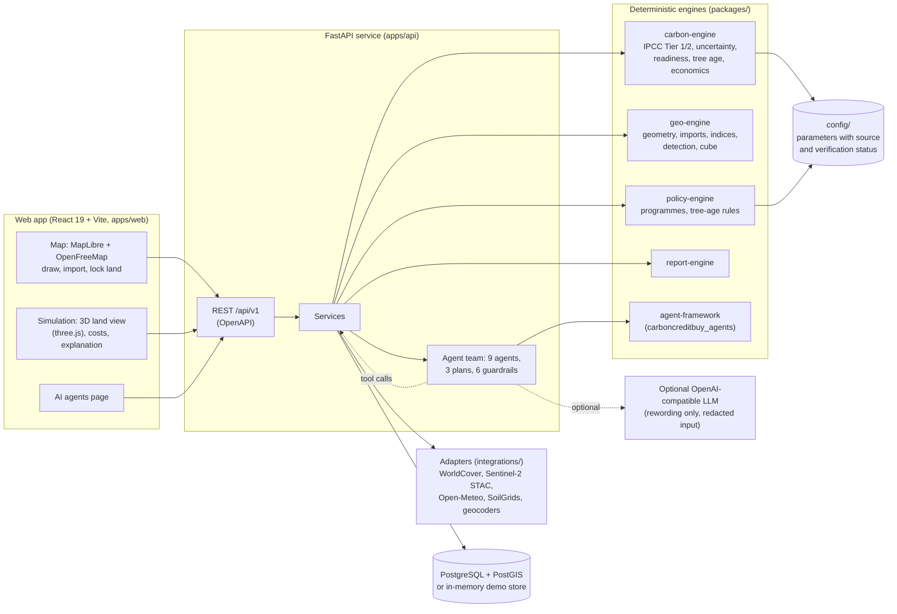

# Architecture

Components render, engines calculate, adapters fetch, agents explain.

**Boundaries that are enforced:** the React app never computes a carbon number; engines never touch the network;
adapters never decide policy; agents never invent a number (every figure comes from a tool call into an engine);
coordinates never reach logs or a language model.

## Detailed documents

- Overview with diagrams: [architecture/system-architecture.md](architecture/system-architecture.md)
- Data flow: [architecture/data-flow.md](architecture/data-flow.md)
- Carbon engine: [architecture/carbon-engine.md](architecture/carbon-engine.md)
- Tree-age model: [architecture/tree-age-model.md](architecture/tree-age-model.md)
- Mapping: [architecture/mapping-architecture.md](architecture/mapping-architecture.md)
- API contract: [architecture/api-contract.md](architecture/api-contract.md)
- Agents: [agents/README.md](agents/README.md) and [agents/catalog.md](agents/catalog.md)
- Decision records: [architecture/adr/](architecture/adr/)
