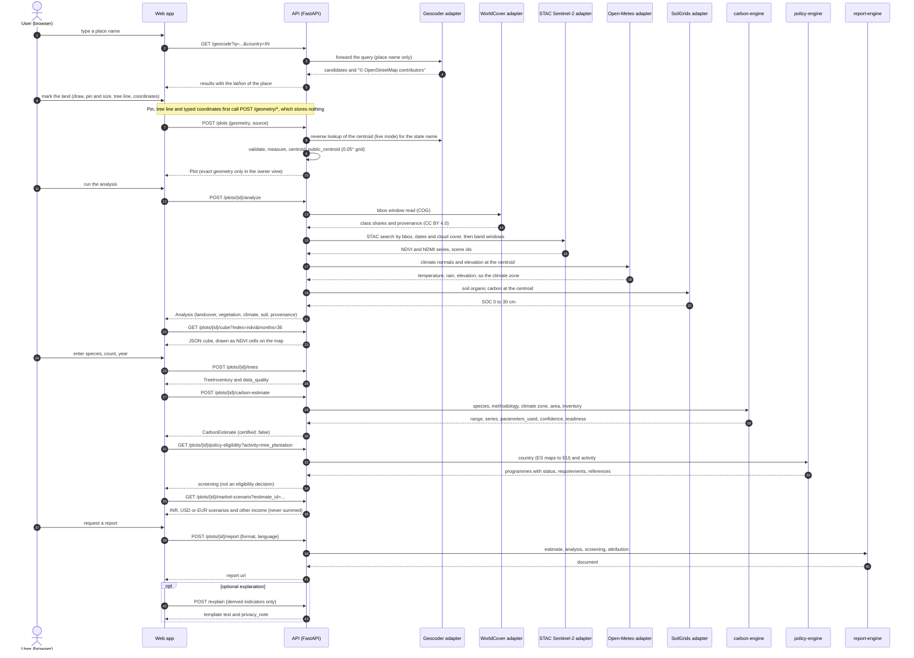
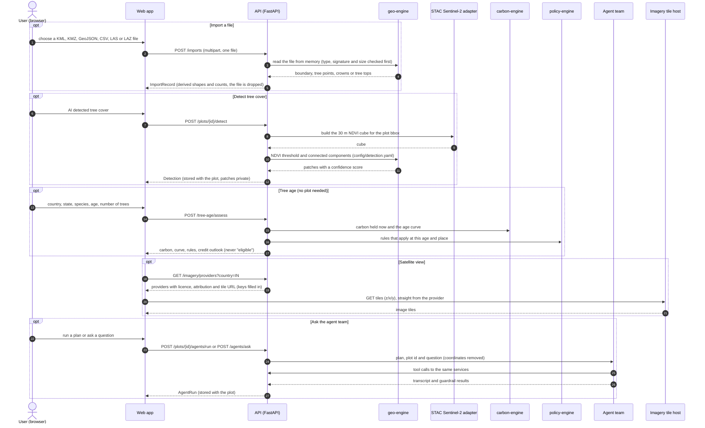
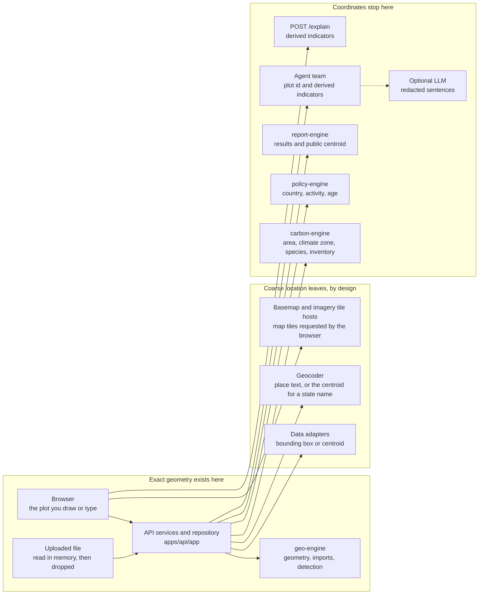

# Data flow

This page follows one farmer's session from typing a place name to downloading a report, then the version 0.2 flows
(imports, tree-cover detection, tree age, imagery and the agent team). It names every external service that is
contacted and marks the point beyond which exact coordinates do not travel: **agents and the language model never
receive coordinates**. Field names match the [API contract](api-contract.md).

## One session

The sequence below is the path of the main workflow. A plot can also start from a pin and a size, a drawn tree line, typed
coordinates or an imported file; those steps are in the next section.

## Version 0.2 flows

Each block is independent of the others. Imports, tree age and the agent team are described in more detail in
[imports-and-detection.md](imports-and-detection.md), [tree-age-model.md](tree-age-model.md) and the
[agents guide](../agents/README.md).

Three details matter for what is stored and what moves:

- **Imports.** The file is read in memory and dropped. The record keeps the derived boundary, tree points, crowns or tree
  tops, the counts and a map preview, linked to a plot when the request names one. A point cloud is never sent anywhere.
- **Detection.** The detection runs on the 30 m NDVI cube that the map's NDVI cells also use. In live mode the cube is
  built from Sentinel-2 for the plot's bounding box each time (a STAC search and COG window reads that are not cached),
  so a detection costs as much as a `GET /plots/{id}/cube`. The five newest detections of a plot are kept.
- **Tree age.** The request describes trees (country, state, species, age, count, optional girth and height). A plot is
  optional, and when one is named the service reads only its climate zone.

## What each step sends outward

| Step | Leaves the browser | Leaves the API | Towards |
| --- | --- | --- | --- |
| Place search | Place name, country | Place name, country and a `User-Agent` with a contact | Nominatim or Photon (public or self-hosted) |
| Pin and size, tree line, typed coordinates | The pin, the line or the points, to the API | Nothing | None: computed and not stored. When the API is offline the browser calculates the shape itself |
| Import data | The file | Nothing | None: read in memory, and only the derived record is kept |
| Create a plot | The exact polygon | Live mode: the centroid, to name the state or region | Nominatim or Photon |
| Analyze: land cover | None | The bounding box of the plot (a raster window) | WorldCover COGs on AWS S3 |
| Analyze, cube and detection: vegetation | None | The bounding box and a date range (STAC search), then byte ranges of COGs | Earth Search or Copernicus Data Space |
| Analyze: climate and elevation | None | The centroid | Open-Meteo |
| Analyze: soil | None | The centroid | ISRIC SoilGrids |
| Trees, estimate, tree age, policy, market, simulation, report | Species, counts, years, ages, country | Nothing | None |
| Satellite view | Tile requests (the map's position and zoom) | Nothing: the API only lists the providers | The imagery host, which sees the visitor's IP address |
| Basemap | Tile requests | Nothing | The basemap host: your PMTiles bucket, or the style host |
| AI agents | A plot id, a plan or a question (coordinates masked) | Template reasoner: nothing. LLM reasoner: redacted sentences and facts | The configured OpenAI-compatible endpoint, only when `ATLAS_AGENT_REASONER=llm` |
| Explain | Derived indicators (area, counts, NDVI, estimate range) | Nothing: the answer is a template | None |
| Share link (simulation) | Country, species, trees, year, horizon | Nothing | Anyone who receives the link |

An agent run that has to analyse a plot first makes the same adapter requests as `POST /plots/{id}/analyze`, because its
tools call the same services. The statistics adapters (USDA NASS, data.gov.in, the Census geocoder) are built by the
API but no service calls them yet, so nothing is sent to them. The [QGIS plugin](../../integrations/qgis-plugin/README.md)
is one more client: it posts the selected polygon to your own CarbonCreditBuy server, and the flow from there is the one above.

## The privacy boundary

The diagram shows where exact geometry exists and where it stops. Coordinates necessarily reach the Earth-observation
and climate providers, because that is how a pixel is looked up, and, in live mode, the geocoder once per plot to name
the state. Those requests are bounding boxes or centroids sent from the API with no user identity attached, and the
adapters cache their results in memory so that a repeated analysis does not repeat the disclosure. The tile hosts see
which map tiles a browser asks for, an approximate area and never a plot boundary, because the browser draws the outline.

Beyond the services, **coordinates stop**:

- The carbon engine receives area, climate zone, species and inventory. It never sees geometry.
- The policy engine receives a country code and an activity; the tree-age rules receive a country, a subdivision, a
  setting and an age.
- The report engine receives results and the `public_centroid`.
- `POST /explain` rejects any key that names a location (`lat`, `lon`, `geometry`, `coordinates`, `polygon`, `bbox`,
  `centroid`, `address`, `name` and similar) at the schema level.
- The agent team works from a plot id and derived indicators: area, state and country names, shares, indices, ranges.
  Tool summaries, messages and the question stored with a run are redacted, a guardrail fails a run whose messages
  contain the plot's own numbers, and the optional language model sees only redacted template sentences and facts.
- Logs, metrics and error messages carry plot ids only, and a logging filter masks anything that looks like a coordinate
  pair as a second line of defence.
- Shareable simulation links carry no location at all.

Public or shared plot views show `public_centroid`, snapped to a 0.05° grid (about 5.5 km north to south), which places
a farm within a district but not on a parcel. Details and the reasoning behind the grid size are in
[geolocation](../privacy/geolocation.md).

## Caching and idempotence

Adapter results are cached in memory, per process, for an hour by default and for 24 hours for the geocoder. The key is
a hash of the dataset, its version and the request (a bounding box or polygon, or a centroid), so the same request is not
sent twice while the process runs, and the cache is empty after a restart. The live vegetation cube is the exception: it
is built again for every cube request and every detection. Carbon estimates are pure functions of their
inputs, the configuration versions and the current year (the age of the trees counts to it): the same inventory and
configuration give the same range, which is what makes the validation protocol in
[research/validation](../../research/validation/README.md) meaningful. With the template reasoner a run of the agent team
is deterministic too, apart from ids and times.

## Failure behaviour

Each adapter has a 20-second timeout and one retry, after a short pause, on a 5xx answer or a transport error. Its errors
name the host and the status, never the request. A failing adapter degrades the analysis rather than failing it: the
block is omitted and `data_quality.warnings` says why (for example "satellite vegetation unavailable"). A carbon estimate
without an analysis uses the region's default climate zone and records `zone_source: region-default` in
`provenance.climate_zone`. The geocoder and the vegetation cube answer 502 `upstream-unavailable` when their provider
fails, and the Nominatim adapter waits to keep to one request a second (`GEOCODER_MIN_INTERVAL_SECONDS`).

Two limits are worth knowing. The vegetation cube is capped at 40,000 cells of 30 m, so for a plot whose bounding box
is larger than about 3,600 ha (the plot limit is 10,000 ha) the cube and the detection answer 502 and the analysis omits
the vegetation block. And a failing imagery host never affects a calculation: the map shows the plain basemap and says
the satellite tiles could not be loaded.
