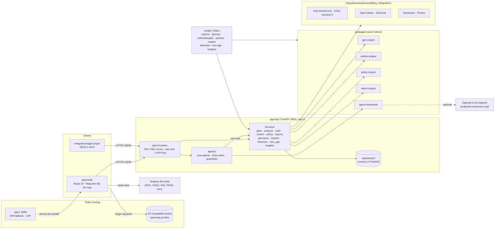

# System architecture

This page shows the parts of CarbonCreditBuy, who may call whom, how a request travels through them and how the two
running modes differ. The version 0.2 pieces are the agent team, the import, detection, tree-age and imagery features,
and the QGIS plugin. The web app is a flat 2D map; there is no 3D scene.

## Components

The diagram shows the direction of each call. Clients call the API over HTTPS. The API's routers hand over to services,
and a service uses the engines in `packages/` (plain Python, no HTTP), the adapters in `integrations/` (the only code
that talks to other servers) and the repository. The agent team calls the same services as tools. Configuration is read
by the services and the engines.

The browser talks to three kinds of origin: the API, the storage that holds the basemap (and the host of its style or
label fonts), and, only while the Satellite view is on, the host of the imagery tiles. Fonts of the interface are
self-hosted, so no font host is contacted. Every provider of data (land cover, Sentinel-2, climate, soil, geocoding) is
called by the API alone, which is where provenance, caching, rate limiting and the privacy boundary are enforced. The
Content-Security-Policy of the web image lists exactly these origins (`ATLAS_API_ORIGIN`, `ATLAS_BASEMAP_ORIGINS`,
`ATLAS_EXTRA_IMG_SRC` and `ATLAS_EXTRA_CONNECT_SRC`) and allows no `unsafe-eval`.

## Responsibilities

| Layer | Owns | Must not |
| --- | --- | --- |
| `apps/web` | Rendering, interaction and drawing; arranging and formatting data the API already computed (NDVI cells, units, language); the demo fallback | Compute carbon numbers, evaluate policy rules, know the URLs of data providers (the basemap, imagery override and API addresses come from `VITE_*` variables) |
| `apps/api` | The HTTP contract, validation, API keys, rate limiting, orchestration of engines and adapters, provenance, the agent team's tools | Contain equations or policy conditions |
| `packages/geo-engine` | Geometry (area in ha and acres, perimeter, centroid, 0.05° generalisation), boundaries from a pin or a tree line, coordinate parsing, file readers, point-cloud tree tops, tree-cover detection, indices, the vegetation cube | Know about carbon, programmes or HTTP routes. The raster and STAC helpers behind the optional `live` extra run only when an adapter calls them |
| `packages/carbon-engine` | Model registry, parameter loading, Tier 1 and Tier 2 calculations, carbon by tree age, uncertainty, confidence, readiness | Hard-code any factor; accept `pending` parameters in production |
| `packages/policy-engine` | Programme rules from `config/policies/<ISO>.yaml`, member states resolved to `EU`, the tree-age rules from `config/tree-age/` | Contain a country-specific `if` |
| `packages/report-engine` | Templates for HTML, Markdown and JSON and optional PDF (WeasyPrint), the attribution block, the three separated values | Recompute anything |
| `packages/agent-framework` | The generic machinery (`carboncreditbuy_agents`): agents, tools, blackboard, plans, orchestrator, reasoner, guardrails, redaction | Know about plots, carbon or HTTP; call a model unless the deployer turns it on |
| `apps/api/app/agents` | The nine agents, three plans, the tool wrappers over the services and the transcript store | Compute a number, receive coordinates |
| `integrations/carboncreditbuy_integrations` | One adapter per external API: endpoint from the environment, request shaping, parsing, caching, retry, `provenance()` with licence and attribution | Log coordinates; hard-code endpoints |
| `integrations/imagery` | The documentation of the imagery providers; the data is `config/imagery/providers.yaml` | Fetch, proxy or store tiles |
| `integrations/qgis-plugin` | A QGIS 3 client of the API, licensed GPL-2.0-or-later | Talk to anything but CarbonCreditBuy API |
| `config/` | All regional, species, methodology, policy, market, detection, tree-age and imagery knowledge, with sources and verification status | None |

## Request lifecycle

A `POST /plots/{id}/carbon-estimate` call passes through these stages:

1. **Transport.** nginx serves only the static web app; the browser calls the API origin directly. Middleware adds a
   request id and the security headers, refuses a JSON body whose `Content-Length` is over `ATLAS_MAX_BODY_BYTES`
   (uploads to `POST /imports` have their own limit), applies CORS (`ATLAS_CORS_ORIGINS`) and the rate limit
   (`ATLAS_RATE_LIMIT`, 60 a minute per client by default). When `ATLAS_API_KEYS` is set, a mutating endpoint also
   needs a valid `X-API-Key`.
2. **Validation.** Pydantic v2 models validate the body; a failure becomes an RFC 7807 `application/problem+json`
   response with status 422.
3. **Loading.** The repository returns the plot and the requested or latest inventory. The exact geometry stays in the
   services; the public view of a plot carries only the generalised centroid.
4. **Context.** The latest analysis supplies the climate zone. Without one, the region's default zone is used and
   recorded as `zone_source: region-default` in `provenance.climate_zone`. The species entry and the methodology
   parameter set come from `config/` with their versions.
5. **Calculation.** The carbon engine runs the deterministic model and returns `estimate` (low, central and high),
   `stock`, `components`, `annual_series`, `parameters_used`, `confidence` and `readiness`. If a parameter it needs is
   `pending` and the environment is production (or `ATLAS_ALLOW_PENDING_PARAMETERS=false`), the call ends in a 409
   problem of type `pending-parameters` that names the parameter.
6. **Provenance.** The service assembles `provenance` (generation time, API and app versions, mode, sources with
   attribution, model, parameter set, climate zone and species) and adds `certified: false` and the disclaimer.
7. **Persistence and response.** The estimate is stored with an `estimate_id` and returned with status 201. The access
   log records the method, the path (never the query string), the status and the duration; the audit log records the
   event, the plot id and counts. Neither holds coordinates.

Read endpoints follow the same path without the write. Calls to other servers have a 20-second timeout and one retry on
a 5xx answer or a transport error, and their results are cached in memory for an hour by default (per process). When an
adapter fails, `POST /plots/{id}/analyze` still answers 200 and omits that block with an explanation in
`data_quality.warnings`; `GET /geocode`, `GET /reverse-geocode` and the vegetation cube answer 502
`upstream-unavailable`.

## How a feature plugs in

The core services (plots, analysis, trees, carbon, policy, market, reports) are built once into an `AppContext`. The
version 0.2 features add no field to it. Each builds its service on first use with
`services.registry.service(ctx, name, factory)` and keeps it in `ctx.extras`, a router calls it, and the data it keeps
goes through the repository's generic `save_record(kind, id, record, plot_id)`. The kinds in use are `import`,
`detection` (the five newest per plot are kept) and `agent-run`. A record linked to a plot is deleted with the plot.

The agent team follows the same rule. `AgentService` runs a plan with the orchestrator of `carboncreditbuy_agents`; each
agent calls
tools that wrap the services above, writes its findings to a shared blackboard and says them through a reasoner. The
default reasoner fills a template; with `ATLAS_AGENT_REASONER=llm` an OpenAI-compatible model may rephrase the redacted
sentence, and its answer is discarded if it changes a number. Guardrails check the whole transcript before it is stored
([agents guide](../agents/README.md), [ADR-0006](adr/0006-agentic-framework.md)).

## Demo mode and live mode

The server runs in one of two modes, chosen with `ATLAS_MODE` and reported by `GET /health`.

| Aspect | `demo` | `live` |
| --- | --- | --- |
| Network | None from the API. The browser still loads the basemap, and imagery tiles while the Satellite view is on | The API calls the configured public APIs |
| Adapters | Deterministic synthetic twins, labelled `"source": "synthetic-demo"`, with a `data_quality.warnings` entry | Real data, with dataset versions, scene ids and access times |
| Climate zone | Derived from synthetic climate normals by the same classifier | Derived from Open-Meteo normals for the plot |
| Repository | In memory by default, pre-seeded with the three example plots (`PLT-DEMOIN`, `PLT-DEMOUS`, `PLT-DEMOEU`) | PostgreSQL with PostGIS recommended |
| Purpose | Development, CI, demonstrations, offline workshops | Real use |
| Honesty | Every provenance block names `synthetic-demo` as its source, and a report's header shows the mode | The standard disclaimers |

Both modes run the same engines on the same configuration, so a demo estimate is "wrong" only in its inputs, never in
its arithmetic. That lets tests and examples exercise the real code paths without network access and without touching a
real farm. The web app has a third, separate fallback: when it cannot reach the API at all, it shows static fixtures
and says so ([web README](../../apps/web/README.md#offline-behaviour)).

## Storage

The default repository is in memory and loses its data when the process stops. With `ATLAS_REPOSITORY=postgres` the API
keeps the same JSON records in PostgreSQL 16 with PostGIS 3.4: plots (the exact boundary as `geometry(Polygon, 4326)`),
the latest analysis, inventories, estimates, reports, the generic records and an audit log, with a `plots_public` view
for anything public. [`data/schemas/schema.sql`](../../data/schemas/schema.sql) creates them, and CI applies it twice
to a real database. Deleting a plot deletes what was derived from it, as described in
[data retention](../privacy/data-retention.md); the one exception is in the in-memory repository, where a plot's reports
stay retrievable until the process restarts ([known limits](../../apps/api/README.md#known-limits)). The API does not
use
object storage in this release. `docker-compose.yml` provisions MinIO as an S3-compatible place to keep a PMTiles
basemap, which the web app reads directly once `VITE_BASEMAP_PMTILES_URL` points at it. Uploaded files are never stored.

## Configuration and secrets

All endpoints, keys and switches come from environment variables listed in [`.env.example`](../../.env.example). The
code holds no credential, and the adapters take their endpoints from the settings. The Vite build compiles `VITE_*`
variables into the bundle, so the web image is built per environment
([Dockerfile.web](../../infra/docker/Dockerfile.web)) and no `VITE_*` value may be a secret. The only key that reaches a
browser on purpose is the imagery key in the tile URL (`ESRI_API_KEY`); use a referrer-restricted, basemap-only key
([imagery integration](../../integrations/imagery/README.md#keys)).

## Deployment shapes

- **Laptop or workshop:** `make dev` or `docker compose up`, demo mode.
- **Single server:** both containers behind a reverse proxy with TLS, PostGIS and MinIO on the same host, live mode.
- **Cloud:** containers on a managed service, managed PostgreSQL with PostGIS, object storage with a CDN for tiles
  ([infra/terraform](../../infra/terraform/README.md), a reference layout without `.tf` files).

The service is single-tenant: there are no user accounts, and `ATLAS_API_KEYS` protects only the mutating endpoints. Do
not expose a deployment that holds real boundaries to the public Internet without a gateway in front
([threat model](../privacy/threat-model.md)).
