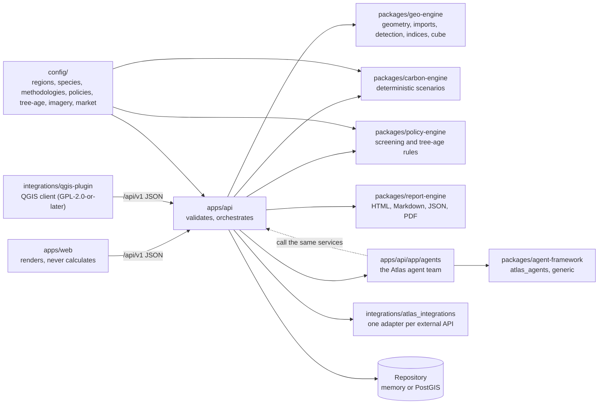
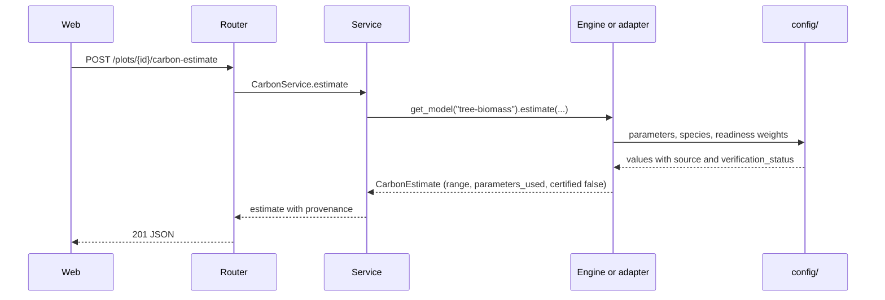

# Architecture overview

A guided walk through the code, following one realistic request from a polygon drawn on the map to a
downloadable report, plus a map of where everything lives. For the diagrams and the reasoning behind
the design, read [system architecture](../architecture/system-architecture.md), the
[data flow](../architecture/data-flow.md) and the
[ADRs](../architecture/adr/0001-vite-react-over-nextjs.md). The endpoints are specified in the
[API contract](../architecture/api-contract.md). This page tells you *which file to open*.

## The picture in one minute

Three rules explain most of the structure (see [CLAUDE.md](../../CLAUDE.md)):

1. **React components render, engines calculate, adapters fetch.** Nothing in `apps/web` computes a
   carbon number or evaluates a policy rule. Agents do not compute either: they call the same
   services and describe what came back.
2. **Knowledge lives in `config/`, not in code.** Regions, species parameters, methodology tables,
   program rules, tree-age rules, imagery providers and price scenarios are YAML, each with a
   source and a verification status.
3. **Privacy and honesty are structural.** Exact polygons are private, coordinates never reach logs
   or a language model, and every carbon result is a range with `certified: false`.

## Repository map

| Path | What is there |
| --- | --- |
| `apps/api/` | FastAPI service: routers (`app/api/v1/routers/`), services, repositories, settings, tests ([README](../../apps/api/README.md)) |
| `apps/api/app/agents/` | The nine Atlas agents, their tools, the three plans and `AgentService` |
| `apps/web/` | React 19 + Vite app ([README](../../apps/web/README.md)) |
| `packages/carbon-engine/` | Models, parameter store, uncertainty, confidence, readiness, tree-age curves ([README](../../packages/carbon-engine/README.md)) |
| `packages/geo-engine/` | Polygon validation and measurement, pin-and-area and tree-line construction, coordinate parsing, imports (GeoJSON, KML, CSV, LAS/LAZ), tree detection, indices, climate zones, cube ([README](../../packages/geo-engine/README.md)) |
| `packages/policy-engine/` | Evaluates `config/policies/*.yaml` and `config/tree-age/rules.yaml` ([README](../../packages/policy-engine/README.md)) |
| `packages/report-engine/` | Jinja2 templates and renderers ([README](../../packages/report-engine/README.md)) |
| `packages/agent-framework/` | `atlas_agents`: agents, tools, plans, blackboard, guardrails, with no knowledge of carbon |
| `integrations/atlas_integrations/` | External-API adapters with demo twins ([README](../../integrations/README.md)) |
| `integrations/qgis-plugin/` | The QGIS plugin, a client of the API. GPL-2.0-or-later, kept separate on purpose ([why](../licensing/THIRD_PARTY.md#the-qgis-plugin-and-the-gpl)) |
| `config/` | `regions/`, `policies/`, `species/`, `methodologies/`, `market/`, `tree-age/`, `imagery/`, `readiness.yaml`, `detection.yaml` |
| `data/schemas/` | JSON Schemas for the contract and `schema.sql` for PostgreSQL + PostGIS |
| `data/sample/` | Synthetic plots and recorded sample responses (demo fixtures) |
| `examples/` | Synthetic farms with ready-to-run scripts |
| `tests/` | Cross-package integration and data-quality tests |
| `scripts/` | `make_sample_responses.py` (fixtures) and `capture_screenshots.mjs` (documentation images) |
| `docs/` | This documentation; `research/` holds the evidence behind the rules |
| `infra/` | Dockerfiles, nginx config, repository-settings notes |
| `.github/` | Workflows, issue forms, pull request template, labels, code owners |

`make install-api` installs the Python packages in editable mode, so editing a file under `packages/`
takes effect in the running API after a reload.

## What v0.2 added

The v0.2 features follow one pattern: a pure function or class in an engine, a router in
`apps/api/app/api/v1/routers/`, a service in `apps/api/app/services/` that the router builds lazily
through `app/services/registry.py`, and records stored through the repository's generic
`save_record(kind, id, record, plot_id)`, so deleting a plot deletes them too. Contract:
[API contract, v0.2 additions](../architecture/api-contract.md).

| Feature | Endpoints | Where the logic is | Rules and numbers |
| --- | --- | --- | --- |
| Simpler land input | `POST /geometry/from-point`, `/geometry/from-line`, `/geometry/parse-coordinates` | `geo_engine/construct.py`, `geo_engine/coordinates.py` | Size limits from `Settings` |
| Import data | `POST /imports`, `GET /imports`, `GET` and `DELETE /imports/{id}` | `geo_engine/imports/`, `geo_engine/pointcloud/` | `ATLAS_MAX_UPLOAD_MB`; the raw file is never stored |
| Tree detection | `POST /plots/{id}/detect`, `GET /plots/{id}/detections` | `geo_engine/detection/` | `config/detection.yaml` |
| Tree age | `GET /tree-age/rules`, `POST /tree-age/assess` | `carbon_engine/age.py`, `policy_engine/tree_age.py`, `app/services/tree_age.py` | `config/tree-age/rules.yaml`, `subdivisions.yaml`, and the growth tables in `config/methodologies/` |
| Imagery | `GET /imagery/providers` | `app/services/imagery.py` | `config/imagery/providers.yaml`; the browser fetches the tiles |
| Agents | `GET /agents`, `POST /plots/{id}/agents/run`, `POST /agents/ask`, `GET /agents/runs` | `apps/api/app/agents/` on `packages/agent-framework` | Plans are data in `app/agents/plans.py` |

Imagery providers are configuration, not adapters: the API only reports which providers are usable
and under what license, and the web app loads tiles itself.
Treat the table as a map to the code. If a file listed here is missing in your checkout, the feature
has not landed yet; the contract describes where it is going.

## One request, end to end

The web app's four-step flow (Select land, Add trees, Analyze, Carbon potential) maps onto these
calls. File paths are relative to the repository root.

### 1. Create the plot: `POST /api/v1/plots`

- The router `apps/api/app/api/v1/routers/plots.py` calls `PlotService.create`
  (`apps/api/app/services/plots.py`).
- `geo_engine.geometry.validate_polygon` enforces the GeoJSON rules and the limits (500 vertices,
  0.01 to 10,000 ha) from `Settings`. `measure_polygon` computes geodesic area, perimeter, centroid
  and the generalized public centroid (0.05 degree grid). `new_plot_id` creates the `PLT-XXXXXX` id.
- The country resolves to a region through `config/regions/*.yaml` (`RegionConfig.resolve`; an EU
  member state maps to `EU`).
- The record goes to the repository (`repositories/memory.py` or `postgres.py`). Failures become
  RFC 7807 problems (`core/errors.py`).

### 2. Analyze: `POST /plots/{id}/analyze`

- `AnalysisService.analyze` asks the adapters, through `ModeRouter` (`services/adapters.py`), for land
  cover, vegetation indices, climate normals and soil carbon. Each block carries its own `provenance`
  with the adapter's `SOURCE`. A failing layer adds a warning and returns `null`; nothing is invented.
- `geo_engine.climate.classify_climate_zone` turns temperature, precipitation and elevation into the
  zone id the parameter tables use.
- In demo mode every adapter is its `Demo*` twin and a "synthetic observations" warning is attached.

### 3. Add trees: `POST /plots/{id}/trees`

- `TreeService.create` validates the species against `config/species/species.yaml` and stores a new
  inventory **version** (`INV-xxxx`); earlier versions are kept.

### 4. Estimate: `POST /plots/{id}/carbon-estimate`

- `CarbonService.estimate` builds `PlotInput`, `InventoryInput`, `ClimateInput` and `ModelParams` and
  calls `carbon_engine.get_model("tree-biomass").estimate`. `allow_pending_parameters` is true only
  outside production and only when `ATLAS_ALLOW_PENDING_PARAMETERS` is true.
- The engine reads parameters through `ParameterStore`, computes Tier 1 or Tier 2, and returns the
  range, series, `parameters_used`, confidence and readiness.
- The service adds API-level provenance and an `EST-xxxx` id and stores the result.
  `PendingParameterError` becomes HTTP 409, `ModelNotImplementedError` HTTP 501.

### 5. Screen programs and show indicative value

- `GET /plots/{id}/policy-eligibility` runs `PolicyService.screen`, which calls
  `policy_engine.PolicyEngine.screen` over `config/policies/<REGION>.yaml`.
- `GET /plots/{id}/market-scenario` runs `MarketService.scenarios_for`: the estimate multiplied by
  the price scenarios in `config/market/carbon-price-scenarios.yaml`. This is the *indicative carbon
  value*; it is never added to the environmental benefit or to other farm income.

### 6. Report: `POST /plots/{id}/report`

- `ReportService.context` assembles the plot summary (public centroid only), inventory, analysis,
  estimate, screening, market scenarios and sources; `report_engine.ReportRenderer` renders HTML,
  Markdown, JSON or PDF; the bytes are stored and served by `GET /reports/{id}`.

### The agent team follows the same road

`POST /plots/{id}/agents/run` runs a plan: an ordered list of agents (`coordinator`, `land`,
`imagery`, `trees`, `carbon`, `policy`, `market`, `review`, `report`). Each agent's tools call the
services above, so a number in an agent transcript is the number the engine returned. A specialist
whose input is missing skips itself. After the plan, deterministic guardrails check the run: not
presented as a credit, uncertainty present, provenance present, no coordinates, no pending
parameters hidden, and the three values kept apart. The default reasoner is a template; an optional
language model may only rephrase sentences from redacted facts. The framework itself
(`packages/agent-framework`) knows nothing about carbon. The
[learning guide](../agents/README.md) walks through one run, and the [agent catalog](../agents/catalog.md) lists
every agent, plan and message kind.

## Where does my change go?

| I want to... | Change this | Also touch |
| --- | --- | --- |
| Correct or verify a carbon parameter | `config/methodologies/*.yaml` or `config/species/species.yaml` | A test; [species and parameters](adding-a-species-or-parameter.md) |
| Add a species | `config/species/species.yaml` | Tests; the tree library lists it automatically |
| Add or change a program rule | `config/policies/<REGION>.yaml` | `config/regions/<REGION>.yaml` program list, policy tests, `docs/regions/` ([adding a region](adding-a-region.md)) |
| Add or change a tree-age rule | `config/tree-age/rules.yaml` | Tests, `docs/research/tree-age-carbon-rules.md` ([tree-age rules](adding-a-tree-age-rule.md)) |
| Support a new country or region | `config/regions/`, `config/policies/`, `config/market/` | [adding a region](adding-a-region.md) |
| Add a data source | `integrations/atlas_integrations/<name>/`, `.env.example`, `Settings`, `ModeRouter` | `docs/licensing/`, [adding an integration](adding-an-integration.md) |
| Add an imagery provider | `config/imagery/providers.yaml` | `docs/licensing/MAP_LICENSES.md`, `docs/research/imagery-providers.md` |
| Change an equation or add a model | `packages/carbon-engine` | Methodology citation, parameters in `config/`, tests with reference values |
| Change geometry, imports, detection, indices or the cube | `packages/geo-engine` | Tests; API response shape if it changes |
| Add or change an endpoint | `apps/api` routers, schemas and services | `docs/architecture/api-contract.md`, `apps/web/src/services/api.ts` and `types/api.ts`, demo fixture |
| Change what an agent says or does | `apps/api/app/agents/` | Agent tests; never add a number the engines did not compute |
| Change a screen or label | `apps/web/src/features/...` and `i18n/en.json` | Other language files, Vitest |
| Change report wording or layout | `packages/report-engine/report_engine/templates/` | Report test |
| Change the database | `data/schemas/schema.sql` and `apps/api/app/repositories/postgres.py` | Keep the script idempotent; [testing the schema](testing.md#testing-the-postgresql-schema) |
| Change the QGIS plugin | `integrations/qgis-plugin/` | Its tests; keep it free of imports from the rest of the repository |
| Change a workflow or issue form | `.github/` | [Release process](release-process.md) if a check name changes |

If your change needs an `if country == "IN"` outside `config/`, it belongs in configuration instead.

## Configuration files

| File | Read by | Content |
| --- | --- | --- |
| `config/regions/<ISO>.yaml` | API, policy engine, demo twins | Units, currency, languages, default climate zone, map defaults, program links, member states |
| `config/policies/<ISO>.yaml` | policy engine | Programs with ordered rules, requirements, references, disclaimer |
| `config/species/species.yaml` | carbon engine, API | Species table with cited, status-tagged parameters |
| `config/methodologies/ipcc-2006-tier1.yaml` | carbon engine | Constants, root-to-shoot, Tier 1 growth, allometry registry, assumptions |
| `config/methodologies/tree-biomass-model.yaml` | carbon engine | Model behavior settings (horizon, post-maturity factor) |
| `config/methodologies/registry.yaml` | API | Methodologies the platform can *reference* (never applies) |
| `config/readiness.yaml` | carbon engine | Evidence weights and grade thresholds |
| `config/market/carbon-price-scenarios.yaml` | API | Illustrative price scenarios per region |
| `config/tree-age/rules.yaml` | policy engine, API | Rules that apply by tree age, species, setting and place, each with a source and a status |
| `config/tree-age/subdivisions.yaml` | API | States and provinces that a tree-age rule can name |
| `config/detection.yaml` | geo engine | Thresholds for tree-cover detection, with verification status |
| `config/imagery/providers.yaml` | API | Imagery providers with license, attribution, key requirement and whether analysis is allowed |

`ATLAS_CONFIG_DIR` points every reader at another directory (used in the Docker image).

## Demo and live

`ModeRouter` is the single switch. In demo mode each adapter is a deterministic `Demo*` twin that
labels its output `synthetic-demo`; the engines, the repository and the API code are identical in
both modes. At start-up in demo mode (`ATLAS_SEED_DEMO` true) `app/demo_seed.py` creates the three
synthetic plots from `data/sample/plots/`. The web app has a second, independent fallback: static
fixtures in `apps/web/public/demo/` for when the API is unreachable.

A keyed adapter (USDA NASS, data.gov.in) falls back to its demo twin when its key is empty, even in
live mode, so check the `provenance` of a result before you trust it as real. The
[free APIs table](../data-sources/FREE_APIS.md) lists every source with its demo twin.

## The privacy boundary

| Rule | Where it is enforced |
| --- | --- |
| Exact polygons are private; public views use a 0.05 degree grid | `geo_engine.geometry.generalize_point`; `PlotService.public_view`; `GET /plots/{id}/public` |
| No coordinates in logs | `app/main.py` logs the path only (never the query string); `core/logging.py` scrubs coordinate-like text |
| No coordinates to a language model | `ExplainRequest` rejects location keys; the web builds the payload from indicators; agent questions are redacted before any optional model call |
| Agent transcripts carry no geometry | Tool `input` and `output` are summaries; the `no-coordinates` guardrail checks the finished run |
| Uploaded files are not kept | `POST /imports` stores only the derived record, never the raw file |
| Reports carry the public centroid only | `ReportService.context` |
| Adapter errors do not echo queries | `HttpAdapter` error messages carry the host and status only |
| The database refuses what the API must never write | `schema.sql` has CHECK constraints for a coarse `public_centroid`, `certified: false` in stored estimates and no coordinates in audit details |

Known gaps, kept honest here so contributors can fix them: the public view still returns `bbox` at six
decimals, because `PRIVATE_FIELDS` in `services/plots.py` lists only `geometry`, `centroid` and
`perimeter_m` ([starter issue 10](../community/starter-issues.md#10-stop-the-public-plot-view-returning-bbox));
the in-memory repository does not delete a plot's reports when the plot is deleted
([starter issue 11](../community/starter-issues.md#11-delete-a-plots-reports-with-the-plot)); and
`ATLAS_API_KEYS` protects only mutating endpoints, so GET endpoints are open, which is a design question and
not a quick fix ([roadmap ideas](../community/roadmap-ideas.md#privacy-and-access)). Read the
[privacy design](../privacy/privacy-design.md) and the [threat model](../privacy/threat-model.md)
before touching this area.

## The web side

- `src/services/api.ts` is the only module that knows URLs; `client.ts` wraps it with the offline
  fallback (`demoFallback.ts`); `queries.ts` exposes TanStack Query hooks; `agentsApi.ts` holds the
  agent endpoints.
- Pages live in `src/features/<name>/`; pure logic sits in a `logic/` folder with its unit tests so
  it can be tested without React. Shared pieces are in `src/components/` (`map/` holds the MapLibre
  hook and the basemap fallback).
- `src/store/` (Zustand) persists settings and the selected plot id, never geometry.
- Text goes through i18next (`src/i18n/*.json`); numbers and units go through `src/lib/format.ts`.
- Fonts are self-hosted through `@fontsource` packages, and the map keeps working without its basemap
  ([troubleshooting](troubleshooting.md#the-map-is-gray-or-says-the-basemap-is-unavailable)).

## Tests, briefly

`packages/*/tests` and `integrations/tests` hold unit tests, `apps/api/tests` runs the application in
demo mode through `TestClient`, `tests/integration` checks contract fixtures, `tests/data-quality`
guards the configuration, and Vitest and Playwright cover the web app. Details in
[testing](testing.md).

## Also in the repository

- The agent framework and the agent team: `packages/agent-framework` and `apps/api/app/agents`, explained in
  [docs/agents](../agents/README.md) (see "Adding a new agent"). Each module also starts with a docstring.
- The QGIS plugin: [user guide](../user-guide/qgis-plugin.md). It follows the same rules: no business
  logic beyond what the API returns, and no coordinates in its log.

Next: [setup](setup.md) or [testing](testing.md).
