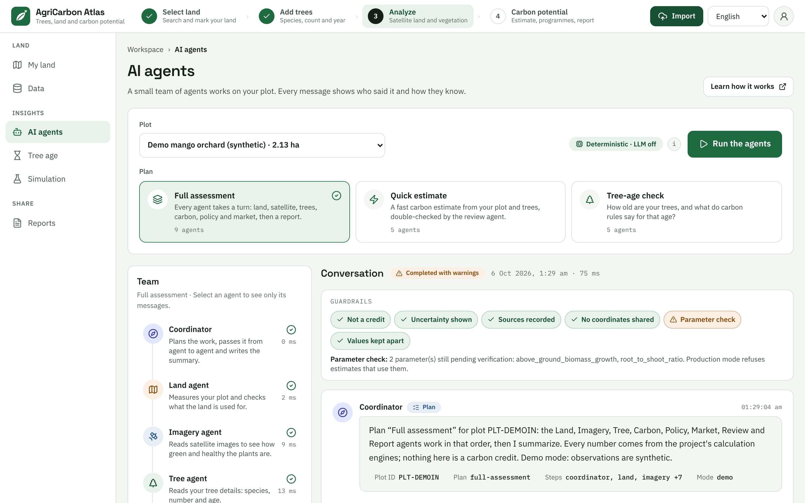

# AI agents

The **AI agents** page puts a small team of helpers to work on one of your plots. Each helper, called an agent, has
one job, such as measuring your land or looking up programmes. You can read what each agent says, see how it knows,
and ask your own questions.

> **Read this first.** Every number on this page comes from the app's calculation engines, the same ones behind
> [Carbon potential](results-explained.md). An AI model never works out a carbon number, and no AI model ever
> receives coordinates. Scenario estimate only. This is not an issued carbon credit.

- [What the agents are, and what they are not](#what-the-agents-are-and-what-they-are-not)
- [Open the page and run the agents](#open-the-page-and-run-the-agents)
- [The three plans](#the-three-plans)
- [Meet the team](#meet-the-team)
- [The Team list](#the-team-list)
- [Read the conversation](#read-the-conversation)
- [Guardrails: the automatic safety checks](#guardrails-the-automatic-safety-checks)
- [Ask the agents](#ask-the-agents)
- [Where AI is used, and where it is not](#where-ai-is-used-and-where-it-is-not)
- [Privacy](#privacy)
- [If something goes wrong](#if-something-goes-wrong)
- [Learn more](#learn-more)

## What the agents are, and what they are not

| The agents are | The agents are not |
| --- | --- |
| A fixed team of nine helpers. Each one does one job | A chat assistant that can answer anything. They answer questions about one plot of yours |
| Open about their work. Every message shows who said it and how they know | A source of new numbers. Every number comes from a calculation |
| Checked automatically. Six safety checks run on every result | A way to get a carbon credit. A result is never certified |

## Open the page and run the agents

1. Choose **AI agents** in the left menu, under **INSIGHTS**. On a phone, tap **Menu** first.
2. Under **Plot**, choose your plot. Each choice shows the plot's name and its area. The plot you last selected on
   the map is already chosen.
3. Under **Plan**, choose what you want the team to do. **Full assessment** is chosen for you. See
   [the three plans](#the-three-plans).
4. Press **Run the agents**. While the team works, the button says **Working…** and the page says "The agents are
   working…".

When the team is done, the **Team** list shows how each agent got on and the **Conversation** shows what they said.

*The screenshots in this guide use the demo plot, so the numbers in them are examples.*

Add your trees first. Without a tree count, the agents that estimate carbon have nothing to work on and skip their
turn. See [step 2 in Getting started](getting-started.md#step-2-add-your-trees).

At the top right, **Learn how it works** opens the project's guide to the agents in a new tab. The short badge
**Deterministic · LLM off** next to the run button is explained [below](#where-ai-is-used-and-where-it-is-not).

## The three plans

A plan is the order in which the agents work. The **Coordinator** always starts and always finishes.

| Plan | What it is for | Agents, in order | Writes a report |
| --- | --- | --- | --- |
| **Full assessment** (9 agents) | "Every agent takes a turn: land, satellite, trees, carbon, policy and market, then a report." | Coordinator, Land, Imagery, Tree, Carbon, Policy, Market, Review, Report, then the Coordinator again | Yes |
| **Quick estimate** (5 agents) | "A fast carbon estimate from your plot and trees, double-checked by the review agent." | Coordinator, Land, Tree, Carbon, Review, then the Coordinator again | No |
| **Tree-age check** (5 agents) | "How old are your trees, and what do carbon rules say for that age?" | Coordinator, Tree, Carbon, Policy, Review, then the Coordinator again | No |

- In the **Tree-age check**, the Policy agent also looks at the rules that treat trees differently by age. It takes
  the age from your tree details, or from a question such as "my trees are 60 years old". The
  [Tree age](tree-age.md) page shows the same rules in more detail.
- If you are not sure, keep **Full assessment**.

## Meet the team

The names and the one-line jobs below are the ones the page shows.

| Agent | Its job | It skips its turn when |
| --- | --- | --- |
| **Coordinator** | Plans the work, passes it from agent to agent and writes the summary. | Never. The closing summary always runs |
| **Land agent** | Measures your plot and checks what the land is used for. | It has no skip rule. It can warn if it cannot measure the plot |
| **Imagery agent** | Reads satellite images to see how green and healthy the plants are. | It has no skip rule |
| **Tree agent** | Reads your tree details: species, number and age. | It has no skip rule. Without a tree count it warns, and tells you to add the species, the number of trees and the planting year |
| **Carbon agent** | Estimates the carbon your trees store and remove, with a low–high range. | There are no trees on the plot yet |
| **Policy agent** | Looks up programmes and rules that may apply. It never decides eligibility. | It has no skip rule |
| **Market agent** | Shows example carbon prices as scenarios, not promised income. | There is no carbon estimate |
| **Review agent** | Double-checks the result against the safety rules. | There is no carbon estimate |
| **Report agent** | Collects everything into a report you can share. | There is no carbon estimate |

Some details that help you read their work:

- The **Imagery agent** uses the same vegetation health (NDVI) and tree cover data as the map. It does not read the
  pictures of the **Satellite** view. See [Satellite imagery](satellite-imagery.md#viewing-versus-analysing).
- The **Tree agent** also mentions trees that were counted in files you imported, and says how many fall inside the
  plot. See [Import data](import-data.md#use-the-trees-as-your-tree-count).
- The **Market agent** shows example prices as scenarios. They are not promised income, and they are never added to
  the carbon number or to your other farm income.
- The **Report agent** writes a report with the same report engine as the **Reports** page and gives its report
  number. To read, print or save a report, use [Reports](reports.md).

## The Team list

The **Team** list shows every agent of the chosen plan, with its job, an icon for its status and the time it took in
milliseconds. In demo mode these times are tiny.

| Icon | Meaning |
| --- | --- |
| Empty circle | **Waiting** for its turn |
| Spinning circle | **Working** |
| Tick | **Done** |
| Warning triangle | **Needs a look**. The agent said something you should read |
| Cross | **Failed** |
| Dash | **Skipped**. It had nothing to work on |

Select an agent in the list to read only its messages. The page shows "Showing … only." with a **Show everyone**
button to go back, and lists what the agent reports and which tools it can use. If the agent said nothing in this run,
the page says "This agent has not said anything in this run."

## Read the conversation

The **Conversation** has a badge for the whole run, then the date and how long the run took.

| Badge | What it means |
| --- | --- |
| **Completed** | Every step and every safety check passed |
| **Completed with warnings** | An agent warned or was skipped, or a safety check needs attention. Read the warnings. The result is still shown |
| **Failed** | A key step failed, no agent produced anything, or a safety check failed. The page says "This run stopped early." |
| **Running** | The team is still working |

Every time you run the agents, the run is kept with the plot. When a plot has more than one run, an **Earlier runs**
list appears. The newest run is shown first.

### What you see in a message

| Part | What it is |
| --- | --- |
| The agent's name and a coloured badge | Who is speaking, and the kind of message (table below) |
| An arrow and a name, for example "→ Carbon agent" | Who the message is for. Hand-offs name the next agent |
| The time | When the message was written |
| **STEP 1**, **STEP 2** and so on | The order in which the agents worked |
| The text | A short, plain explanation in full sentences |
| Small fact chips | The main facts behind the text, such as **Area**, **Trees**, **Species**, **Age**, **Planted**, **NDVI**, **Estimate**, **Low**, **High**, **Confidence** and **Readiness**. At most six show. "+3 more" means more facts exist but are not shown |
| **How I know this** | A fold-out with the tools used, the sources and the confidence |

| Kind | What it means |
| --- | --- |
| **Plan** | The Coordinator says what the team is about to do |
| **Finding** | An agent reports what it found |
| **Warning** | Something is missing, did not work or needs care |
| **Hand-off** | An agent passes work to the next agent |
| **Answer** | The Coordinator answers a question you asked |
| **Summary** | The Coordinator closes the run (shown in a green panel) |

### How I know this

Open **How I know this** under a message. The title shows how many tools and sources are behind it, for example
"(3 tools · 3 sources)". Inside you find:

- **Tools used**: each calculation or lookup the agent ran, whether it worked (ok, error or skipped), how long it took,
  and a short summary of what went in and what came out. The app removes coordinates from these summaries.
- **Sources**: the data sets and documents behind the message, with links where there is one.
- **Confidence**: low, medium or high, where the agent gives one.

### The summary

At the end of a run, a green **Summary** panel gives you the short version:

- a headline;
- the **Estimated range**, as "Range low – high", in tCO₂e per year;
- **Programme readiness**, as a score out of 100;
- **Next steps**;
- the reminder "Scenario estimate only. This is not an issued carbon credit." and "certified: no".

The range and the readiness come from the same calculations as the [Carbon potential](results-explained.md) page.
Read that page to see what the numbers mean.

## Guardrails: the automatic safety checks

Above the messages, the **Guardrails** strip shows six checks that run on every result. A tick means passed, a
warning triangle means needs attention, and a cross means failed. Hover over a chip, move to it with the keyboard or
tap it to see what it checked. When a check is not green, the reason is written right below the chips.

| Check | What it looks at |
| --- | --- |
| **Not a credit** | Nothing is presented as a credit, a certification or promised income. Every result says `certified: no` and carries a disclaimer |
| **Uncertainty shown** | Every carbon number comes as a low, central and high value, with a unit and a confidence grade |
| **Sources recorded** | Every finding and answer names its sources |
| **No coordinates shared** | No coordinates, boundary or exact location appear in any message, fact or tool summary |
| **Parameter check** | The estimate does not rest on growth numbers that are still "pending verification". If it does, the chip is amber, not red |
| **Values kept apart** | The environmental benefit, the indicative carbon value and your other farm income are never added together |

A failed check makes the whole run **Failed**. A warning makes it **Completed with warnings**.

For example, while some growth numbers in the species table wait for verification, **Parameter check** is amber and
reads like this: "2 parameter(s) still pending verification: … Production mode refuses estimates that use them."
The estimate is still shown, with the warning. See [what "pending" means](faq.md#what-does-pending-mean-next-to-a-value).

## Ask the agents

Under the conversation, the box **Ask the agents** takes a question about the selected plot.

1. Type your question. The box says: "Ask about your plot, trees, carbon or programmes…". It counts up to 500
   characters.
2. Press **Ask**. An empty box says "Type a question first." A question longer than 500 characters says "Please keep
   the question under 500 characters." With no plot chosen, you see "Pick a plot first."
3. Your question appears in the conversation, followed by the agents' messages and an **Answer** from the Coordinator.

Four ready-made questions sit under the box. Selecting one asks it straight away:

| Question | What the team does |
| --- | --- |
| How much carbon will my trees store? | Runs a **Quick estimate** and answers with the Carbon agent's range |
| Which programmes can I join? | Runs a **Full assessment** and answers with the Policy agent's findings. These are programmes that may apply, not a decision about eligibility |
| What if I plant 200 more trees? | Runs a **Quick estimate** and compares the estimate for your trees with the estimate for your trees plus 200. Your saved tree data does not change |
| Are my old trees eligible for credits? | Runs a **Tree-age check** |

How the team understands a question: the Coordinator looks for key words in it. No AI model reads your question. It
is not a chat assistant, so short questions with clear words work best.

| Your question is about | Words it looks for, for example | Plan it runs |
| --- | --- | --- |
| Adding or removing trees, with a number | add, plant, more, remove, "what if" | **Quick estimate**, with a comparison |
| The age of trees | "years old", "old trees", "tree age", heritage | **Tree-age check** |
| A report | report, PDF, download | **Full assessment** |
| Money | value, price, income, worth | **Full assessment**, answered by the Market agent |
| Programmes | credits, eligible, programme, scheme, CCTS, CRCF | **Full assessment**, answered by the Policy agent |
| Satellite and plant health | NDVI, vegetation, satellite, canopy, drought | **Full assessment**, answered by the Imagery agent |
| The land | area, size, boundary, climate, cropland | **Quick estimate**, answered by the Land agent |
| Carbon | carbon, CO₂, removal, estimate, "how much" | **Quick estimate**, answered by the Carbon agent |
| Anything else | | **Quick estimate**. The Coordinator says that no key word matched |

The key words also work in Hindi, Kannada, German, French and Spanish. The answers are in English.

No need to type coordinates. The box says: "No need to type coordinates. They are never sent to an AI model." If you
type some anyway, the app masks them before it keeps your question.

## Where AI is used, and where it is not

The badge next to **Run the agents** tells you how the messages were written:

| Badge | What it means |
| --- | --- |
| **Deterministic · LLM off** | The messages are written from fixed templates filled with the results of the calculation engines. No AI language model is involved. This is the normal setting |
| **LLM narration on** | The person who runs your copy of the app has switched on a language model. It can only reword the text. |

The small **i** button next to the badge says it plainly: "Every number comes from the calculation engines, never
from an AI model. If a language model is switched on, it can only reword the text, and it never receives
coordinates."

With a language model switched on, the app checks every reworded message. It keeps the original text when the model
changes a number, adds a number, includes coordinates, or presents an estimate as a credit. The disclaimer "not a
credit" is added by the app after the wording, so a model cannot drop it.

The agents write in English for now. If you use the app in another language, the Coordinator's first message says so.

## Privacy

- Your exact boundary is never part of a message. The **No coordinates shared** check scans every message and fails
  the run if location data turns up.
- No AI model receives coordinates. By default, no AI model is involved at all.
- Every run is kept with the plot it was about. When you delete the plot, its runs are deleted too.

More in [privacy in the FAQ](faq.md#privacy-and-your-data).

## If something goes wrong

| You see | What to do |
| --- | --- |
| **The agents need the API** | The agents run on the server, and the server is not answering. Ask whoever runs your copy of the app to start it, then try again |
| **The agents work on a plot** | You have no plots yet. Choose **Open the workspace** and [mark your land](mark-your-land.md) first |
| A dash next to an agent, or a Tree agent warning that there is no tree inventory | Add the species, the number of trees and the planting year in **My land**, then run the agents again |
| **Completed with warnings** | Read the warnings in the conversation and the note under **Guardrails**. The numbers are still shown |
| **Failed**, with "This run stopped early." | Run the agents again. If it fails again, see [If something looks wrong](getting-started.md#if-something-looks-wrong) |
| **Something went wrong** | The page could not load the agents. Press **Try again** |
| No conversation yet | The page says "Pick a plan and press "Run the agents", or ask a question below." |

## Learn more

- [How the agents work](../agents/README.md) is the project's learning guide. Start with
  [the team at a glance](../agents/README.md#3-the-team-at-a-glance). It also explains
  [templates first, LLM optional](../agents/README.md#7-templates-first-llm-optional) and
  [privacy](../agents/README.md#8-privacy).
- [The agent catalogue](../agents/catalog.md) lists every agent, its tools and what it reads and writes.

Back to the [user guide](README.md). Next: [Tree age](tree-age.md) or [Reports](reports.md).
