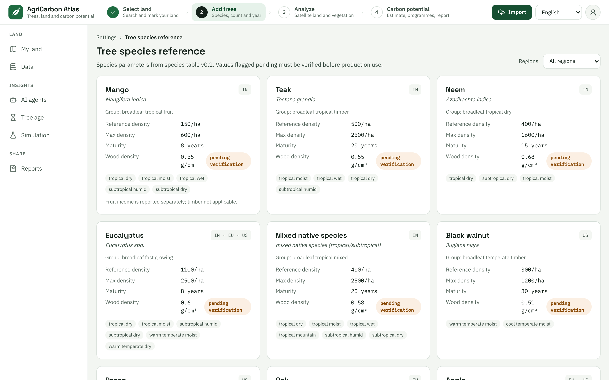

# FAQ

Short answers to the questions people ask most. Each answer points to the page that explains it in full.

- [The basics](#the-basics)
- [Carbon credits and money](#carbon-credits-and-money)
- [Accuracy](#accuracy)
- [Using the app](#using-the-app)
- [Privacy and your data](#privacy-and-your-data)
- [Known limits in this version](#known-limits-in-this-version)
- [Getting help](#getting-help)

## The basics

### What is CarbonCreditBuy?

A free, open-source web app for looking at your land and your trees. You mark the boundary of a plot on a map, or
import it from a file, and say what you planted. The app combines your answers with open satellite, climate and soil
data. It shows how healthy the vegetation looks, a range for the carbon your trees may remove each year, which
programmes might be worth a closer look, and a checklist of the evidence those programmes usually ask for. Every
number comes with its sources and assumptions.

Around that core there is a **Satellite** view of the map, a **Simulation** page for "What if I plant more trees?", a
**Tree age** page for trees that are already growing, **AI agents** that explain the steps in a conversation, and
printable **Reports**.

It is not a registry, a marketplace or a programme office. It does not issue, certify or sell carbon credits.
Start with [Getting started](getting-started.md).

### Does it cost anything? Do I need an account?

The software is free and open source under the Apache License, Version 2.0 (see the `LICENSE` file at the top of the
project and [ADR 0005](../architecture/adr/0005-apache-2-license.md)). The pages in `docs/`, including this guide,
are covered by the same licence unless a page states otherwise. The QGIS plugin folder (`integrations/qgis-plugin`)
is licensed under GPL-2.0-or-later. Data sets and map pictures keep their own licences and credits. See
[Licences and credits](satellite-imagery.md#licences-and-credits) for the pictures, and the
[data licences](../licensing/DATA_LICENSES.md) for the rest.

This version has no accounts and no sign-in. Whoever runs your copy of the app decides how it is offered to you.

### Which countries, languages and devices does it work with?

- **Countries:** India, the United States and the European Union (its 27 member states). The app works out the
  country from where your plot is. A plot elsewhere is refused with a message such as "The plot could not be
  created: Country XX is not supported in this release (IN, US, EU members)." The pages for each region are
  [India](../regions/IN/README.md), [United States](../regions/US/README.md) and
  [European Union](../regions/EU/README.md).
- **Languages:** English, Hindi, Kannada, German, French and Spanish. They change the labels and the number formats.
  Longer texts stay in English: the "In plain words" paragraph, the [report](reports.md), the messages of the
  [AI agents](ai-agents.md) and the rules on the [Tree age](tree-age.md) page. Use the language box at the top right
  or **Settings**.
- **Devices:** a recent browser on a computer, tablet or phone, with WebGL switched on, because the map needs it. On a
  phone, press **Menu** to open the left menu. The **Earth data & insights** panel, with the layers and the legend, is
  hidden on phones.

### Can I use it for crops, soil practices or livestock?

Not in this version. The calculation covers **trees** only: orchards, plantations and trees grown with crops. The
landing page mentions "trees or crops", but only trees can be entered. Practices such as cover crops, reduced tillage
or grazing have their own programmes and methods. The region pages mention them, but the app does not estimate them.

### Is the app showing real data?

It depends on how your copy is set up. See [Is this real data?](getting-started.md#is-this-real-data) before you read
any number.

## Carbon credits and money

### Is the number a carbon credit?

No. It is a modelled **scenario estimate**, and every result says "certified: no" and **Scenario estimate only. This
is not an issued carbon credit.** A carbon credit is a unit that a registry issues after a methodology was applied, a
baseline was set, verification was done by an accredited third party, and a serial number was recorded. The app does
none of these steps. Read [why an estimate is not a credit](results-explained.md#why-an-estimate-is-not-a-credit) and
[carbon credit vs carbon estimate](../concepts/carbon-credit-vs-estimate.md).

### Can I sell what the app shows?

No. The app cannot register, sell or send anything to a programme, a registry or a buyer. To sell credits you would
join a programme, usually through a project developer or an aggregator, follow its approved methodology, have the
results verified, and be issued credits. The region pages describe the programmes that exist in
[India](../regions/IN/README.md), the [United States](../regions/US/PROGRAMS.md) and the
[European Union](../regions/EU/PROGRAMS.md).

### How much money will I earn?

The app cannot tell you. The **Indicative carbon value** multiplies a placeholder price by the central removal
estimate to show what a scenario would look like. The prices are not offers and no reviewer has checked them yet, and
the card says "Market-value scenario — not guaranteed revenue. Prices are illustrative placeholders for local price
discovery." The costs of designing, verifying and registering a project, and the credits held back as a safety
buffer, reduce what is left. See [Indicative carbon value](results-explained.md#indicative-carbon-value).

### Why does the app show three values and never add them?

The **environmental benefit** (tonnes of CO₂e), the **indicative carbon value** (a hypothetical price times that
estimate) and **other farm income** (real money from fruit, timber or payments) are different kinds of things. Adding
them would double-count, mix a guess with real income, and make the carbon value look like money in your pocket. See
[why the three values are never added](results-explained.md#why-the-three-values-are-never-added).

### What is the difference between India's Green Credits and carbon credits?

They are two separate mechanisms. The Green Credit Programme (GCP) is run by the environment ministry and gives
government recognition for environmental actions. For tree plantation, the programme's official pages describe
degraded forest land managed by state forest departments, not a farmer's own land. Carbon credits under the Carbon
Credit Trading Scheme (CCTS) are run by the Bureau of Energy Efficiency and count tonnes of CO₂e reduced or removed.
One does not convert into the other. The app repeats "Green Credits (GCP) and carbon credits (CCTS) are separate
mechanisms." on every Indian result. Details and sources are on the pages
[Green Credit Programme](../regions/IN/GREEN_CREDIT.md) and [CCTS](../regions/IN/CCTS.md).

### What does the EU certification rule mean for me?

Regulation (EU) 2024/3012 creates a voluntary EU framework, the CRCF, for certifying carbon removals and carbon
farming (source: <https://eur-lex.europa.eu/eli/reg/2024/3012/oj>). Units come only from activities certified by a
recognised scheme. An estimate from this app is therefore never automatically certifiable. See the
[EU page](../regions/EU/README.md).

### Does the app tell me whether I qualify for a programme?

No. It gives an initial screening, with a status label for each programme, and says "Initial screening only — not an
eligibility determination." Only the programme's administrator can decide. See
[Potential policy pathways](results-explained.md#potential-policy-pathways).

## Accuracy

### How accurate is the estimate?

Treat it as a first estimate for exploring, not a measurement. Without your own measurements the app uses general
growth tables for your climate zone and tree type, adjusts them for how densely you planted and for an assumed 85%
survival, and converts the carbon to CO₂e. The **low** and **high** values are 30% below and above the central value
(20% if you entered a measured diameter). Those percentages are project assumptions, not a statistical interval.
Several growth values are still waiting for a reviewer, so every estimate is preliminary, and so far the calculations
have been checked against hand calculations but not against field measurements
([validation status](../architecture/carbon-engine.md#validation-status)). Real removal depends on soil, water, care,
weather and pests.

### What makes the estimate more reliable?

- Count the trees you **planted** and choose the right tree type and planting year.
- Measure the average trunk diameter at breast height on at least 30 trees, and the average height, and enter them
  under **Add tree diameter & height (optional)**. This moves the estimate from general tables to your own
  measurement and raises the confidence.
- Keep records: counts of dead or removed trees each year, a management log, land-use history, tenure papers. The
  **Carbon readiness** card lists them. See [Results explained](results-explained.md#carbon-readiness).

### What does the estimate leave out?

- **Soil carbon.** The soil value in the report is an indicator, not part of the estimate.
- **Losses.** Pruning, harvest, fire, storms and pests are not modelled, apart from the assumed 85% survival.
- **Everything a credit needs.** There is no baseline, additionality test, leakage check or permanence buffer.
- **Emissions of the farm itself**, such as fertiliser, fuel and machinery.

See the notes in the [carbon engine](../architecture/carbon-engine.md#what-this-engine-is-not).

### Why is my confidence "low" or "medium"?

**Confidence** describes how much of your own tree information the estimate uses. It is "high" only when you give the
number of trees, the tree type, the planting year, the average diameter **and** the average height. It does not
describe how accurate the model is. See [Confidence](results-explained.md#confidence).

### What does "pending" mean next to a value?

Each value the calculation uses carries a status. **Verified**: a reviewer checked it against the table or paper it
comes from. **Pending**: copied from its source but not yet checked. **Assumption**: a choice made by the project. A
"pending" value is fine for exploring, but a production installation refuses to calculate with one.

You see the counts on the results page, for example "2 verified · 3 pending · 11 assumption" (see
[Tree data quality](results-explained.md#tree-data-quality)). To see the values behind them, open **Settings** and
choose **Tree species reference**. Every species card lists its growth values, and a tag reading "pending
verification" sits next to each value that nobody has checked yet.

### Why does another calculator give a different number?

Calculators differ in method. Some multiply by a fixed "kilograms of CO₂ per tree per year", which this app
deliberately does not do. They may count roots or not, report carbon (C) instead of CO₂ (multiply by 44/12 to
convert), ignore the slow start of young trees, or report this year's removal instead of an average over many years.
Compare only numbers that state the same quantity over the same period and show a method and a range.

### Why does the Simulation page show a different number from my results page?

The **Simulation** page uses the **default climate zone** of the country, not the climate of your plot, assumes 85%
survival, and never uses a measured diameter. Its figure labelled **Annual removal at maturity** is in fact the
average yearly removal over the horizon you chose, counted from the planting year. See
[Simulation](simulation-lab.md#the-results).

### The vegetation looks healthy but the carbon number is small, or the other way round. Why?

NDVI measures how green and dense the plant cover is, not how much carbon there is. In a young plantation much of the
green may be grass or intercrops, and in a dense canopy NDVI stops rising. The carbon estimate comes from the trees
you described, not from the satellite. See
[Reading the line sensibly](results-explained.md#reading-the-line-sensibly).

### Why is the area different from my land record?

The app measures the area on the earth's surface inside the boundary you marked. Land records often use survey areas
or different boundaries. Local units such as guntha, bigha and cent are not converted automatically. A plot made with
**Pin + size** or **Tree line** has an approximate boundary, so its area is the size you gave or the strip around your
line. If the difference is large, check how carefully the boundary was drawn. See
[Mark your land](mark-your-land.md#boundary).

## Using the app

### Why does the results page ask me to add trees when I already did?

The page shows "Add trees to the plot to get an estimate." whenever it has no estimate to show, and in this version it
does not say why. The usual reasons are:

1. **The app is still saving.** It saves a moment after you stop typing. Wait until "Saving tree data…" and "Updating
   estimate…" disappear in the **Selected plot details** panel, then open the results again.
2. **An entry was not accepted.** The number of trees must be a whole number from 1 to 10,000,000, the planting year
   must be this year or earlier, and the diameter and height must be within their limits (up to 500 cm and 120 m).
   While the form holds something the app cannot accept, nothing is saved.
3. **The plot has never been open on the map.** The starting tree details are saved when the plot is selected on
   **My land**. A plot you imported or edited, and then opened with **Results** on the **Data** page, may have none.
   Open **My land**, select the plot, wait for the saving message to go away, and try again.
4. **The server could not calculate the estimate.** Any failure of the estimate request shows the same message. For
   example, a production installation refuses to calculate with values that are still "pending" (the error is 409),
   and it also happens if the server is down. Look for the amber "API offline" banner. If the problem persists, tell
   whoever runs your copy.

If the page shows an estimate but not the trees you typed, see the first row under
[known limits](#known-limits-in-this-version).

### How do I add my land?

Choose one of five ways in the **Mark your land** toolbar on **My land**: **Boundary**, **Tree line**,
**Pin + size**, **Coordinates** or **Import file**. **Boundary**, **Coordinates** with three or more corners and an
imported boundary give an exact outline. The others give an approximate boundary, marked with a blue "Approximate
boundary" tag. See [Mark your land](mark-your-land.md).

### Can I upload a file with my boundary or my trees?

Yes. Press the green **Import** button at the top right of the app. It takes GeoJSON, KML/KMZ, CSV, LAS and LAZ
files. The app reads the file, keeps only the results, and lets you use a boundary as your land or a tree count as
the tree details of a plot. See [Import data](import-data.md).

### What do the Map and Satellite buttons do?

**Map | Satellite**, at the bottom left of the map, changes the background. **Satellite** shows aerial or satellite
pictures where your copy of the app has a source for them. The pictures are for looking. The app does not use them in
its calculations. How sharp and how old they are depends on your country. See
[Satellite imagery](satellite-imagery.md).

### What are the AI agents?

A page where a team of helpers runs the same calculations one step at a time and explains each step in a
conversation. By default, no AI language model is involved, and no agent ever calculates a carbon number with AI. See
[AI agents](ai-agents.md).

### What does the Tree age page tell me?

For trees that are already growing, it shows a rough carbon outlook by age and the rules that may apply to trees of
that age, such as tree protection rules or incentive schemes. It is a reading aid, not an eligibility check. See
[Tree age](tree-age.md).

### Where can I see everything I have added?

On the **Data** page, in the left menu under **LAND**. **Land plots** lists your plots, with **Open on map**,
**Results** and **Delete**. **Imported files** lists the records of the files you imported. See
[The Data page](import-data.md#the-data-page).

### Can I change the survival rate?

Not in the workspace in this version. The app assumes that 85 of every 100 planted trees survive. Enter the number you
**planted**, not the survivors, and keep your own record of losses.

### My tree type is not in the list

Please do not pick a look-alike. **Settings**, then **Tree species reference**, shows every supported species for each
region and the status of its values. A new species needs a documented growth rate and wood density. You can request
one with the *Carbon model / parameter proposal* issue form, and the steps are in
[adding a species](../developer-guide/adding-a-parameter.md#adding-a-species).

### I have two kinds of trees, or trees planted in different years, in one field

Mark one plot for each group. A plot holds one tree type planted in one year. India's list has a "Mixed native
species" entry for mixed planting.

### My trees are older than 30 years, or they are very young seedlings

The **Plantation year** list goes back 30 years from this year. For older trees, see [Tree age](tree-age.md), which
works with trees of any age up to 300 years. For very young trees, expect small numbers: the estimate builds up over
the first six years of growth.

### I made a mistake. How do I fix a plot?

- **Trees:** change the fields in **Selected plot details**. The app saves each change as a new version.
- **Boundary:** **Edit**, then **Apply**, creates a new plot. Delete the old one when you no longer need it.
- **Name:** plots cannot be renamed in this version.
- **Delete:** use **Delete** in the **Mark your land** toolbar or on the **Data** page.

### Can I use the app without internet?

The app needs its server. When the server cannot be reached, a banner says "API offline — showing demo data." and the
app shows stored examples. Nothing you enter is calculated or saved on the server, so do not use anything you see in
that state. See [Is this real data?](getting-started.md#is-this-real-data).

### Can I switch to acres, or to another unit?

Yes, in **Settings**, under **Area units**: the regional default (hectares for India and the EU, acres for the US),
hectares first, or acres first. One hectare is 10,000 m², about 2.47 acres. Local units are not supported.

### How do I save or share my results?

- **Download JSON** on the results page saves the numbers. It leaves out your boundary and exact centre, but it
  contains the plot's bounding box.
- **Print / Save as PDF** on the [report](reports.md) saves a document.
- **Share private link** copies the page address.
- The **Simulation** and **Tree age** pages each have their own **Copy link**. Those links hold no coordinates.
- **Download JSON** on the report page contains your exact boundary and centre. Keep that file private.

### Can I import my tree measurements from a spreadsheet?

Not as measurements. You can import a CSV file of tree positions: the app counts the rows and can use the count, and
the mean height if the file has heights, as the tree details of a plot. It does not read diameters, tree types or
planting years from a file. Type the diameter under **Add tree diameter & height (optional)**. See
[Use the trees as your tree count](import-data.md#use-the-trees-as-your-tree-count). The [QGIS plugin](qgis-plugin.md)
and the API can also send plots.

## Privacy and your data

### Who can see my boundary?

Your boundary is stored on the server you connect to, not in your browser. The pages of the app show other people only
a rounded location, but this version has **no sign-in**, and the server does not check who is asking. Anyone who can
reach the server can list every plot on it, with a technical tool even the exact boundaries. The note "Exact polygons
stay on your side" in the left menu means that exact boundaries are not published in the app's public views. It does
not mean the boundary never leaves your device.

So: use a copy of the app that you or your organisation controls, behind a login or a private network. Do not enter a
real boundary on a server that is open to the public Internet. The operator can read the database, as
[farmer data](../privacy/farmer-data.md) explains.

### What leaves the server, and where does it go?

In demo mode, nothing. When the server runs on real data (live mode) it asks open services, without your name:

| Service | What it receives |
| --- | --- |
| Satellite catalogue (Earth Search or Copernicus Data Space) | The outline of your plot as the area to search, a date range and a cloud limit. The image files are then read from cloud storage for the window around your plot |
| ESA WorldCover (cloud storage) | Requests for the part of the land-cover map that covers your plot |
| Open-Meteo (climate and elevation) | The exact centre of your plot |
| SoilGrids (soil) | The exact centre of your plot |
| Place search and reverse lookup (Nominatim or Photon) | What you type in the search box, and the exact centre of a new plot, to find its state and country |
| A language model service, only if whoever runs your copy has switched one on for the AI agents | The text and numbers of agent messages, with coordinates, boundaries and names removed |

Files you import, and the values you type on the **Simulation** and **Tree age** pages, go only to your copy of the
app's server. Nothing from them is sent to an AI service.

Your browser contacts the map provider for the map tiles. Unless whoever runs your copy set another, the plain map
and its labels come from the MapLibre demo service. For the **Satellite** view it contacts the picture provider for
your country, so those providers see which tiles you look at. Your boundary is not sent to them. Opening a
[report](reports.md#keeping-and-sharing-a-report) fetches fonts from Google Fonts. The sources are described in the
[data source reference](../data-sources/FREE_APIS.md).

### What does my browser store?

Only preferences: your language, country, area unit, which map layers are on, the plot you last selected, the **Map |
Satellite** choice, the satellite pictures you chose in **Settings**, and the "Data-processing mode" choice. No plot
data is kept in the browser. The app does not include analytics or advertising code.

### Does an AI model see my data, or calculate my carbon?

An AI model never calculates a carbon number. Carbon numbers come from fixed equations and tables. The "In plain
words" paragraph is written from a fixed template on the server, and the AI agents use fixed templates by default. If
whoever runs your copy of the app switches on a language model for the agents, the badge on the page changes to
**LLM narration on**. The model then receives the text and numbers of a message, such as the area, the tree count and
the estimate range, never coordinates, a boundary, an address or a name. It can only reword the text, and the app
checks the result and keeps the original wording if a number changed. The **Data-processing mode** choice in
**Settings** is saved but does not change anything in this version. See [AI agents](ai-agents.md#privacy).

### What does "Share private link" do?

It copies the address of the current page to your clipboard. Nothing is uploaded. The address holds the plot ID and no
coordinates, but because there is no sign-in, anyone who can open your copy of the app and has the address can see the
results.

### What happens when I delete a plot?

The server removes the plot with its analysis, tree details, estimates, imported-file records and AI agent runs. On a
server with a database (PostgreSQL), its stored reports are removed as well. On the default in-memory setup, reports
already generated stay in memory until the server restarts. Deleting does **not** recall files you downloaded,
reports you printed or sent, or links you shared, and backups that the operator keeps remain until they expire. See
[data retention](../privacy/data-retention.md).

### How do I get a copy of my data?

Use **Download JSON** on the results page, and print or save a [report](reports.md). This version has no single export
button for everything. The **Data** page lists your plots and files but does not export them.

## Known limits in this version

These are things that do not work the way you might expect in this version, from the way the app was built. Some will
be fixed in later versions (see the [changelog](../../CHANGELOG.md) and the [roadmap](../../ROADMAP.md)).

### Your data

| What you may notice | What is going on and what to do |
| --- | --- |
| After a reload, or when you come back to the results or report more than about five minutes after your last edit, the tree details show the first version you saved, often the example (420 trees), and the estimate follows it | Each save is kept as a new version, but when the app asks the server for the list again it picks the oldest version instead of the newest. Before you rely on a result or print a report, check the line at the top of the results page and section 2 of the report. If they are not your numbers, do not use the result. Report it to whoever runs your copy |
| The first version of every new plot is an example the app saves for you | The form starts with 420 trees of the first tree type on the list, planted three years ago, and saves it so that a result appears. A **Tree line** plot starts with its suggested tree count instead. Replace the values straight away |
| Everyone who can open the app sees every plot on that server | There is no sign-in. See [privacy](#privacy-and-your-data) |
| **Default country** in **Settings** changes by itself | When you select a plot in another region, the setting follows that plot. Check it before you search for a place |
| Plots cannot be renamed, and editing a boundary makes a new plot without tree details | See [I made a mistake](#i-made-a-mistake-how-do-i-fix-a-plot) |
| You cannot change the survival rate, record baseline records, management history or ownership papers, or type in other farm income | The app has no place for them yet. The readiness score therefore tops out at 73 out of 100, and the three items stay "missing" even if you have the documents |

### The numbers

| What you may notice | What is going on and what to do |
| --- | --- |
| Every estimate says "pending" for some values | Several growth values are not yet checked by a reviewer. Treat estimates as preliminary |
| An estimate for black walnut, pecan, oak, apple, olive or poplar that uses your measured diameter carries a note about "no verified equation" | For these tree types the app applies a tropical equation to the diameter outside the range it was made for. The note is in the report and in the downloaded JSON. Treat such estimates as rough. See the [US](../regions/US/METHODOLOGIES.md) and [EU](../regions/EU/METHODOLOGIES.md) methodology pages |
| The **Simulation** figure "Annual removal at maturity" does not match the results page | It is the average over the horizon, calculated with the country's default climate. See [Simulation](simulation-lab.md#the-results) |
| Policy cards show a status but not the reason | The reasons are in the file from **Download JSON** (in each programme's `notes`) and in the region pages ([India](../regions/IN/README.md), [US](../regions/US/PROGRAMS.md), [EU](../regions/EU/PROGRAMS.md)) |
| The "In plain words" paragraph is in English and says "Green Credit" for every country | It comes from one fixed English template. Read the programme cards for your country instead |
| The price scenarios are placeholders | They are flagged "pending" and are not quotes |

### The map and the views

| What you may notice | What is going on and what to do |
| --- | --- |
| The plain map is too coarse to find a field | The default basemap is a demo map. Switch to **Satellite**, search for your place, or import a boundary. Whoever runs the app can also set up a detailed map |
| **Satellite** is greyed out | Your copy of the app has no picture source. Hover over the button to read why. See [If Satellite does not work](satellite-imagery.md#if-satellite-does-not-work) |
| The satellite pictures are blurry or old | Many places use 10 m pictures from 2016. See [Sharp or blurry](satellite-imagery.md#sharp-or-blurry-10-m-and-sub-metre-pictures) |
| **Land use layer** and **Soil & terrain** do nothing when switched | They are not connected in this version. The land cover and soil numbers are in the report |
| **Tree cover (AI detected)** does not count my trees | It marks patches of dense green from 10 m pixels. See [Mark your land](mark-your-land.md#look-at-your-land-with-the-layers) |
| The **Change over time** card says "No monthly vegetation data for this plot yet." | The server could not build the monthly data. A plot whose surrounding box is bigger than about 3,600 hectares never gets it: split the plot. Otherwise tell whoever runs your copy. See [Change over time](results-explained.md#change-over-time) |
| There is no 3D view or 4D page | The app no longer has them. **Change over time** on the results page shows the monthly vegetation line |

### Reports and files

| What you may notice | What is going on and what to do |
| --- | --- |
| The report is in English whatever language you chose | Only the labels around it are translated |
| Links in the report preview do not open | Use the programme links on the results page, which open in a new tab |
| A report about a "Demo mango orchard" appears for your plot | You are offline. It is a stored example |
| The **Reports** page does not list my earlier reports | It lists plots, not reports. Save a PDF of the version you want to keep. See [Keeping and sharing a report](reports.md#keeping-and-sharing-a-report) |
| Downloaded files contain the plot's bounding box | The box locates the plot closely. Treat the files as private. The file from the report page also holds your exact boundary |

### Settings

| What you may notice | What is going on and what to do |
| --- | --- |
| **Data-processing mode** has no visible effect | It is saved, but nothing in this version reads it |
| The round person icon at the top right does nothing | This version has no accounts and no sign-in |

## Getting help

- **Ask whoever runs your copy of the app** about the server, the data mode, the map and anything that looks broken.
- **Questions about the numbers:** read [Results explained](results-explained.md) and the
  [carbon engine notes](../architecture/carbon-engine.md).
- **Questions and ideas:** ask in the project's Discussions.
- **Found a mistake or want a feature?** The project's issue forms are Bug report, Feature request, Data source
  proposal, Carbon model / parameter proposal, Verify a parameter or rule, Region request and Policy rule proposal.
  [CONTRIBUTING](../../CONTRIBUTING.md) explains how to take part.
- **A privacy or security problem**, for example a leak of farm boundaries, must not go into a public issue. Follow the
  [security policy](../../SECURITY.md).

Back to the [user guide](README.md).
