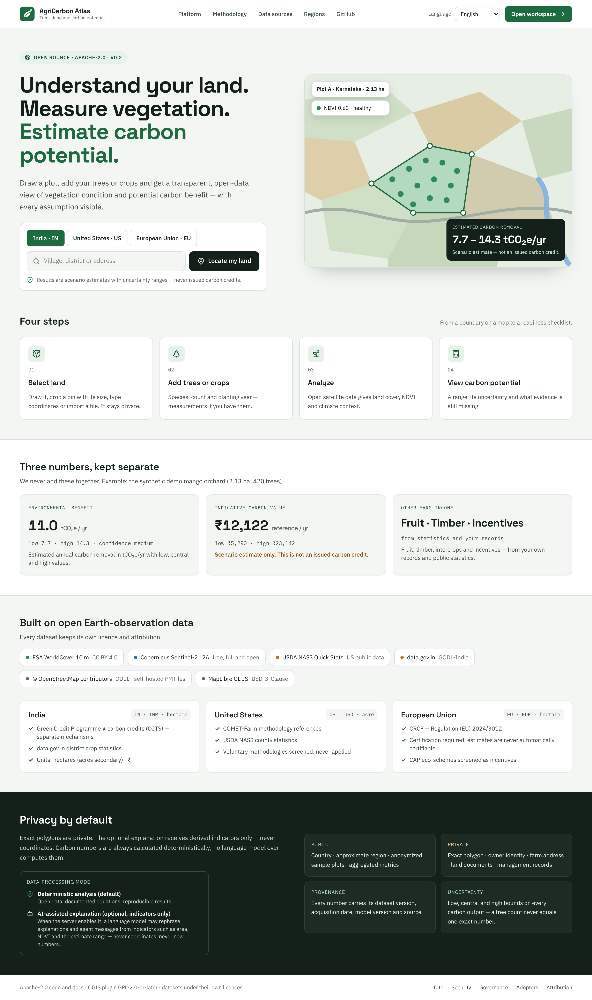

# Getting started

This page takes you from opening the app to your first carbon potential result. It should take about ten minutes. If
a word is new, see [words used in the app](#words-used-in-the-app) at the end.

**What to have ready:**

- The place where your land is, and a way to recognise your field on a map or a satellite picture.
- How many trees you planted, which kind, and the year you planted them.
- Optional: the average trunk diameter and height of a sample of your trees. These make the estimate firmer, and you
  can add them later.
- Optional: a boundary file or GPS readings, if you already have them. The app takes GeoJSON, KML/KMZ and CSV files,
  and LAS/LAZ point clouds, or latitude and longitude typed in.
- A recent browser on a computer, tablet or phone. The map needs WebGL. If you see "Your browser does not support
  WebGL, which the map needs.", try another browser or update this one.

## Open the app

Open the address given to you by whoever runs your copy of the app. If you want to run a copy yourself, the
[developer setup guide](../developer-guide/setup.md) explains how. It is a one-time job for someone comfortable with a
command line.

The landing page has three things to do:

1. Choose your country: **India · IN**, **United States · US** or **European Union · EU**. The choice sets the tree
   list, units, currency and programme rules the app uses for your plots.
2. Type a **Village, district or address** and press **Locate my land**, or press **Open workspace** to go straight
   in. When you arrive from **Locate my land**, the search box on the map is already filled in. Click it and pick a
   result, or press Enter to take the first one.
3. Check the language box at the top right. Your choice is remembered in this browser.

## Is this real data?

The app can run in three situations. Check which one you are in before you read any number.

| What you see | What it means | What the numbers are |
| --- | --- | --- |
| An amber banner: "API offline — showing demo data. Start it with `make api`." | Your browser cannot reach the app's server, so it shows stored example data | Fixed examples. A plot you mark exists only in this browser tab until you reload, and the estimate does **not** respond to your trees |
| **Settings**, last line of "How your data is handled": "API: online · mode demo" | The server is running but is set to demo mode, with no outside lookups | The carbon estimate is really calculated from your trees. The satellite, land cover, climate and soil values are synthetic (made up) |
| **Settings**: "API: online · mode live" | The server looks up open datasets: ESA WorldCover, Sentinel-2, Open-Meteo and SoilGrids | The estimate is calculated from your trees and from real open data |

Two more clues. On the results page, the last line of the **Evidence chain** says "mode demo" or "mode live". In
**Data**, the example plots show the source **Demo data**. Every screenshot in this guide comes from demo mode.

## Find your way around the workspace

The workspace is the main screen. It is the **My land** page. It opens when you press **Open workspace** or choose
**My land** in the left menu.

- **The strip at the top** shows the four steps, **Select land**, **Add trees**, **Analyze** and **Carbon potential**,
  as a progress guide. It is not a set of buttons, and small screens hide it. It highlights the step that fits the
  page you are on. At the right of the strip are the green **Import** button, the language box and a round person
  icon. The person icon does nothing in this version, because there is no sign-in.
- **The left menu** has these places. On a phone, open it with the **Menu** button at the top left.

| Menu group | Item | What it is for | Guide |
| --- | --- | --- | --- |
| **LAND** | **My land** | The map. Mark your land, describe your trees, see a short result | [Mark your land](mark-your-land.md) |
| **LAND** | **Data** | A list of your land plots and of the files you imported | [The Data page](import-data.md#the-data-page) |
| **INSIGHTS** | **AI agents** | A small team of helpers that explain one of your plots, step by step | [AI agents](ai-agents.md) |
| **INSIGHTS** | **Tree age** | Carbon in trees of a given age, and the rules that treat old trees differently | [Tree age](tree-age.md) |
| **INSIGHTS** | **Simulation** | "What if I plant more trees?" | [Simulation](simulation-lab.md) |
| **SHARE** | **Reports** | A printable report for each plot | [Reports](reports.md) |
| Bottom | **Settings** | **Language**, **Default country**, **Area units**, **Data-processing mode** (saved, but it changes nothing yet), **Map imagery** and the **Tree species reference** | [Satellite imagery](satellite-imagery.md#choose-other-pictures-in-settings) |

  Under the menu, a note says "Private by default": "Exact polygons stay on your side. Public views use a generalised
  centroid only."

- **The map** has a search box ("Search a place or address"), the **Mark your land** toolbar at the left, **Zoom in**,
  **Zoom out** and **Use my location** at the right, the **Earth data & insights** layers panel, and the **Map |
  Satellite** switch at the bottom left. On a phone the layers panel and legend are hidden to leave room for the map.
- **Three cards under the map** summarise the selected plot: **Plot area**, **Vegetation health** and **Estimated
  carbon removal**.
- **The panel on the right**, **Selected plot details**, is where you describe your trees and see a short summary. On
  a phone it sits below the map.

## Step 1: Select land

Find your place, then tell the app where your land is. You can draw the boundary, draw a row of trees, drop a pin and
say how big your land is, type coordinates, or import a file. All of this is in the **Mark your land** toolbar. This
step has its own page: [Mark your land](mark-your-land.md). When the plot is created, the app names it "Plot A" (the
next plot is "Plot B", and so on), flies to it and selects it.

## Step 2: Add your trees

Use the **Selected plot details** panel on the right.

| Field | What to enter |
| --- | --- |
| **Plot** | Which plot you are describing. Only useful when you have more than one |
| **Land area** | Shown for information. It comes from your plot, and you cannot type over it |
| **Number of trees** | The number of trees you **planted** on this plot, as a whole number from 1 to 10,000,000 |
| **Tree type** | Choose from the list. It shows the common name and the scientific name, and it depends on the country |
| **Plantation year** | The year the trees were planted. The list runs from this year back 30 years |
| **Add tree diameter & height (optional)** | Opens two boxes: **Average diameter at breast height (cm)** and **Average height (m)** |

**Replace the example values.** When a plot has no tree details yet, the form starts with an example and saves it, so
that you see a result straight away: 420 trees planted three years ago, with the first tree type in the list. These
are placeholders, not your numbers. Until you change them, the estimate is about the example, not about your land. A
plot made with **Tree line** starts with the number of trees the app suggests for that row instead.

**You do not need to press Save.** A moment after you stop typing, the app saves your trees ("Saving tree data…") and
recalculates ("Updating estimate…"). Each save is kept as a new version of the tree details. At the moment,
reloading the page can bring back the first version you saved instead of the latest one, so check the panel after a
reload. See [known limits](faq.md#known-limits-in-this-version).

A few points that matter:

- **Count planted trees, not survivors.** The app assumes that 85 of every 100 planted trees survive and reduces the
  count itself. You cannot change that percentage in the workspace in this version. If you know your real losses,
  keep a record: the readiness checklist asks for yearly counts of dead or removed trees.
- **Pick the right tree type.** If your tree is not in the list, the app cannot estimate it yet. Please do not choose
  a look-alike just to get a number. **Settings**, then **Tree species reference**, lists every supported species,
  and whether its values have been checked ("verified"), are still "pending verification" or are an "assumption". To
  suggest a new species, see [adding a species](../developer-guide/adding-a-parameter.md#adding-a-species).
- **One plot holds one group of trees**: one species, planted in one year. For a field with two blocks of different
  trees or different ages, make two plots.
- **Trees planted more than 30 years ago** do not appear in the year list. See [Tree age](tree-age.md).
- **Measurements are optional but valuable.** Diameter at breast height (DBH) is the trunk thickness measured 1.3 m
  above the ground. The app suggests measuring at least 30 trees, noting the date and the tape used, and entering the
  average. With a diameter, the estimate rests on your measurement instead of general growth tables, the range gets
  narrower, and the confidence can rise. Add the average height as well to reach "high" confidence. The app accepts
  diameters up to 500 cm and heights up to 120 m.
- **A tree count from a file.** If you imported a file in which trees were counted, you can use that count. See
  [Import data](import-data.md#use-the-trees-as-your-tree-count).

## Step 3: The app analyzes your plot

You do not have to do anything. When a plot is selected, the app asks for:

- **Land cover** from ESA WorldCover 2021: what the satellite sees on the ground, such as tree cover, cropland,
  grassland, built-up land and water.
- **Vegetation health**: NDVI from the latest cloud-free Sentinel-2 scene, with a trend since earlier years.
- **Climate zone**, worked out from temperature, rainfall and elevation, or taken from a default for your country if
  the lookup fails.
- **A soil carbon indicator** from SoilGrids.

NDVI is a number that satellites compute from how plants reflect light. Higher means denser, greener vegetation. The
app calls it **sparse** below 0.3, **moderate** from 0.3 to 0.6 and **healthy** from 0.6 upward. The **Vegetation
health** card shows the value, its class and a trend such as "+11% since 2024" (or the scene date when there is no
trend). NDVI describes the plant cover, not the carbon: a healthy number does not by itself mean a high carbon
estimate.

You can turn the map layers on and off in **Earth data & insights**, and look at a different year with the
**Observation year** slider. See
[Look at your land with the layers](mark-your-land.md#look-at-your-land-with-the-layers) for what each layer shows. For
a month-by-month view of the vegetation inside your plot, see
[Change over time](results-explained.md#change-over-time) on the results page.

## Step 4: See the carbon potential

The right panel now shows a short summary:

- **Estimated carbon removal range**: low to high, in tCO₂e/yr.
- **Vegetation health**: the NDVI value and class.
- **Programme readiness**: a score out of 100 and what is missing.

Press **See carbon potential** to open the full page. [Results explained](results-explained.md) goes through every
card on it. Two things to keep in mind from the start:

- The number is a **scenario estimate**. The app says so on every screen: "Scenario estimate — not an issued carbon
  credit."
- The estimate changes when you change your trees. Try it. It is the quickest way to see what matters.

## What the app does not do

- It does not issue, certify or sell carbon credits, and it does not send anything to any programme, registry, buyer
  or government office.
- It does not decide whether you qualify for a programme. It shows a first screening and the evidence a programme
  usually asks for.
- It does not predict your income. The indicative value is a price scenario, not an offer.
- It does not replace an agronomist, a forester or a programme adviser.

## Where your work is kept

Plots and tree details are saved on the server you are connected to. **Data** in the left menu lists your land plots,
with the area, the source and the date added, and the files you imported. From a plot's row you can open it on the map
or go straight to its results. There is no sign-in in this version, so the list shows every plot on that server. Read
[privacy in the FAQ](faq.md#privacy-and-your-data) before you store a real boundary on a shared server.

## If something looks wrong

| You see | What to do |
| --- | --- |
| The map area is empty, or the message "Your browser does not support WebGL, which the map needs." | Try another browser or update it. The map needs WebGL |
| "Basemap unavailable — showing your plot on a plain ground" | The background map could not be loaded. Your plot still works. Try again later |
| **Satellite** is greyed out, or "Satellite tiles could not be loaded — showing the plain map" | See [If Satellite does not work](satellite-imagery.md#if-satellite-does-not-work). It is not a problem with your plot |
| "Location unavailable — check browser permissions." | Allow location in the browser for this site, or search for your place instead |
| The estimate does not change when you change your trees | Look for the "API offline" banner. Offline, the app shows fixed example numbers |
| A red or amber message with a number, such as "The API returned an error (422)…" | Read the text after it. It usually says what to fix, for example a boundary that crosses itself |
| "This needs the AgriCarbon Atlas server. Start the API (make api) and try again." | That part, for example importing a file, works only when the server is running. Ask whoever runs your copy of the app |
| The results page says "Add trees to the plot to get an estimate." | Go back to **My land** and fill in **Number of trees**, **Tree type** and **Plantation year** |

## Words used in the app

| Word | Meaning |
| --- | --- |
| **Plot** | The piece of land you marked. One plot holds one group of trees |
| **Approximate boundary** | A boundary made from a pin and a size, a row of trees, or a single typed point. It is a first guess, so the estimate is rougher. Draw the exact edges for a better one |
| **tCO₂e/yr** | Tonnes of carbon dioxide equivalent per year. One tonne of CO₂e is one tonne of carbon dioxide, or the amount of another greenhouse gas that warms the climate as much |
| **Estimate, range** | The app gives Low, Central and High values instead of a single number |
| **Scenario estimate** | A calculated result with stated assumptions. It is not measured, not certified, and not a carbon credit |
| **NDVI** | A vegetation index from satellite images. About 0 means bare ground. Values near 1 mean dense green vegetation |
| **DBH** | Diameter at breast height: the trunk thickness 1.3 m above the ground |
| **Climate zone** | A group of similar climates. It decides which growth values the estimate uses |
| **Confidence** | low, medium or high. It describes how much of your own tree information the estimate uses, not how sure anyone is about the real number |
| **Pending** | A number in the tables that has not yet been checked by a reviewer. See [the FAQ](faq.md#what-does-pending-mean-next-to-a-value) |
| **Readiness** | A checklist score of how complete your evidence file is. It is not an eligibility decision |
| **Provenance** | Where each number came from: data set, version, date and model. See the **Evidence chain** |
| **Hectare, acre** | 1 hectare is 10,000 m² and about 2.47 acres. Choose your preferred unit in **Settings**, under **Area units** |
| **Carbon credit** | A tradable unit issued by a registry after a defined process. An estimate from this app is not one |

Next: [Mark your land](mark-your-land.md).
