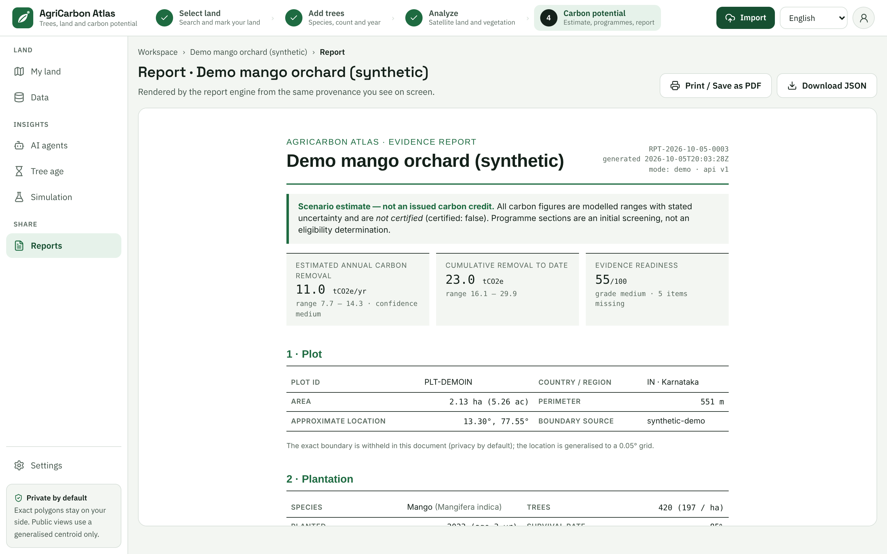

# Reports

A **report** is a printable evidence file for one plot. On a few A4 pages it gathers what the app knows: the plot,
your trees, the satellite and climate data, the carbon estimate with its range, the programmes that were screened,
the price scenarios, the evidence you have and still lack, and where every number came from. You can print it or save
it as a PDF to show an adviser, a programme office or a lender.

A report records an *estimate*. It is not a certificate, a quote or an application. It says so on its first page and on
its last: "Scenario estimate — not an issued carbon credit."

*The report in the picture is about the demo plot. Its numbers are examples, and its mode line says "demo".*

- [Open a report](#open-a-report)
- [The two buttons](#the-two-buttons)
- [What is in a report](#what-is-in-a-report)
- [What the report leaves out](#what-the-report-leaves-out)
- [The language](#the-language)
- [Keeping and sharing a report](#keeping-and-sharing-a-report)
- [Before you give a report to anyone](#before-you-give-a-report-to-anyone)

## Open a report

You need a plot with tree details first, so that there is an estimate to report on. See
[Getting started](getting-started.md#step-2-add-your-trees).

- Choose **Reports** in the left menu, under **SHARE**. On a phone, tap **Menu** first. The page says "One report per
  land plot, rendered from the same provenance you see on screen." Each row shows the plot's name, and under it the
  area, the country and the date the plot was added. Press **Open report** on the plot you want.
- Or, on the [results page](results-explained.md#the-buttons), press **Generate report** at the top, or **Preview
  report** under "In plain words".

If you have no plots, the **Reports** page says "No land yet — add your land to create a report." Press **Go to the
map** and [mark your land](mark-your-land.md).

The report page has the title "Report" followed by the plot name, and a line under it: "Rendered by the report engine
from the same provenance you see on screen." For a moment you see "Generating report…". Then the report appears in a
frame. Scroll inside the frame to read it.

| You see | What it means |
| --- | --- |
| "The report could not be generated." | The server could not make it. Wait a moment and open the page again |
| "Add trees to the plot to get an estimate." | There is no estimate yet, so there is nothing to report on. See [the FAQ](faq.md#why-does-the-results-page-ask-me-to-add-trees-when-i-already-did) |
| A report about "Demo mango orchard (synthetic)" although your plot is another one, and the amber banner "API offline — showing demo data." | The app cannot reach its server, so it shows a stored example report, whichever plot you open. Do not use it |

## The two buttons

| Button | What it does |
| --- | --- |
| **Print / Save as PDF** | Opens your browser's print window for the report only. Choose "Save as PDF" as the destination to get a file, or choose a printer. It is switched off until the report has appeared |
| **Download JSON** | Saves a file named after the plot ID and ending `-report.json`. It holds the plot record, your tree details, the carbon estimate and the report's ID and address, for people who want to process the numbers. It is not the text of the report. It has no policy or price data. It is switched off until there is an estimate. **It also holds your exact boundary and exact centre.** See the note below |

The report is laid out for A4 paper. If the edges are cut off on US Letter paper, choose the print option for "fit to
page" or "scale to fit". The wording differs between browsers. If the shaded boxes are missing in your PDF, switch on
the print option for background graphics.

**Keep the JSON file from this page private.** The report itself leaves out your exact boundary (see
[below](#what-the-report-leaves-out)), but this file does not. It is different from the **Download JSON** on the
results page, which leaves out the boundary and the exact centre. Send the PDF, not this file.

## What is in a report

The top of the first page shows "CarbonCreditBuy · Evidence report", the plot name, the **report ID**, the time the
report was made, and a line such as "mode: demo · api v1". The report ID looks like `RPT-2026-10-05-0001`: the date,
then a running number for that day. The mode says whether the satellite, climate and soil values are made up
(**demo**) or looked up (**live**).

Under it comes a banner: **Scenario estimate — not an issued carbon credit.** It says that all carbon figures are
modelled ranges with stated uncertainty, that they are not certified (`certified: false`), and that the programme
sections are an initial screening, not an eligibility determination. It cannot be switched off. Then come three
tiles:

- **Estimated annual carbon removal**: the central figure with its low to high range and the confidence;
- **Cumulative removal to date**: the stock to date, with its range;
- **Evidence readiness**: the readiness score out of 100, its grade and how many items are missing. It is the same
  score as **Carbon readiness** on the results page.

These three tiles are not the "three separate values" of the results page. They are all about the removal and the
evidence behind it. The prices come later, in section 6.

| Section | What it shows |
| --- | --- |
| **1 · Plot** | Plot ID, country and region, area in hectares and acres, perimeter in metres, the **approximate location**, and the boundary source |
| **2 · Plantation** | Tree type (common and scientific name), number of trees and trees per hectare, planting year and age, the survival rate, average diameter and height ("not measured" if you gave none), the measurement source and the inventory confidence |
| **3 · Earth observations** | Land cover shares and areas (ESA WorldCover), the satellite vegetation table with date, NDVI, NDMI, cloud cover and scene, the latest NDVI and NDMI with their classes and trend, the climate zone with temperature, rainfall and elevation, and the soil organic carbon indicator. A line starting "Data quality:" lists warnings, such as "demo mode: synthetic observations" or a lookup that failed |
| **4 · Carbon** | The model and its version, the methodology, and the status of the parameter set. A table with Low, Central and High for the annual removal and the cumulative removal. A table of the yearly series, every fifth year and the last one. The list of every parameter used, with its value, unit, source and status (verified, pending or assumption), and any notes |
| **5 · Potential programmes (screening)** | For each programme: its name and kind, the authority behind it, the screening status, the key requirements, and official references. The section says it is an initial screening, not an eligibility determination |
| **6 · Financial scenarios** | The Low, Central and High price scenarios in your country's currency and the value per year at each, the basis of the prices, and the "Other farm income" lines that are still "to be entered". It repeats that three separate values are shown and never summed |
| **7 · Evidence** | The evidence present and the evidence missing with its weight, then a table of every data source and model behind the numbers, with its version, licence and attribution |
| **8 · Disclaimer** | The closing statement: a modelled scenario estimate, not a certification, not an issued carbon or green credit, and not a market quote or an eligibility decision |

Every number comes from the same saved estimate as the results page. The report calculates nothing itself. The
meaning of each figure is explained in [Results explained](results-explained.md).

Some things appear only in the report. It shows the moisture index (NDMI) next to NDVI, every parameter with its
source, and the full list of data sources with their licences. Some things appear only on the results page: the
charts, the **Evidence chain** box and the "In plain words" paragraph.

## What the report leaves out

- **Your exact boundary and exact centre.** The report shows the plot's centre rounded to a 0.05 degree grid, and
  says "The exact boundary is withheld in this document (privacy by default); the location is generalised to a 0.05°
  grid." The report has no map.
- **The "In plain words" paragraph and the Change over time chart.**
- **Anything you did not enter.** Baseline records, management history and ownership documents are listed as missing,
  because the app has no place to record them. They belong in your own file.

The report does contain the plot's name and ID, its area and perimeter, the approximate location, the species and the
count of your trees. Together they can identify your farm to people who know the area. Share the report only with
people you want to know that.

## The language

The words of the report are in English, whatever language you chose in the app. Only the page around it is
translated.

## Keeping and sharing a report

- **Save a PDF.** The server keeps a copy of each report it makes, but the app has no page that lists past reports.
  The **Reports** page lists your plots, not earlier reports. A PDF is the way to keep the version you showed someone.
- **A new report each time.** Opening the report page asks the server to make a report from the estimate the app can
  see, and the server gives it a new report ID and time. If you leave the page and come back within a few minutes, the
  app may show the report it already has. An earlier report never changes when you change your trees. Open the page
  again after a change. See also [known limits](faq.md#known-limits-in-this-version), which explain why you should
  check section 2 after reloading the app.
- **Send the PDF, not the address.** The address of the report page works only inside the app, and anyone who can open
  your copy of the app can open it.
- **Links.** The references in section 5 are links. Inside the preview they may not open, and on paper only their
  titles show. The programme links on the results page open in a new tab.
- **Fonts.** The report loads its typefaces from Google Fonts when it opens. The request does not include your
  boundary, trees or results. The report falls back to standard fonts if the request is blocked or you are offline.
- **AI agents.** The **Report agent** in [AI agents](ai-agents.md#meet-the-team) writes a report with the same report
  engine in the **Full assessment** plan and tells you its report ID. To read, print or save a report, use this page.
- **For people who run the server.** The server can also make the report as Markdown or JSON, and as a PDF when the
  optional PDF component (WeasyPrint) is installed. The web app does not offer these. See the
  [API notes](../../apps/api/README.md) and the [report engine](../../packages/report-engine/README.md).

## Before you give a report to anyone

1. **Section 2.** Are the trees, species and planting year yours? When you add a plot, the app fills in an example of
   420 trees of the first species in the list, planted three years ago. If you never changed it, the report shows that
   example.
2. **The mode line at the top.** If it says "demo", the satellite, climate and soil values are made up, and the source
   table in section 7 names the sources as "Synthetic demo data (imitating …)". Do not give a demo report to anyone as
   evidence.
3. **Section 4.** Look at the status of the parameter set and the status tags in the parameter table. Any "pending"
   tag means the estimate is preliminary.
4. **Section 7.** The missing evidence shows what you still need to collect. The results page lists it under **What to
   measure or collect**.
5. **The reader.** Say plainly that it is an estimate. Do not crop the banner or the disclaimer, and do not describe
   it as a credit, a certificate or an offer to sell.

Back to the [user guide](README.md), or on to the [FAQ](faq.md).
