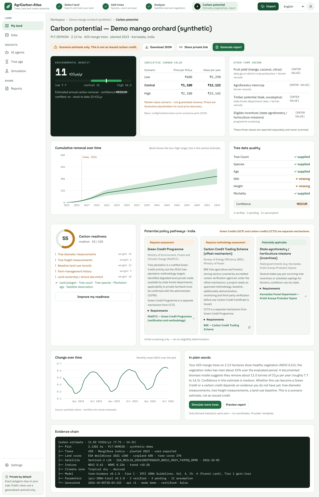

# Results explained

This page goes through the **Carbon potential** page card by card: what each number means, what it does not
mean, and what to do next. Open it with **See carbon potential** on the **My land** map, or with **Results**
next to a plot on the **Data** page.



The screenshot shows demo data, a made-up mango orchard. Every number on this page is a scenario estimate, not an
issued carbon credit.

On this page:

- [The top of the page](#the-top-of-the-page)
- [Environmental benefit](#environmental-benefit): [what the number is](#what-the-number-is), [the range](#the-range)
  and [confidence](#confidence)
- [Indicative carbon value](#indicative-carbon-value)
- [Other farm income](#other-farm-income)
- [Why the three values are never added](#why-the-three-values-are-never-added)
- [Cumulative removal over time](#cumulative-removal-over-time)
- [Tree data quality](#tree-data-quality)
- [Carbon readiness](#carbon-readiness)
- [Potential policy pathways](#potential-policy-pathways)
- [Change over time](#change-over-time)
- [Evidence chain](#evidence-chain)
- [In plain words](#in-plain-words)
- [The buttons](#the-buttons)
- [Why an estimate is not a credit](#why-an-estimate-is-not-a-credit)
- [Before you rely on a number](#before-you-rely-on-a-number)

## The top of the page

- The path above the title reads **Workspace** › the plot name › **Carbon potential**. **Workspace** takes you back
  to the map.
- The title reads "Carbon potential — " followed by the plot name. Under it is one line with the plot ID, the area,
  the number and kind of trees, the planting year, and the region and country. For example: "PLT-DEMOIN · 2.13 ha ·
  420 mango trees · planted 2023 · Karnataka, India".
- The amber label says **Scenario estimate only. This is not an issued carbon credit.** It is on every result, on
  purpose.
- The buttons are **Download JSON**, **Share private link** and **Generate report**. They are described
  [below](#the-buttons).
- If you see a box with the title **Carbon potential**, the line "Add trees to the plot to get an estimate." and a
  **Workspace** button instead of the cards, the app has no tree details it could use for this plot. Go back to the
  map and fill in the trees. If you already did, see
  [the FAQ](faq.md#why-does-the-results-page-ask-me-to-add-trees-when-i-already-did).

## Environmental benefit

This is the first of [three separate values](#why-the-three-values-are-never-added). It is the first card at the
top, in dark green.

**The big number** is the **central** estimate of the carbon your trees remove from the air each year, in tCO₂e/yr
(tonnes of carbon dioxide equivalent per year). Under it, a bar runs from the low estimate to the high estimate with
a white marker at the central one. The three numbers are printed below the bar as **low**, **central** and **high**.
The line underneath reads "Estimated annual carbon removal", then **confidence** with the level in capitals, then
"certified: no", then **stock to date**.

### What the number is

The app estimates how much wood, leaf and root the trees you described add each year, using general growth tables
for your tree type and climate zone. It converts the carbon in that growth to carbon dioxide equivalent. The method
follows the IPCC 2006 Guidelines for forest land (the "Tier 1" gain-loss approach), adjusted for how densely your
trees are planted and for an assumed survival of 85%. The equations and tables are listed in the
[carbon engine notes](../architecture/carbon-engine.md).

The central figure is an **average**, not this year's removal. Without measurements it is the average of the yearly
removals from the planting year to 30 years later. Young trees remove little at first, more as they grow, and less
again after the species reaches maturity. The figure can therefore differ a lot from what your trees remove this
year.

If you added an average trunk diameter under **Add tree diameter & height (optional)**, the app works differently.
It estimates the carbon stored in the trees from your measurement (using an allometric equation from Chave and
colleagues, 2014) and divides it by the age of the trees. That is the average yearly rate since planting.

**stock to date** is the total the trees are estimated to have taken in from planting until now, in tCO₂e. It is a
running total, not a yearly rate. In the screenshot it is 23 tCO₂e.

### The range

**low** and **high** are the central value less and plus **30%** when the estimate uses general growth tables, or
**20%** when it is based on your measured diameter. In the screenshot, the central value of 11 tCO₂e/yr comes with
a low of 7.7 and a high of 14.3.

These percentages are project assumptions. They are not a statistical confidence interval, and the
real value can fall outside the range. Several growth values are also still waiting for a reviewer to check them (see
[Tree data quality](#tree-data-quality)). Read the range as "the right order of magnitude", and use it to compare
scenarios, not as a measurement.

### Confidence

**Confidence** is **low**, **medium** or **high**, printed in capitals on the page. It describes how much of your
own tree information the estimate uses:

| Confidence | You gave the app |
| --- | --- |
| high | Number of trees, tree type, planting year, average diameter **and** average height |
| medium | Number of trees, tree type and planting year |
| low | Anything less |

Adding only one of the two measurements keeps the confidence at medium. Confidence does not describe how accurate
the model is, and "high" never means certified.

## Indicative carbon value

The second card is a small table with three rows, **Low**, **Central** and **High**, and the columns **Scenario**,
**Price per tCO₂e** and **Value per year**. Each row multiplies a price by the **central** removal. The currency is
the one for your country: ₹, $ or €. In the screenshot, ₹1,100 per tonne times 11.02 tonnes gives the Central row,
₹12,122 per year.

- The prices are placeholders from a project file, shown under the table as "Basis:" with the file name and the year
  (2025). The file says they are meant "for local price discovery" and must be reviewed every release against public
  reports on carbon prices. For now the prices are flagged "pending", which means no reviewer has checked
  them yet.
- For India, the project's price file adds a note that neither the Green Credit Programme nor the CCTS offset market
  has a public, liquid price for agroforestry removals yet. The numbers are global voluntary-market ranges
  converted to rupees. The page itself does not show this note.
- The warning under the table is important: "Market-value scenario — not guaranteed revenue. Prices are illustrative
  placeholders for local price discovery."

This is **not** what you would earn. Before any money could flow, a credit has to be issued after a methodology, a
baseline, verification and registration. Project costs and permanence buffers reduce what is left, and a buyer has
to pay. See [why an estimate is not a credit](#why-an-estimate-is-not-a-credit).

## Other farm income

The third card lists the kinds of income that matter on a farm like yours, each with the kind of source it would
come from. The list depends on your country:

| Country | Lines on the card |
| --- | --- |
| India | Fruit yield (mango, coconut, citrus); Agroforestry intercrop; Timber potential (teak, eucalyptus); Eligible incentives (state agroforestry / horticulture missions) |
| United States | Nut / fruit yield (pecan, walnut, apple); Timber potential; Conservation programme payments (EQIP, CSP) |
| European Union | Fruit / olive / nut yield; Timber potential; CAP eco-scheme payments |

Every line shows "[ENTER VALUE]". **You cannot type values in yet, and the app does not calculate
them.** The card is a reminder to keep your own records of what the land earns. Those records also help any
programme assessment.

## Why the three values are never added

The page says it in one sentence: "These three values are reported separately and never summed." They are different
kinds of things:

- the **environmental benefit** is a physical estimate in tonnes of CO₂e;
- the **indicative carbon value** is a hypothetical price multiplied by that estimate, and may never exist;
- **other farm income** is real money from crops, timber or payments, measured differently.

Adding them would double-count some benefits, mix a guess with real income, and suggest that the carbon value is
money in your pocket. The app also never shows one combined figure.

## Cumulative removal over time

The **Cumulative removal over time** card is a chart of the running total of carbon removed since planting, up to 30
years after planting. Its note says: "Band shows the low–high range; line is the central estimate." A dashed vertical
line marks the current year, with the label "today" and the year. Hover over the chart to see the central value and
the range for a year, in tCO₂e.

The curve starts flat, rises as the trees reach full growth, and bends toward a gentler slope after the species
reaches maturity. This is a model of growth, not a record of what happened in your plot each year.

## Tree data quality

A table of what you supplied. Each line shows "✓ supplied" or "✗ missing".

| Line | What it is |
| --- | --- |
| Tree Count | The number of trees you entered |
| Species | The tree type you chose |
| Age | Worked out from the planting year |
| Dbh | The average trunk diameter at breast height ("Dbh" is the short name) |
| Height | The average height |
| Mortality | The survival rate. The workspace fills in the assumed 85% itself, so this line usually says "supplied" even though you did not enter anything |

Below the table are the **Confidence** again and a line such as "2 verified · 3 pending · 11 assumption". That line
counts the parameters the calculation used, by how well they have been checked:

| Status | Meaning |
| --- | --- |
| **verified** | A reviewer has checked the value against the table or paper it is cited from |
| **pending** | A working value copied from its cited source that nobody has checked yet. Fine for exploring. A production installation refuses to give an estimate that depends on one |
| **assumption** | A choice made by the project, such as 85% survival or the 30% range, not a value from a published table |

Several important growth values are still "pending", so every estimate is **preliminary**. Open
**Settings** and choose **Tree species reference** to see the same statuses for each species. The page there
calls the middle one "pending verification". The [FAQ](faq.md#what-does-pending-mean-next-to-a-value) explains it
with a picture.

## Carbon readiness

A ring with a score out of 100, the words **Carbon readiness**, and a line such as "medium · 55 / 100". The grade is
**low**, **medium** or **high**, and the ring is red, amber or green to match. The score is the share of a typical
evidence file that you already have: 70 or more is high, 40 to 69 is medium, and below 40 is low.

It is a checklist, not an eligibility decision. Programmes differ, but these ten items are the evidence they
typically ask for. Each has a weight, shown as "weight 15" and so on.

| Item | Weight | Can the app know it? |
| --- | --- | --- |
| Land polygon | 15 | Yes, you drew or imported it |
| Tree count | 15 | Yes |
| Tree species | 10 | Yes |
| Plantation age | 10 | Yes |
| Satellite observation | 14 | Yes, when the analysis found vegetation data for the plot |
| Tree diameter measurements | 15 | Only if you enter an average diameter |
| Tree height measurements | 6 | Only if you enter an average height |
| Baseline land-use records | 12 | No, the app has no place to record this yet |
| Farm management history | 9 | No, same |
| Land ownership / tenure document | 10 | No, same |

The score is the weight of what is present divided by 116, the sum of all weights. For example, the five items the
app can know on its own add up to 64, and 64 of 116 is **55 out of 100**, grade medium. Adding both measurements
lifts it to 85 of 116, which is 73, grade high.

The card lists every missing item with a "!" in front and its weight. A line with a tick (✓) names what is already
in place. The last three items in the table stay on the "!" list even if you have the documents, because the app
cannot yet record them. Keep them in your own files.

The same score appears on the map as **Programme readiness**, with a "Missing: …" line.

**Improve my readiness** opens a window called **What to measure or collect**. It says: "Programmes differ, but
these items are almost always requested. Each one you add narrows the estimate range." Then it lists each missing
item with one piece of advice:

| Missing item | The advice in the window |
| --- | --- |
| Tree diameter measurements | "Measure diameter at breast height (1.3 m) on a sample of at least 30 trees; record the date and tape used." |
| Tree height measurements | "Measure average tree height with a clinometer or a height pole on the same sample trees." |
| Baseline land-use records | "Collect land-use records before planting: previous crop, satellite images or official land records." |
| Farm management history | "Keep a management log: irrigation, pruning, fertiliser, replanting and tree losses by year." |
| Any other item, such as Land ownership / tenure document | "Record this evidence with a date and a responsible person so it can be verified later." |

## Potential policy pathways

Cards for the programmes that might matter in your country. The title is **Potential policy pathways ·** followed by
the country (for a plot in an EU member state you may see the two-letter country code, for example DE). Each card
shows:

- a coloured **status label**;
- the programme name and the authority behind it;
- a **Requirements** list you can open;
- a link to the first official reference, which opens in a new tab.

| Status label | Colour | What it means |
| --- | --- | --- |
| **Potentially applicable** | Green | The programme looks relevant for this kind of activity. Whether you qualify still depends on conditions you must check |
| **Requires assessment** | Amber | Relevant in principle, but the programme's administrator must confirm that it applies to your land |
| **Requires methodology assessment** | Amber | An approved methodology, a baseline, additionality, monitoring and third-party verification are needed first |
| **Requires certification** | Blue | Certification by a recognised scheme is required. An estimate is never automatically certifiable |
| **Not applicable** | Grey | The rules say the programme does not cover this activity |
| **Unknown** | Grey | The rules have no answer for this activity yet |

Read the lines around the cards. The amber text at the top right is "Green Credits (GCP) and carbon credits (CCTS) are
separate mechanisms." for India. For the United States and the European Union it is a sentence that starts "Initial
screening only — not an eligibility determination." and then adds the main condition for that country. The line
under the cards says: "Initial screening only — not an eligibility determination."

The screening assumes your activity is **tree plantation**. It uses your country and that activity. It does not know
who owns the land, which state or member state you are in, or any other condition.

At the moment the cards do not show the short explanation behind each status. It is in the file you get from
**Download JSON** (under `policy`, in each programme's `notes`), and it is written down in the region pages, together
with the sources: [India](../regions/IN/README.md), [United States](../regions/US/README.md) and
[European Union](../regions/EU/README.md).

| Country | Programmes screened | Status shown for tree plantation |
| --- | --- | --- |
| India | Green Credit Programme | Requires assessment |
| | Carbon Credit Trading Scheme (offset mechanism) | Requires methodology assessment |
| | State agroforestry / horticulture missions (incentives) | Potentially applicable |
| United States | USDA COMET-Farm (methodology reference, to cross-check the estimate) | Potentially applicable |
| | Voluntary market afforestation/reforestation methodologies | Requires methodology assessment |
| | USDA NRCS conservation programmes (EQIP, CSP) | Potentially applicable |
| European Union | Carbon Removals and Carbon Farming Certification Framework (CRCF) | Requires certification |
| | CAP eco-schemes and agri-environment-climate measures | Potentially applicable |
| | Voluntary carbon-farming standards and national labels | Requires methodology assessment |

When the banner "API offline — showing demo data." is on, only the Indian screening is available. For another country
the area under the title stays empty.

## Change over time

The **Change over time** card is a line chart of the **monthly mean NDVI over the plot**. It shows how green and
dense the plant cover on your plot looked in each of the last 36 months, according to satellite pictures.

NDVI is a number from satellite pictures that tells you how green and dense the plant cover is. It is low for bare
soil and sparse plants, and high for dense vegetation. The map panel uses the same scale for **Vegetation health**:
below 0.3 is sparse, 0.3 to 0.6 is moderate, and 0.6 or more is healthy.

Earlier versions of the app had a separate 4D analysis page with a stack of monthly maps. That page is no longer part
of the app. This card keeps the part most people used: the month-by-month line for the whole plot. It does not show
which part of the plot is green or stressed. It does not change your carbon estimate either, and it is not a carbon
measurement.

### What you see

- The title **Change over time** and, on the right, "Monthly mean NDVI over the plot".
- One line with one value for each month. The line has no dots on it. Month names run along the bottom, for example
  "Apr 2024". NDVI values run up the left side. That scale does not start at zero. It is stretched to fit your line,
  so small wiggles can look big. Read the numbers on the scale.
- Hover over the line, or touch it on a phone, to see the month and its **Mean NDVI**.
- Small print under the chart, such as "Source: synthetic-demo · monthly-min-cloud composite". It names the data
  source and how each month's picture was put together. With real data the source is the name of the satellite data
  service. With demo data it says **synthetic-demo**, and the line is made up: a pattern with a dry season, not a real
  field.

### How each point is made

For each month, the app takes the clearest satellite picture it can find and leaves out pixels flagged as cloud or
similar. It averages the rest over the plot, in cells of about 30 m. A month with no usable picture is left out, and
the line joins the months on either side. Plots smaller than about 0.1 hectare are covered by only one or two cells,
so the line says little about them.

If the card says "No monthly vegetation data for this plot yet.", the server could not build the data. A very large
plot is one reason: the app builds the data on a grid of at most 40,000 squares of 30 m, so a plot whose surrounding
box is bigger than about 3,600 hectares gets none. With real data the server also needs its satellite libraries
installed and a reachable satellite catalogue. Tell whoever runs your copy of the app.

### Reading the line sensibly

- **Seasons are normal.** NDVI usually dips in the dry season and rises with rain or irrigation. Compare the same
  month in different years, for example October 2025 with October 2026, and not October with April.
- **Young trees and ground cover.** In a young plantation, much of the green may be grass or intercrops between the
  trees, not the trees themselves.
- **Dense canopies flatten out.** NDVI stops rising once the canopy is dense, so it cannot tell a good stand from a
  very good one.
- **Clouds leave gaps.** A month with a gap tells you less. Look at several months before you decide.
- **One line hides the details.** The line is an average of the whole plot. A dip can come from water, soil, pests,
  missing trees or a track, and a problem in one corner may not show at all. Go and look.
- **Greener is not more carbon.** The line does not measure carbon. Use it to decide where to look, not to adjust
  your estimate.

## Evidence chain

A box of monospaced text that lists, line by line, where the result came from. Here is the one for the demo orchard:

```text
Carbon estimate · 11.02 tCO2e/yr (7.71 – 14.32)
├── Plot          2.1301 ha · PLT-DEMOIN · synthetic-demo
├── Trees         420 · Mangifera indica · planted 2023 · user-reported
├── Land cover    ESA WorldCover 2021 v200 · cropland 68% · tree cover 27%
├── Satellite     Sentinel-2 L2A · S2A_MSIL2A_20261005T050659_N0511_R019_T43PGQ_DEMO · 2026-10-05
├── Indices       NDVI 0.63 · NDMI 0.226 · trend +10.5%
├── Climate zone  Tropical dry · derived
├── Model         tree-biomass v0.1.0 · tier 1 · IPCC 2006 Guidelines, Vol. 4, Ch. 4 (Forest Land), Tier 1 gain-loss
├── Parameters    ipcc-2006-tier1 v0.1.0 · 2 verified · 3 pending · 11 assumption
└── Generated     2026-10-05T18:17:15Z · api v1 · mode demo · certified: false
```

| Line | What it tells you |
| --- | --- |
| Carbon estimate | The central estimate and, in brackets, the low and high |
| Plot | The area, the plot ID, and how the boundary was made, written as a code such as `manual-drawing`, `pin-and-area` or `synthetic-demo` |
| Trees | The number of trees, the scientific name, the planting year and where the tree details came from |
| Land cover | The land cover data set and its two biggest classes |
| Satellite | The satellite scene and its date. Left out when no vegetation data was found |
| Indices | The vegetation indices and their trend. Left out in the same case |
| Climate zone | The zone used for the growth tables, and whether it was "derived" from the location or taken as a "region-default" |
| Model | The model, its version and tier, and the method it follows |
| Parameters | The parameter set, with the verified, pending and assumption counts |
| Generated | When the result was made, the API version, the **mode** (demo or live) and "certified: false" |

Use it when you ask someone to check your result: it tells them exactly what went in. It contains the plot ID and the
area, never coordinates.

## In plain words

A short paragraph that restates the result: your trees, the vegetation health, the estimate and its range, the
confidence, and the evidence you still lack, ending "This is a scenario estimate, not an issued credit." It is
written from a fixed template on the server, using only derived numbers such as the area, the tree count, NDVI and the
estimate.

The note under it says "Only derived indicators were sent — no coordinates. Provider: template." No AI model writes
it. For now it is in English whatever language you chose, and its mention of a "Green Credit" refers to
India's programme even when the plot is elsewhere.

Two buttons sit under the paragraph:

- **Simulate more trees** opens the [Simulation](simulation-lab.md) with your tree type, tree count and planting
  year filled in.
- **Preview report** opens the [report](reports.md).

## The buttons

- **Download JSON** saves a file named after the plot ID and ending in `-carbon-potential.json`. It holds the export
  time, the disclaimer, a plot summary, the tree details, the analysis, the estimate, the policy screening, the price
  scenarios and the plain-words paragraph. The file leaves out your boundary and exact centre. For now it
  still contains the plot's bounding box, the smallest rectangle around it, which locates the plot closely, and the
  rounded public centre. Treat the file as private.
- **Share private link** copies the address of this page to your clipboard and shows **Link copied** for a moment.
  The address holds the plot ID and no coordinates. It is "private" only in that sense: this version has no sign-in,
  so anyone who can open your copy of the app and has the link can see the results. If your copy runs only on your
  own computer, the link works only there. If the button does not change to **Link copied**, your browser blocked the
  copy. Copy the address from the address bar instead.
- **Generate report** and **Preview report** open the [report](reports.md) for this plot.
- **Simulate more trees** opens the [Simulation](simulation-lab.md) with your tree type, tree count and planting
  year filled in.

## Why an estimate is not a credit

A carbon credit is a unit issued by a registry after a defined chain of steps: an approved methodology was applied, a
baseline was set (what would have happened anyway), additionality was shown, leakage was assessed, permanence was
secured, monitoring data were collected, an accredited third party verified them, and a registry issued a serial
number. CarbonCreditBuy does none of these steps. It reads open data and applies published growth values to the
trees you describe, so it can only say what **might** be happening.

That is why every result carries "certified: no" until a registry serial number exists, and why India's Green Credits
and carbon credits, and the EU's certification requirement, are kept visible. Read
[carbon credit vs carbon estimate](../concepts/carbon-credit-vs-estimate.md) for the long version, and the short
notes on [additionality](../concepts/additionality.md), [permanence](../concepts/permanence.md),
[leakage](../concepts/leakage.md) and [MRV](../concepts/mrv.md).

## Before you rely on a number

- Are the tree details yours, or still the values the form starts with (for example 420 mango trees planted three
  years ago)? Open the workspace and look.
- Is the app showing demo or offline data? Check the "mode" line of the **Evidence chain**. If the top of the app
  says "API offline — showing demo data.", the numbers are a stored example. They are not worked out from your trees.
- How many parameters are "pending"? If there are any, the estimate is preliminary.
- Is the confidence "high"? If not, measure some trees and check again.
- Did you read the status labels as a first screening, not as a yes?
- Would a decision you are about to make still be sound if the real value were half the **low** figure? If not, do
  not make it on this number. Talk to an adviser or the programme office first.

Next: [try more trees in the Simulation](simulation-lab.md) or [make a report](reports.md). Back to the
[user guide](README.md).
