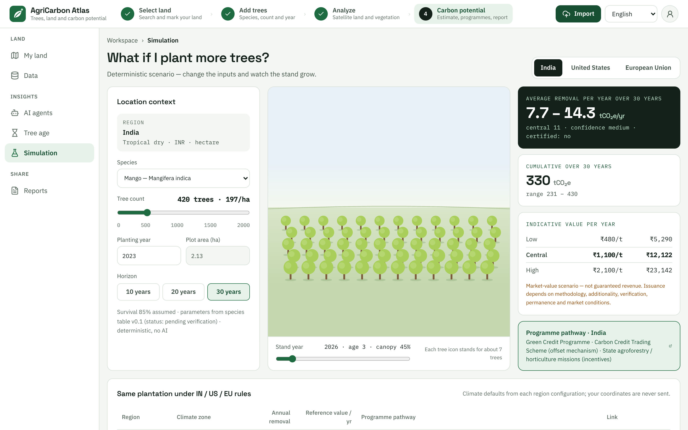

# Simulation

The **Simulation** page answers one question: **What if I plant more trees?** (That is the heading at the top of
the page.) Change the tree type, the number of trees, the planting year or the time horizon, and watch the estimate
and a row of trees change. It is a calculator for comparing scenarios. It does not touch your plots, it does not use
satellite data, and no AI is involved: the same inputs always give the same answer.

The screenshot shows demo data. Every number on the page is a scenario estimate, not an issued carbon credit.

- [Open it](#open-it)
- [The inputs](#the-inputs)
- [The results](#the-results)
- [The tree illustration](#the-tree-illustration)
- [Compare countries](#compare-countries)
- [Share a scenario](#share-a-scenario)
- [Good uses, and what to avoid](#good-uses-and-what-to-avoid)
- [If something looks wrong](#if-something-looks-wrong)

## Open it

- Choose **Simulation** in the left menu, under **INSIGHTS**, for a blank scenario. It starts with the country you
  chose as **Default country** in **Settings**, 420 trees planted three years ago, a 30-year horizon and an area of
  2.13 hectares. The tree type is mango, or the first tree on your country's list when mango is not on it.
- Or press **Simulate more trees** on the [Carbon potential page](results-explained.md#in-plain-words) to start from
  your plot's tree type, tree count and planting year. The page then also takes the area from your plot.

The path above the heading reads **Workspace** › **Simulation**. **Workspace** takes you back to the map.

## The inputs

| Control | What it does |
| --- | --- |
| **India**, **United States**, **European Union** | The three buttons at the top right. They pick the rules, climate default, currency and tree list for the scenario. Switching changes the tree type to the first one on the list if the current one is not on the new country's list |
| **Location context** | Shows the region, then the climate zone, the currency and the area unit the scenario uses, for example "Tropical dry · INR · hectare". You cannot edit it |
| **Species** | The tree type, shown as common name and scientific name, for example "Mango — Mangifera indica" |
| **Tree count** | A slider from 0 to 2000 in steps of 10. Above it you see the count and the density per hectare, such as "420 trees · 197/ha". It can be set no higher than 2000 here, even if your plot has more trees |
| **Planting year** | The year the trees are planted, from 1950 to this year. To try a planting you have not done yet, choose this year |
| **Plot area (ha)** | The area in hectares. When the page was opened from a plot, it is fixed to that plot's area and greyed out |
| **Horizon** | **10 years**, **20 years** or **30 years**, counted from the planting year |

Under the inputs a note says: "Survival 85% assumed · parameters from species table v0.1 (status: pending
verification) · deterministic, no AI". Survival cannot be changed here, and the species values are still waiting for a
reviewer, so treat the results as preliminary. The page also uses the general growth tables only. It has no place for a
measured diameter, so its confidence is always medium, or low when the tree count is 0.

Every change is worked out again after a short pause. The address in your browser changes with it.

## The results

The cards on the right:

- **Annual removal at maturity**: the estimated annual removal as a range in tCO₂e/yr, with the central value, the
  confidence and "certified: no". Despite the label, this is the **average yearly removal over the
  horizon you chose, counted from the planting year**, the same definition as on the
  [Carbon potential page](results-explained.md#what-the-number-is). It is not the removal in the year the trees
  mature.
- **Cumulative over N years**: the total removal from planting to the end of the horizon, in tCO₂e, with its low to
  high range. In the screenshot, 330 tCO₂e over 30 years, with a range of 231 to 430.
- **Indicative value per year**: Low, Central and High price scenarios per tonne, such as "₹480/t", and the value per
  year for the central removal. These are illustrative prices, not offers. The amber note says: "Market-value
  scenario — not guaranteed revenue. Issuance depends on methodology, additionality, verification, permanence and
  market conditions."
- **Programme pathway**: the programmes screened for the country. The whole card is a link that opens the first
  programme's official page in a new tab.

As on every page, the three kinds of value are not added together, and the result is a scenario estimate, not an
issued carbon credit.

### What more trees do and do not do

The model scales growth by how dense the planting is compared with a reference density for the species. The
density counted is limited to between 0.2 and 1.5 times the reference density. So the estimate rises as you add
trees, but only up to a point. Planting far more than 1.5 times the reference density no longer raises it, and
doubling the trees does not double the estimate. Very few trees are counted as 0.2 times the reference density, so
the estimate does not fall further until you reach 0 trees. At 0 trees every result is 0.

To see each species' reference density, open **Settings** and choose **Tree species reference**. These are project
assumptions that a reviewer has not yet confirmed.

## The tree illustration

The middle of the page shows a picture of your trees in rows. It replaces the 3D scene that earlier versions had.

- The picture draws up to 60 trees. When your count is higher, a note says, for example, "Each tree icon stands for
  about 7 trees".
- The **Stand year** slider moves through time, from the planting year to the end of the horizon. The text beside it
  shows the year, the age of the trees and a canopy percentage, for example "2026 · age 3 · canopy 45%". The trees
  grow and turn greener as the age rises.
- The canopy percentage is a simple picture of how big the trees look compared with full size. It is not measured and
  it is not part of the carbon calculation.

The picture is an illustration. The trees stand in a regular pattern, so it does not show where your trees really
stand. The size and colour are a simple growth picture, not satellite data. The numbers come only from the model.

## Compare countries

The table **Same plantation under IN / US / EU rules** runs your scenario in each country with that country's
climate default and price scenario. Its columns are **Region**, **Climate zone**, **Annual removal**, **Reference
value / yr**, **Programme pathway** and **Link** ("Open official page"). Your row is highlighted.

Use it to see how rules and prices differ, not to decide where to plant. The values are in each country's own
currency, so do not compare the money columns directly. The text above the table says: "Climate defaults from each
region configuration; your coordinates are never sent." That means the page uses the **default climate zone** of each
country, not the climate of your actual plot. The result can therefore differ from the one on the Carbon potential
page for the same trees.

## Share a scenario

At the bottom, **Shareable link** shows a web address and a **Copy link** button (it then says "Copied"). The text
beside it says: "The URL holds every input — anyone with it sees the same scenario." The link holds the country,
tree type, tree count, planting year, horizon and area, and no coordinates.

If you opened the page from a plot, the link also ends with `plot=` and that plot's ID. Anyone who can open your copy
of the app and uses such a link makes the page load that plot and fix the area to it. To share only the what-if
scenario, delete the `&plot=…` part from the link before you send it.

## Good uses, and what to avoid

- Good: compare 420 trees against 600 trees on the same area; see how the estimate changes with a 10-year against a
  30-year horizon; see what a different planting year does; get a feel for how rules differ between countries.
- Avoid: reading a number from this page as a promise. It starts from the species table, an assumed 85% survival and
  the country's default climate. Real trees depend on soil, water, care and weather.
- Avoid: using it to plan a purchase or a loan. See
  [Results explained](results-explained.md#before-you-rely-on-a-number).

## If something looks wrong

| You see | What it means or what to do |
| --- | --- |
| The numbers do not change when you move the controls | The app may be offline. Look for "API offline — showing demo data." at the top. The page then shows a stored example for each country, and the numbers do not follow your inputs. Start the server and reload |
| The **Species** list changed when you switched country | Each country has its own tree list. The page picks the first tree on the new list when your tree is not on it |
| The tree count stops at 2000 | That is the limit of the slider. The page cannot try a planting of more than 2000 trees |
| The result differs from the Carbon potential page for the same trees | The page uses the country's default climate zone and no measured diameter. See [Compare countries](#compare-countries) |
| The row of trees shows fewer trees than you set | It draws at most 60 trees. The note beside the **Stand year** slider says how many trees each icon stands for |

Back to the [user guide](README.md).
